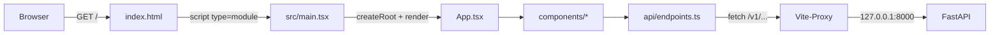

---
tags:
  - documentation
---

# Frontend-Projektaufbau erklärt

Was jede Datei im Ordner `frontend/` tut: woher sie kommt, wofür sie da ist und ob du sie je anfassen musst. Gehört zu [[Umsetzungsstand (Pricing-Dashboard)]] · Leseaufgabe dazu: [[Code-Review-Aufgaben (Pricing-Dashboard)#Leseaufgabe 1 — Das Projektgerüst|Leseaufgabe 1]].

Projektordner: `~/HaegerConsulting/Projects/Interviews/ReactBasics/FrontEndBuchungsSystem/frontend`

## Inhalt

1. [[#Das Gesamtbild in einem Satz]]
2. [[#Übersicht aller Dateien]]
3. [[#Die Python-Brille]]
4. [[#npm-Ebene — package.json, package-lock.json, node_modules]]
5. [[#Vite — index.html, vite.config.ts, public]]
6. [[#TypeScript — die drei tsconfig-Dateien]]
7. [[#ESLint — eslint.config.js]]
8. [[#Umgebungsvariablen — .env.example, .env.local, .gitignore]]
9. [[#Der eigentliche Code — src]]
10. [[#Was aus dem Template gelöscht wurde]]

---

## Das Gesamtbild in einem Satz

Der Browser lädt `index.html`, die lädt `src/main.tsx`, die hängt die React-Komponente `<App />` in ein leeres `<div id="root">` — **alles andere im Ordner sind Werkzeuge**, die diesen Weg ermöglichen (Vite), absichern (TypeScript, ESLint) oder verwalten (npm).



Im Dev-Betrieb (`npm run dev`) übersetzt Vite jede Datei **erst, wenn der Browser sie anfragt** — TSX rein, reines JavaScript raus. Beim Build (`npm run build`) wird dagegen alles vorab zu wenigen Dateien in `dist/` gebündelt.

---

## Übersicht aller Dateien

**Herkunft:** 🏗️ = vom Vite-Template erzeugt, unverändert · 🔧 = Template, aber schon vorher angepasst · ✨ = von Claudian neu oder umgeschrieben (ab 30.09., Phase in der Spalte „Zweck“)

| Datei | Herkunft | Zweck | Musst du sie anfassen? |
|---|---|---|---|
| `package.json` | 🏗️ | Projektbeschreibung, Abhängigkeiten, Skripte | Nur über `npm install <paket>` |
| `package-lock.json` | 🏗️ | Exakt aufgelöste Versionen aller Pakete | Nie von Hand |
| `node_modules/` | 🏗️ | Installierte Pakete | Nie — jederzeit löschbar und per `npm install` wiederherstellbar |
| `index.html` | 🔧 | Einstiegspunkt der Seite | Selten (Titel, Sprache) |
| `vite.config.ts` | 🔧 | Konfiguration von Vite, hier: der Proxy zur API | Selten |
| `tsconfig.json` | 🏗️ | Verteiler auf die zwei folgenden | Nie |
| `tsconfig.app.json` | 🏗️ | TypeScript-Regeln für den Browser-Code in `src/` | Selten |
| `tsconfig.node.json` | 🏗️ | TypeScript-Regeln für `vite.config.ts` | Nie |
| `eslint.config.js` | 🏗️ | Linter-Regeln | Selten |
| `.prettierrc.json`, `.prettierignore` | ✨ | Prettier: Formatierung (Standardeinstellungen), `npm run format` | Nie |
| `.gitignore` | 🏗️ | Was nicht ins Repo gehört | Selten |
| `.env.example` | 🔧 | Vorlage für die Umgebungsvariablen | Wenn neue Variablen dazukommen |
| `.env.local` | 🔧 | Dein echter API-Schlüssel — **nicht im Repo** | Einmal anlegen |
| `README.md` | ✨ | Kurzbeschreibung, Start, Skripte | Wächst mit |
| `public/favicon.svg` | 🏗️ | Symbol im Browser-Tab | Nein |
| `src/main.tsx` | 🏗️ | Startet React | Nie |
| `src/App.tsx` | ✨ | Oberste Komponente, Seitenlayout | Ja — hier wächst die App |
| `src/index.css` | ✨ | Tailwind-Import, Theme (Farben, Schrift) | Wenn Farben/Schrift sich ändern |
| `src/vite-env.d.ts` | ✨ | Typen für `import.meta.env` | Wenn neue `VITE_`-Variablen dazukommen |
| `src/components/ApiStatus.tsx` | ✨ | Erste Komponente: ist die API erreichbar? | — |
| `src/components/Produktliste.tsx`, `ProduktEintrag.tsx`, `Detailbereich.tsx` | ✨ | Phase 2: Liste mit Suche, Auswahl, Detail | — |
| `src/hooks/useApi.ts` | ✨ | Phase 3: eigener Hook fürs Laden | — |
| `src/lib/assertNever.ts` | ✨ | Vollständigkeitsprüfung für `switch` | — |
| `src/components/Empfehlungen.tsx` | ✨ | Phase 4: Empfehlungstabelle und Kennzahlen eines Produkts | — |
| `src/lib/format.ts` | ✨ | Deutsche Zahlen- und Datumsformate (`Intl`) | Wenn neue Formate gebraucht werden |
| `src/hooks/useLauf.ts` | ✨ | Phase 5/7: Hintergrundlauf (Preislauf, Ingest) starten und per Polling verfolgen | — |
| `src/components/Aktionsleiste.tsx` | ✨ | Phase 5/7: Knöpfe und Status für Ingest und Preislauf | — |
| `src/components/ui.tsx` | ✨ | Phase 8: Karte, Kartentitel, Seitentitel, Hinweis | Wenn neue Bausteine dazukommen |
| `src/api/client.ts` | 🔧 | Einziger Ort, der `fetch` aufruft | Selten |
| `src/api/endpoints.ts` | 🔧 ✨ | Eine Funktion pro API-Endpunkt | Wenn Endpunkte dazukommen |
| `src/api/types.ts` | 🔧 ✨ | TypeScript-Gegenstücke der Pydantic-Schemas | Wenn Endpunkte dazukommen |

Faustregel: **Alles außer `src/`, `README.md` und `.env.local` ist Werkzeugkonfiguration.** Die meiste davon schreibt man einmal und schaut sie nie wieder an — man sollte aber wissen, was darin steht, weil sie bei Fehlermeldungen plötzlich wichtig wird.

---

## Die Python-Brille

Fast alles hat ein Gegenstück aus deinem Backend-Projekt:

| Frontend | Backend-Gegenstück | Anmerkung |
|---|---|---|
| `npm` | `uv` | Paketmanager und Skript-Runner |
| `package.json` | `pyproject.toml` | Metadaten, Abhängigkeiten, Skripte |
| `package-lock.json` | `uv.lock` | Exakte Versionen, damit alle dasselbe installieren |
| `node_modules/` | `.venv/` | Aber pro Projekt, nicht aktivierbar — Node sucht einfach im nächsten `node_modules` |
| `npm install` | `uv sync` | |
| `npm run dev` | `uv run uvicorn … --reload` | Dev-Server mit Neuladen bei Änderungen |
| `tsc` | `mypy` | Reine Typprüfung, ändert keinen Code |
| `eslint` | `ruff check` | Linter |
| `prettier` | `ruff format` | Formatierer |
| `.env.local` | `.env` | Konfiguration außerhalb des Codes |
| `src/api/types.ts` | `presentation/api/schemas/*.py` | Dieselben Datenformen, zweimal beschrieben |
| `src/api/client.ts` | — | Der Gegenpart deines FastAPI-Routers auf der anderen Seite der Leitung |

> [!important] Der größte Unterschied zu Python
> Python-Code läuft so, wie du ihn schreibst. Frontend-Code **nie** — der Browser versteht weder TypeScript noch JSX. Zwischen deiner Datei und dem Browser steht immer ein Übersetzungsschritt (hier: Vite). Deshalb gibt es so viele Konfigurationsdateien: Sie steuern diesen Schritt.

---

## npm-Ebene — package.json, package-lock.json, node_modules

### `package.json`

```json
{
  "name": "frontend",
  "private": true,
  "type": "module",
  "scripts": { "dev": "vite", "build": "tsc -b && vite build", "lint": "eslint .", "preview": "vite preview" },
  "dependencies": { "react": "^19.2.8", "react-dom": "^19.2.8" },
  "devDependencies": { "typescript": "~6.0.2", "vite": "^8.3.0", "…": "…" }
}
```

- **`"private": true`** — verhindert, dass du das Projekt aus Versehen per `npm publish` öffentlich ins npm-Register lädst.
- **`"type": "module"`** — `.js`-Dateien im Projekt nutzen `import`/`export` (ES-Module) statt des alten `require()`. Betrifft hier vor allem `eslint.config.js`.
- **`scripts`** — Kurzbefehle für `npm run <name>`. Interessant ist `build`: **erst** `tsc -b` (Typprüfung), **dann** `vite build`. Warum zweistufig, steht unten bei [[#Warum Vite die Typen nicht prüft|TypeScript]].
- **`dependencies` vs. `devDependencies`** — `react` und `react-dom` braucht die App zur Laufzeit im Browser. Alles andere (TypeScript, Vite, ESLint, Typdefinitionen) wird nur zum *Bauen* gebraucht und landet nie beim Nutzer.
- **Versionsangaben** — `^19.2.8` heißt „ab 19.2.8, aber unter 20" (Minor- und Patch-Updates erlaubt). Tatsächlich installiert ist gerade React **19.3.0** — das Caret in Aktion. `~6.0.2` bei TypeScript ist enger: „ab 6.0.2, aber unter 6.1", weil TypeScript auch in Minor-Versionen neue Fehler melden kann.

**Die Pakete kurz erklärt:**

| Paket | Wofür |
|---|---|
| `react` | Die Bibliothek selbst: Komponenten, Hooks, der Abgleich zwischen altem und neuem UI-Zustand |
| `react-dom` | Die Brücke zum Browser-DOM. React selbst ist plattformneutral — `react-native` wäre eine andere Brücke |
| `vite` | Dev-Server und Build-Werkzeug. Seit Version 8 bündelt es mit **Rolldown** (in Rust geschrieben) |
| `@vitejs/plugin-react` | Bringt Vite JSX bei und aktiviert **Fast Refresh**: Code-Änderungen erscheinen sofort, *ohne* dass der State verloren geht |
| `typescript` | Der Compiler `tsc` — hier nur zur Prüfung |
| `@types/react`, `@types/react-dom`, `@types/node` | Typbeschreibungen für Bibliotheken, die selbst in JavaScript geschrieben sind |
| `eslint`, `@eslint/js`, `typescript-eslint`, `eslint-plugin-react-hooks`, `eslint-plugin-react-refresh`, `globals` | Der Linter und seine Regelpakete, siehe [[#ESLint — eslint.config.js|ESLint]] |

### `package-lock.json` und `node_modules/`

`package.json` sagt „irgendein React 19". Die Lock-Datei hält fest, **welches genau** — samt aller ~110 indirekten Abhängigkeiten. Sie gehört ins Repo, damit ein anderer Rechner exakt denselben Stand bekommt. `node_modules/` gehört **nicht** ins Repo (steht in `.gitignore`); es ist reproduzierbar aus der Lock-Datei.

> [!tip] Wenn etwas komisch ist
> `rm -rf node_modules && npm install` ist das Frontend-Gegenstück zu „`.venv` löschen und neu anlegen" — und löst erstaunlich viele Rätsel.

---

## Vite — index.html, vite.config.ts, public

### `index.html`

Anders als bei vielen anderen Werkzeugen ist bei Vite die **HTML-Datei der Einstiegspunkt**, nicht eine JavaScript-Datei. Sie ist fast leer:

```html
<div id="root"></div>
<script type="module" src="/src/main.tsx"></script>
```

- `<div id="root">` — der leere Container, den React später komplett übernimmt.
- `<script type="module" src="/src/main.tsx">` — der Browser fragt `/src/main.tsx` an. Im Dev-Betrieb fängt Vite diese Anfrage ab und liefert **übersetztes JavaScript** aus. Beim Build ersetzt Vite die Zeile durch einen Verweis auf das gebündelte `dist/assets/index-<hash>.js`.
- Angepasst: `lang="de"` und der Titel „Pricing-Dashboard".

### `vite.config.ts`

Zwei Dinge sind eingestellt:

1. **`plugins: [react()]`** — JSX-Übersetzung und Fast Refresh, siehe oben.
2. **`server.proxy`** — der wichtigere Teil. Der Browser spricht nur mit `localhost:5173`; alles unter `/v1` reicht Vite an `127.0.0.1:8000` weiter. Aus Sicht des Browsers gibt es damit nur **eine** Herkunft (Origin) → **kein CORS nötig**. Das ersetzt Schritt 0b aus dem [[Pricing-Dashboard Plan & Syntax-Tutorial#Schritt 0b — CORS im Backend freischalten|ursprünglichen Plan]]. Die Kommentare in der Datei erklären auch, warum `127.0.0.1` statt `localhost` (IPv6-Falle).

> [!warning] Der Proxy existiert nur im Dev-Server
> Ein fertiger Build in `dist/` ist nur ein Haufen statischer Dateien, da läuft kein Vite mehr. In Produktion bräuchte es einen Reverse Proxy (nginx o. ä.), der dasselbe tut — oder doch CORS im Backend.

### `public/` vs. `src/assets/`

- **`public/`** — wird **unverändert** ausgeliefert, unter dem Wurzelpfad (`public/favicon.svg` → `/favicon.svg`). Für Dateien, die einen festen Namen brauchen.
- **`src/assets/`** — Dateien, die man im Code importiert (`import logo from './assets/logo.svg'`). Die laufen durch Vite und bekommen im Build einen Hash im Namen (`logo-BF8QNONU.svg`). Vorteil: Ändert sich die Datei, ändert sich der Name, und kein Browser zeigt eine veraltete Version aus dem Cache. Der Ordner ist gerade leer und daher gelöscht; er entsteht wieder, sobald wir Bilder brauchen.

---

## TypeScript — die drei tsconfig-Dateien

### Warum drei?

Im Projekt läuft Code in **zwei verschiedenen Umgebungen**:

| | `tsconfig.app.json` | `tsconfig.node.json` |
|---|---|---|
| Gilt für | alles in `src/` | nur `vite.config.ts` |
| Läuft in | Browser | Node.js (beim Start von Vite) |
| kennt | `document`, `window`, `fetch` (`lib: DOM`) | `process`, Dateisystem (`types: node`) |

Getrennte Konfigurationen verhindern, dass du im Browser-Code aus Versehen `process.env` benutzt (gibt es dort nicht) oder in der Vite-Konfiguration `document`. **`tsconfig.json`** selbst enthält keinen Code (`"files": []`), sondern verweist nur auf die beiden (`references`). `tsc -b` („build mode") prüft beide nacheinander.

### Die wichtigsten Optionen in `tsconfig.app.json`

| Option | Bedeutung |
|---|---|
| `noEmit: true` | `tsc` **erzeugt keine Dateien**, es prüft nur. Die Übersetzung macht Vite. Genau wie `mypy` |
| `target` / `lib` | Welche JavaScript-Syntax (`ES2023`) und welche eingebauten APIs (`ES2023` + `DOM`) als vorhanden gelten |
| `jsx: react-jsx` | JSX wird in Aufrufe von `jsx()` aus `react/jsx-runtime` übersetzt — deshalb muss man React **nicht** in jeder Datei importieren |
| `moduleResolution: bundler` | Imports werden so aufgelöst, wie ein Bundler es tut, z. B. `'./client'` ohne Dateiendung |
| `allowImportingTsExtensions` | Erlaubt trotzdem `import App from './App.tsx'` (wie in `main.tsx`) |
| `verbatimModuleSyntax` | Reine Typ-Importe **müssen** `import type` heißen — siehe `endpoints.ts`: `import type { Product, … } from './types'`. Grund unten |
| `erasableSyntaxOnly` | Verbietet TypeScript-Syntax, die Laufzeitcode erzeugt: `enum`, `namespace`, Parameter-Properties. Übrig bleibt TypeScript = JavaScript + wegstreichbare Typen. Der Kommentar in `client.ts` bei `ApiError` ist ein Beispiel dafür |
| `types: ["vite/client"]` | Welche globalen Typpakete geladen werden. `vite/client` liefert die Typen für `import.meta.env` und für Asset-Importe |
| `noUnusedLocals` / `noUnusedParameters` | Ungenutzte Variablen sind ein **Fehler**, keine Warnung — der Build bricht ab |
| `noFallthroughCasesInSwitch` | Ein `case` ohne `break`/`return` ist ein Fehler |
| `skipLibCheck` | Die `.d.ts`-Dateien in `node_modules` nicht mitprüfen — spart Zeit |
| `tsBuildInfoFile` | Cache für schnellere Wiederholungsläufe, liegt in `node_modules/.tmp` |

> [!note] Wo ist `"strict": true`?
> Frühere Vite-Templates hatten das explizit drin. Seit **TypeScript 6** ist `strict` die Voreinstellung — deshalb fehlt die Zeile, und trotzdem ist z. B. `null` nicht einfach einem `string` zuweisbar (am 30.09. nachgeprüft). Ebenfalls neu in TS 6: `types` ist standardmäßig leer, globale Typpakete wie `@types/node` werden also **nicht** mehr automatisch geladen. Deshalb stehen `types: ["vite/client"]` bzw. `types: ["node"]` explizit da.

### Warum Vite die Typen nicht prüft

Vite (genauer: der Übersetzer **Oxc**) **streicht die Typen einfach weg**, Datei für Datei, ohne sie zu verstehen. Das ist extrem schnell — aber es heißt:

> [!danger] Ein Typfehler hält im Dev-Betrieb nichts auf
> Die Seite lädt trotzdem, und der Fehler knallt erst zur Laufzeit — oder gar nicht. Den Typfehler sehen nur: dein Editor (VS Code prüft laufend), `npm run build` (wegen `tsc -b` davor) und `npx tsc -b` von Hand.

Daraus folgen auch `verbatimModuleSyntax` und `erasableSyntaxOnly`: Ein Werkzeug, das jede Datei **einzeln** und **ohne Typverständnis** verarbeitet, kann bei `import { Product } from './types'` nicht wissen, ob `Product` ein Typ (weg damit) oder ein Wert (behalten) ist. Mit `import type` ist es eindeutig.

### `src/vite-env.d.ts` (neu)

`vite/client` kennt nur Vites eigene Variablen. Ohne diese Datei wäre `import.meta.env.VITE_API_KEY` vom Typ `any` — der Compiler würde also nie meckern, auch nicht bei einem Tippfehler im Namen. Die Datei ergänzt das Interface `ImportMetaEnv` um unsere Variable (*declaration merging*: zwei Interfaces gleichen Namens werden zusammengeführt). Eine `.d.ts`-Datei enthält nur Typen, nie Laufzeitcode.

---

## ESLint — eslint.config.js

Das neue „Flat Config"-Format: ein Array von Konfigurationsobjekten. Hier gilt eines für alle `.ts`/`.tsx`-Dateien, zusammengesetzt aus vier Regelpaketen:

| Paket | Was es prüft |
|---|---|
| `js.configs.recommended` | Allgemeine JavaScript-Fehler: ungenutzte Variablen, unerreichbarer Code, … |
| `tseslint.configs.recommended` | TypeScript-spezifisch, z. B. `any` vermeiden |
| `reactHooks.configs.flat.recommended` | **Die wichtigsten für uns.** `rules-of-hooks` (Hooks nur oben in Komponenten, nie in `if`/Schleifen) und `exhaustive-deps` (jede Variable, die ein Effekt benutzt, gehört ins Dependency-Array). Version 7 bringt zusätzlich Regeln aus dem React Compiler mit, z. B. `set-state-in-effect` (kein direktes `setState` im Effekt-Körper) und `purity` (Rendern ohne Seiteneffekte) |
| `reactRefresh.configs.vite` | Eine Regel: Eine Datei, die Komponenten exportiert, soll **nur** Komponenten exportieren. Sonst kann Fast Refresh sie nicht austauschen und lädt die ganze Seite neu |

`globalIgnores(['dist'])` nimmt den Build-Output aus. `globals.browser` sagt ESLint, dass es `window`, `document` usw. gibt.

> [!tip] Die Hooks-Regeln sind dein Tutor
> Viele der Fehler, die man mit Effects machen kann (fehlende Abhängigkeit, State im Effekt synchronisieren statt ableiten), meldet `npm run lint` von selbst. Wenn eine Meldung kommt: nicht wegklicken, sondern lesen — sie ist fast immer eine Mini-Lektion aus [[3. Effects, Daten und Architektur - Vertiefung|Block 3]].

---

## Umgebungsvariablen — .env.example, .env.local, .gitignore

- **`.env.example`** — Vorlage mit Platzhalter, gehört ins Repo.
- **`.env.local`** — die echte Datei mit deinem Schlüssel. `.gitignore` enthält `*.local` → landet nie im Repo.
- **Nur Variablen mit `VITE_`-Präfix** kommen im Browser-Code an, und zwar über `import.meta.env.VITE_…` (nicht `process.env` — das gibt es im Browser nicht).
- Vite **ersetzt** diese Ausdrücke beim Bauen durch den festen Wert. Der Schlüssel steht danach im Klartext im JavaScript-Bundle — deshalb die Warnung in `.env.example` und im README.
- Nach einer Änderung an `.env.local` den Dev-Server **neu starten**; Vite liest die Datei nur beim Start.

`.gitignore` schließt außerdem `node_modules`, `dist` und Log-Dateien aus.

---

## Der eigentliche Code — src

### `main.tsx` — der Zündschlüssel

```tsx
createRoot(document.getElementById("root")!).render(
  <StrictMode>
    <App />
  </StrictMode>,
);
```

- `import "./index.css"` — ein Import ohne Namen, nur für den Nebeneffekt: Vite hängt das CSS an die Seite.
- `document.getElementById("root")` liefert `HTMLElement | null`. Das **`!`** am Ende ist TypeScripts *non-null assertion*: „Ich verspreche, das ist nicht `null`." Ohne `!` würde der Compiler (wegen `strict`) meckern, weil `createRoot(null)` nicht geht.
- `createRoot(...)` — React übernimmt das `<div id="root">`, `.render(...)` zeichnet die App hinein.
- **`<StrictMode>`** — nur im Dev-Betrieb aktiv. Er rendert jede Komponente **zweimal** und führt jeden Effekt **zweimal** aus (Aufbau → Cleanup → Aufbau), um fehlende Cleanups und unreine Komponenten aufzudecken. Folge: Im Netzwerk-Tab siehst du `/v1/health` zweimal — das ist Absicht, siehe [[Code-Review-Aufgaben (Pricing-Dashboard)#Leseaufgabe 3 — Die erste Komponente|Leseaufgabe 3]].

### `App.tsx`, `index.css`, `components/`

- **`App.tsx`** — war der Vite-Demo-Zähler mit Logos, ist jetzt das Seitengerüst: Kopfzeile mit API-Status, Aktionsleiste, zwei Spalten (Produktliste | Empfehlungen). Besitzt die beiden Stücke State, die mehrere Bereiche brauchen: die Auswahl und den Preislauf.
- **`index.css`** — neu geschrieben, schlicht: Farbvariablen, Zwei-Spalten-Grid, Stile pro Bereich.
- **`components/`**, **`hooks/`**, **`lib/`** — was welche Datei tut, steht kompakt in der Tabelle oben und im Abschnitt „Aufbau" der `frontend/README.md`. Die einzelnen Dateien sind in den [[Code-Review-Aufgaben (Pricing-Dashboard)|Leseaufgaben]] 3–8 ausführlich besprochen.

### `api/` — vorher schon angelegt

Drei Dateien, eine klare Schichtung — dieselbe Idee wie die Layered Architecture im Backend ([[Documentation/Traineeship/Grundlagen der Software Entwicklung/1.5 REST APIs & Layered Architecture/1.5 REST APIs & Layered Architecture - Vertiefung|Kapitel 1.5]]):

| Datei | Kennt | Kennt nicht |
|---|---|---|
| `client.ts` | HTTP: Header, Statuscodes, JSON, Fehler | Welche Endpunkte es gibt |
| `endpoints.ts` | URLs und Query-Parameter, je eine Funktion pro Endpunkt | Wie HTTP funktioniert |
| `types.ts` | Die Datenformen | Irgendetwas anderes |

Komponenten importieren nur aus `endpoints.ts` und `types.ts` und wissen nichts von `fetch`. Details in [[Code-Review-Aufgaben (Pricing-Dashboard)#Leseaufgabe 2 — Die API-Schicht|Leseaufgabe 2]].

---

## Was aus dem Template gelöscht wurde

| Gelöscht | Warum |
|---|---|
| `src/App.css` | Stile für die Demo-Seite, ersetzt durch `index.css` |
| `src/assets/` (`hero.png`, `react.svg`, `vite.svg`) | Nur für die Demo-Seite genutzt |
| `public/icons.svg` | Symbolsammlung für die Demo-Links (GitHub, Discord, …) |
| Template-`README.md` | Englischer Standardtext über ESLint-Erweiterungen → durch ein Projekt-README ersetzt |

Alles davon lässt sich jederzeit mit `npm create vite@latest` in einem Wegwerf-Ordner neu erzeugen.
