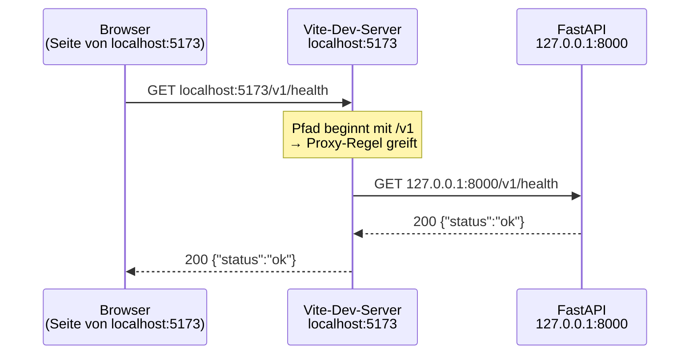

---
tags:
  - documentation
---

# Lückenschluss — Pricing-Dashboard

Ausführliche Antworten auf alles, was in den [[Code-Review-Aufgaben (Pricing-Dashboard)|Leseaufgaben]] gefehlt hat oder falsch war. Wächst mit: Nach jeder Leseaufgabe, die du beantwortet hast, kommt hier ein Abschnitt dazu. Richtige Antworten bekommen nur eine Zeile, Lücken die volle Erklärung.

Zurück zu: [[Umsetzungsstand (Pricing-Dashboard)]] · Dateien erklärt: [[Frontend-Projektaufbau erklärt]]

**Legende:** ✅ saß · 🟡 Richtung stimmt, Wesentliches fehlt · ❌ falsch oder offen · ⏭️ nicht beantwortbar (z. B. Experiment verpasst)

## Bilanz

| Leseaufgabe | ✅ | 🟡 | ❌ | ⏭️ |
|---|---|---|---|---|
| 1 — Projektgerüst | 1 | 3 | 1 | 0 |
| 2 — API-Schicht | 3 | 3 | 0 | 0 |
| 3 — Erste Komponente | 2 | 0 | 3 | 0 |
| 4 — Produktliste | 1 | 3 | 3 | 0 |
| 5 — Eigener Hook | 1 | 3 | 2 | 0 |
| 6 — Backend-Filter, Detailbereich | 1 | 2 | 3 | 1 |
| 7 — Preislauf und Polling | 2 | 3 | 1 | 1 |
| 8 — Aufräumen, Gesamtbild | 1 | 2 | 0 | 1 |
| **Summe** | **12** | **19** | **13** | **3** |

> [!important] Die vier, die du fürs Gespräch zuerst sitzen haben solltest
> 0. **[[#Das Denkmodell — wo React den State aufbewahrt|Das Denkmodell]]**: Hooks nach Reihenfolge, Instanz nach Typ + Position + Key. Daraus folgen 4.3, 5.2, 6.5 und 6.6.
> 1. **[[#4.2 — Die falsche Variante mit zweitem State ❌|4.2 Abgeleiteter State]]**: die vielleicht beste React-Frage überhaupt („You Might Not Need an Effect").
> 2. **[[#4.3 — Warum der Key dort steht, und was Index-Keys kaputt machen ❌|4.3 Keys]]**: wird fast immer gefragt.
> 3. **[[#1.4 — Der Weg eines Requests durch den Proxy ❌|1.4 Proxy und CORS]]**: verbindet Frontend und Backend, und genau das ist deine Stärke.

## Inhalt

- [[#Leseaufgabe 1 — Projektgerüst]]
- [[#Leseaufgabe 2 — API-Schicht]]
- [[#Leseaufgabe 3 — Erste Komponente]]
- [[#Leseaufgabe 4 — Produktliste, Suche, Auswahl]]
- [[#Leseaufgabe 5 — Eigener Hook]]
- [[#Leseaufgabe 6 — Backend-Filter und Detailbereich]] — beginnt mit dem Denkmodell „wo React den State aufbewahrt“
- [[#Leseaufgabe 7 — Preislauf und Polling]]
- [[#Leseaufgabe 8 — Aufräumen und Gesamtbild]]

---

## Leseaufgabe 1 — Projektgerüst

### 1.1 — Was fehlt nach dem Klonen? 🟡

Den fehlenden Schlüssel und seine Folgen hast du richtig erkannt: Die Ampel ist grün, weil `/v1/health` keinen Schlüssel braucht, und die Produktliste zeigt einen Fehler (401). Es fehlen aber noch **zwei weitere Dinge**:

| Fehlt | Warum | Was er sieht |
|---|---|---|
| `node_modules/` | steht in `.gitignore`, wird nicht mitgeklont | `npm run dev` bricht sofort ab: `sh: 1: vite: not found`. Lösung: erst `npm install` |
| `.env.local` | `*.local` steht in `.gitignore` | Ampel grün, Produktliste rot (401) |
| laufendes Backend | ist ein eigener Prozess | Ampel rot, Produktliste rot |

Das ist das Gleiche wie in Python: Nach dem Klonen fehlt die `.venv`, bis du `uv sync` ausführst.

### 1.2 — Was kommt im Browser an? 🟡

Richtig: TypeScript kommt nicht im Browser an. Aber **React schon**: Die 222 kB im Build sind zum größten Teil React und React-DOM. Die Trennung:

- **`dependencies`** = Code, der **zur Laufzeit** gebraucht wird. Vite bündelt ihn mit deinem Code zusammen in `dist/assets/index-<hash>.js`.
- **`devDependencies`** = **Werkzeuge**, die vor der Auslieferung ihre Arbeit erledigen: TypeScript prüft, Vite übersetzt und bündelt, ESLint und Prettier prüfen und formatieren. Danach werden sie nicht mehr gebraucht.

Dein eigener Code kommt also an, nur eben übersetzt: TypeScript → JavaScript, JSX → `jsx()`-Aufrufe.

### 1.3 — Typfehler: Browser vs. Build ✅

Richtig, mit einer wichtigen Begriffskorrektur: Es ist ein **Typfehler**, kein Syntaxfehler. Der Unterschied ist genau der Punkt:

- **Syntaxfehler** (fehlende Klammer): Vite kann die Datei nicht lesen → **Fehler auch im Browser** (rote Fehlerseite).
- **Typfehler** (`const x: number = "hallo"`): syntaktisch einwandfrei. Vite **streicht die Typen weg, ohne sie zu prüfen** → im Browser passiert nichts. Erst `tsc -b` in `npm run build` prüft sie.

### 1.4 — Der Weg eines Requests durch den Proxy ❌

Der Browser sieht **nie** `127.0.0.1:8000`. So läuft es:



1. `fetch("/v1/health")` ist eine **relative** URL. Der Browser ergänzt sie um die Herkunft der Seite → `http://localhost:5173/v1/health`.
2. Die Anfrage geht an den **Vite-Dev-Server**. Der sieht: Pfad beginnt mit `/v1` → Proxy-Regel aus `vite.config.ts`.
3. Vite stellt **selbst** eine neue Anfrage an `127.0.0.1:8000/v1/health`, das ist Server-zu-Server-Kommunikation, ein Browser ist nicht beteiligt.
4. Die Antwort geht denselben Weg zurück.

**Warum kein CORS?** Die *Same-Origin-Policy* ist eine Regel **des Browsers**: Er vergleicht die Herkunft der Seite (Schema + Host + Port) mit der Herkunft der Anfrage. Seite `localhost:5173`, Anfrage `localhost:5173` → gleiche Herkunft → CORS spielt gar keine Rolle. Und zwischen Vite und FastAPI gibt es keinen Browser, der etwas prüfen könnte. Das ist derselbe Grund, warum `curl` nie ein CORS-Problem hat.

**Gegenprobe:** Schriebe `client.ts` direkt `fetch("http://127.0.0.1:8000/v1/health")`, wäre der Port anders → **andere Herkunft** → der Browser verlangt CORS-Header von FastAPI. Wegen des eigenen Headers `X-API-Key` schickt er vorher sogar eine zusätzliche `OPTIONS`-Anfrage (*Preflight*).

> [!tip] Satz fürs Gespräch
> „Im Dev-Betrieb leitet der Vite-Server `/v1` an die API weiter. Für den Browser ist alles eine Herkunft, deshalb brauche ich kein CORS. In Produktion würde das ein Reverse Proxy wie nginx übernehmen."

### 1.5 — `API_KEY` statt `VITE_API_KEY` 🟡

Das Ergebnis stimmt (nicht autorisiert), die Begründung nicht: Im Code ist nichts *hardcodiert*. `client.ts` liest `import.meta.env.VITE_API_KEY`, also eine Variable, deren **Wert** aus `.env.local` kommt.

Der eigentliche Grund: **Vite gibt nur Variablen mit dem Präfix `VITE_` an den Browser-Code weiter.** Alles andere bleibt im Node-Prozess. Das ist eine Schutzmaßnahme: In einer `.env` stehen oft Geheimnisse (Datenbank-Passwort), die niemals ins öffentliche Bundle dürfen. Das Präfix ist das bewusste „ja, das darf öffentlich sein".

Ablauf bei `API_KEY=…`: `import.meta.env.VITE_API_KEY` ist `undefined` → in `apiFetch` greift `API_KEY ? {...} : {}` → **kein Header** → 401 bei allem außer `/v1/health`. Dasselbe Bild wie bei 1.1.

---

## Leseaufgabe 2 — API-Schicht

### 2.1 — Wo wird ein 404 zum Fehler? 🟡

*Theorie: [[0. JavaScript für React - Vertiefung#6.3 `fetch` wirft bei 404 nicht|Block 0 · 6.3]]*

Dass die Komponente den Fehler abfängt und selbst entscheidet, was sie anzeigt, stimmt. Es fehlt die Stelle, an der ein 404 überhaupt erst zum Fehler **wird**:

```ts
// client.ts, in apiFetch
if (!response.ok) {
  throw new ApiError(response.status, await readDetail(response));
}
```

`fetch` selbst löst bei 404 **normal** auf, ohne Fehler. Erst diese Zeile verwandelt jeden Status ≥ 400 in ein abgelehntes Promise mit einem `ApiError`, der Statuscode **und** Meldung behält. Die Komponente bekommt also keinen „irgendwie kaputten" Datensatz, sondern einen eindeutigen Fehler. Seit Phase 3 übersetzt `useApi` ihn in `{ art: "fehler", meldung, status }`.

### 2.2 — Decimal als String ✅

Genau. Konkret: `"12.345678" + 1` ergibt `"12.3456781"`, das `+` hängt an, statt zu rechnen. Richtig: `Number(empfehlung.recommended_adjustment_pct) + 1`.

### 2.3 — Prüft jemand zur Laufzeit? 🟡

Richtig: Niemand prüft. `as T` ist eine reine Behauptung an den Compiler und verschwindet beim Übersetzen. Es fehlte das Gegenstück im Backend: **Pydantic**. Python-Typhinweise allein prüfen zur Laufzeit auch nichts, aber Pydantic tut es: `RunRead.model_validate(run)` und die Request-Validierung (die dein 422 erzeugt) prüfen echte Daten gegen das Schema.

Im Frontend gibt es diese Prüfung nicht. Benennt das Backend `occupancy` in `auslastung` um, zeigt das Frontend still `undefined` an statt eines Fehlers. Das Frontend-Gegenstück zu Pydantic wären Bibliotheken wie **Zod**. Hier bewusst weggelassen, weil beide Seiten von dir sind. Das ist eine gute Antwort auf die Frage „Was würden Sie in Produktion anders machen?".

### 2.4 — Warum ein Union-Typ? 🟡

> [!warning] Hier lag der Fehler bei mir
> Der Kommentar in `types.ts` behauptete, der Union-Typ sorge dafür, „dass ein switch darüber vollständig sein muss". **Das stimmt nicht**, siehe [[#3.5 — Meldet der Compiler einen vergessenen case? ❌|3.5]]. Kommentar ist in Commit `30cceab` korrigiert.

Was der Union-Typ **wirklich** bringt:
- **Tippfehler fallen auf**: `status === "suceeded"` → Compilerfehler, weil der Vergleich nie wahr sein kann.
- **Autovervollständigung**: Der Editor schlägt die vier Werte vor.
- **Narrowing**: In `if (run.status === "failed")` weiß TypeScript, welcher Wert vorliegt.
- **Vollständigkeit** gibt es erst **zusammen mit `assertNever`**.

### 2.5 — Reihenfolge der Header ✅

Richtig: Was später kommt, gewinnt. Präzisierung: „Nutzer" heißt hier der **aufrufende Code**, also eine Funktion in `endpoints.ts`, nicht der Mensch vor dem Bildschirm. Typischer Anwendungsfall: Ein späterer Datei-Upload überschreibt `Content-Type`.

### 2.6 — Endpunkt pro Produkt ✅

Richtig: Es gibt keinen. Die Folge daraus war deine Entscheidung B: Das Backend bekommt in Phase 4 den Filter `product_id`.

---

## Leseaufgabe 3 — Erste Komponente

### 3.1 — Zwei Anfragen im Netzwerk-Tab ✅

*Theorie: [[3. Effects, Daten und Architektur - Vertiefung#2. Effects — Synchronisation mit der Außenwelt|Block 3 · 2]]*

Sehr gut erklärt. Ergänzung zum genauen Ablauf: StrictMode spielt beim ersten Einhängen **Einhängen → Aushängen → Einhängen** durch. Beim Aushängen läuft das Cleanup, also `controller.abort()`. Deshalb steht die erste Anfrage im Netzwerk-Tab als *(canceled)*. **Nur im Dev-Betrieb**; im Build gibt es eine Anfrage.

### 3.2 — `[zustand]` als Abhängigkeit ✅

*Theorie: [[0. JavaScript für React - Vertiefung#4.3 Identität statt Inhalt — und warum React darauf baut|Block 0 · 4.3]]*

Richtig (deine Antwort ist am Ende abgeschnitten, der Kern steht da). Zur Vervollständigung: React vergleicht Abhängigkeiten mit `Object.is`, bei Objekten also die **Referenz**, nicht den Inhalt. Jedes `setZustand({ art: "ok" })` erzeugt ein neues Objekt → „geändert" → Effekt läuft → neue Anfrage → neues Objekt → … eine Endlosschleife von Requests.

> [!tip] Das kommt in Phase 4 wieder
> Dasselbe gilt für **Funktionen**: Jede Pfeilfunktion im Komponentenkörper ist bei jedem Rendern ein neues Objekt. Deshalb steht im neuen Hook `useApi` die Warnung, dass die Ladefunktion stabil bleiben muss. Dafür gibt es `useCallback`.

### 3.3 — Wozu `if (controller.signal.aborted) return`? ❌

*Theorie: [[0. JavaScript für React - Vertiefung#6.4 Fehler vollständig behandeln|Block 0 · 6.4]]*

Ein Abbruch lässt `fetch` **mit einem Fehler ablehnen** (`AbortError`, Meldung etwa „signal is aborted without reason"). Der landet im `catch`, genau wie ein echter Fehler.

Ohne die Zeile im StrictMode:
1. Erste Anfrage startet, wird durch das Cleanup abgebrochen → `catch` → `setZustand({ art: "fehler", … })`.
2. Ampel zeigt kurz **„API nicht erreichbar"**.
3. Die zweite Anfrage kommt an → „API erreichbar".

Du sähest also ein **kurzes rotes Flackern**, obwohl alles funktioniert. Die Zeile sagt: Einen Abbruch haben wir selbst ausgelöst, das ist kein Fehler, also nichts anzeigen. Im Wegwerf-Test für Phase 3 habe ich nachgeprüft, dass mit der Zeile nie ein Fehlerzustand auftaucht.

### 3.4 — `zustand.meldung` außerhalb des `case` ❌

Der Compiler meldet:

```
Property 'meldung' does not exist on type 'Zustand'.
  Property 'meldung' does not exist on type '{ art: "pruefe"; }'.
```

Oben in der Komponente kann `zustand` **jede** der drei Varianten sein, und zwei davon haben kein `meldung`. Im `case "fehler"` dagegen hat TypeScript den Typ **eingeengt** (*Narrowing*): Nur die Variante mit `art: "fehler"` passt, und die hat `meldung`.

Das kennst du aus Python mit mypy: Nach `if isinstance(x, Fehler):` weiß mypy, dass `x` ein `Fehler` ist. Hier übernimmt das Feld `art` die Rolle von `isinstance`, daher der Name *discriminated union* („unterscheidbare Vereinigung").

Seit Phase 3 siehst du das Gleiche in `Produktliste`: Nach den zwei `if (…) return` darf man `produkte.daten` lesen, weil nur noch `art: "fertig"` übrig ist.

### 3.5 — Meldet der Compiler einen vergessenen case? ❌

*Theorie: [[1. React-Grundlagen - Vertiefung#4.3 Wenn eine Komponente `null` zurückgibt|Block 1 · 4.3]]*

**Nein**, nachgeprüft: `tsc` läuft mit der Variante `{ art: "langsam" }` ohne Fehler durch. Der Grund: Ohne passenden `case` läuft die Funktion ans Ende und gibt **stillschweigend `undefined`** zurück. Eine React-Komponente darf `undefined` zurückgeben, also sieht der Compiler kein Problem, und auf der Seite bleibt die Stelle einfach leer. Auch die Compiler-Option `noImplicitReturns` hilft hier nicht (ebenfalls getestet).

Die übliche Lösung steckt seit Commit `30cceab` im Projekt: `assertNever` im `default`-Zweig.

```tsx
default:
  return assertNever(zustand);   // zustand muss hier vom Typ never sein
```

Sind alle Fälle behandelt, ist im `default` nichts mehr übrig: Typ `never`, der Aufruf passt. Fehlt ein Fall, bleibt er übrig, und der Compiler meldet genau dort:

```
Argument of type '{ art: "langsam"; }' is not assignable to parameter of type 'never'.
```

---

## Leseaufgabe 4 — Produktliste, Suche, Auswahl

### 4.1 — Wo wohnt welcher State? 🟡

*Theorie: [[1. React-Grundlagen - Vertiefung#8.3 Angewandt auf dein Dashboard|Block 1 · 8.3]] · [[2. State und Interaktivität - Vertiefung#7.1 Lifting State Up|Block 2 · 7.1]]*

Die Orte stimmen alle. Es fehlten das **Warum** und die „12 Treffer"-Frage.

**Die Regel:** State wohnt in der **niedrigsten Komponente, die alle Nutzer dieses States umschließt**.
- Produkte und Suchbegriff braucht nur die Liste → `Produktliste`.
- Die Auswahl brauchen Liste **und** Detailbereich, zwei Geschwister → ihr gemeinsamer Elternteil `App`.

**„12 Treffer" in der Kopfzeile:** Die Kopfzeile liegt in `App`. Die Trefferzahl ist `gefiltert.length`, und `gefiltert` wird aus **Produkten und Suchbegriff** berechnet. Also müssen **beide nach oben in `App`**; dort wird `gefiltert` berechnet und an Kopfzeile und Liste heruntergereicht. Die Trefferzahl selbst wird dabei **kein** State, sie bleibt abgeleitet.

Die Versuchung wäre, die Zahl per Callback aus der Liste nach oben zu melden und in `App` in einen State zu schreiben. Das ist genau die falsche Variante aus 4.2.

### 4.2 — Die falsche Variante mit zweitem State ❌

*Theorie: [[0. JavaScript für React - Vertiefung#3.1 map, filter, find, reduce|Block 0 · 3.1]] · [[2. State und Interaktivität - Vertiefung#6.2 Redundanter State|Block 2 · 6.2]] · [[3. Effects, Daten und Architektur - Vertiefung#3. Wann du KEINEN Effect brauchst|Block 3 · 3]]*

So sähe sie aus:

```tsx
const [suche, setSuche] = useState("");
const [gefiltert, setGefiltert] = useState<Product[]>([]);   // ← zweiter State

useEffect(() => {
  setGefiltert(produkte.filter((p) => p.product_id.includes(suche)));
}, [produkte, suche]);
```

Sieht harmlos aus, hat aber drei Probleme:

1. **Ein Frame lang falsch.** Du tippst „H" → React rendert mit neuem `suche`, aber **altem** `gefiltert` → erst danach läuft der Effekt → `setGefiltert` → **zweites** Rendern. Für einen Moment passen Suchfeld und Liste nicht zusammen, und jede Eingabe kostet zwei Renderdurchläufe statt einem.
2. **Zwei Quellen der Wahrheit.** `gefiltert` ist eine *Kopie*, die mit `produkte` und `suche` synchron gehalten werden muss. Kommt später ein Filter nach Zimmertyp dazu und man vergisst ihn im Dependency-Array, **veraltet die Liste still**, ohne Fehlermeldung.
3. **Mehr Code** für ein schlechteres Ergebnis.

Die richtige Variante (so steht es im Code): `gefiltert` **bei jedem Rendern ausrechnen**. Dann ist es immer exakt „Produkte gefiltert nach Suche", ohne dass irgendetwas synchronisiert werden muss.

> [!tip] Die Faustregel und der Satz fürs Gespräch
> **Lässt sich ein Wert aus Props oder State berechnen, ist er kein State.** Effects sind für die Synchronisation mit der *Außenwelt* da (Netzwerk, Timer, DOM-APIs), nicht für Daten, die React schon hat. „You Might Not Need an Effect" aus der React-Doku. Das ESLint-Plugin meldet die falsche Variante übrigens als `set-state-in-effect`.

### 4.3 — Warum der Key dort steht, und was Index-Keys kaputt machen ❌

*Theorie: [[1. React-Grundlagen - Vertiefung#5.3 Warum der Index als Key meistens falsch ist|Block 1 · 5.3]]*

**Wozu Keys?** Bei jedem Rendern vergleicht React die neue Liste mit der vorigen und muss entscheiden: Welches Element ist **dasselbe** wie vorher (behalten, nur aktualisieren), welches ist neu, welches weg? Der Key ist die **Identität** eines Elements unter seinen Geschwistern.

**Warum an `<ProduktEintrag>`?** Die Geschwister, die React vergleicht, sind die Elemente im **Array, das `map()` zurückgibt**, und das sind `<ProduktEintrag>`-Elemente. Das `<li>` darin ist aus Sicht von `Produktliste` ein Implementierungsdetail; jede `ProduktEintrag`-Instanz rendert genau ein `<li>`, da gibt es nichts zu unterscheiden.

**Was `key={index}` kaputt macht:** Der Index ist die **Position**, nicht die Identität.

| | Index 0 | Index 1 | Index 2 |
|---|---|---|---|
| vor der Suche | HVHC4U | HVHF2 | HVHF2D |
| nach Suche „F3" | HVHF3 | HVHF32 | HVHF3D |

Mit Index-Keys denkt React: „Element 0 ist dasselbe wie vorher, nur seine Props haben sich geändert." Es **verwendet die Komponenteninstanz samt State und DOM-Knoten weiter**. In unserer Liste fällt das kaum auf, weil `ProduktEintrag` keinen eigenen State hat. Sobald ein Eintrag aber eigenen Zustand hat (aufgeklappt/zugeklappt, ein Eingabefeld, der Tastaturfokus), **klebt dieser Zustand an der Position statt am Produkt**: Du klappst HVHC4U auf, suchst, und plötzlich ist HVHF3 aufgeklappt.

`product_id` ist der Primärschlüssel, also **stabil** (ändert sich nicht) und **eindeutig**. Genau das braucht ein Key.

### 4.4 — Kontrolliertes Feld ohne `onChange` 🟡

*Theorie: [[2. State und Interaktivität - Vertiefung#7.2 Kontrolliert vs. unkontrolliert|Block 2 · 7.2]]*

Die Richtung stimmt, der Mechanismus fehlte:

1. `value={suche}` heißt: React **setzt** den Feldinhalt bei jedem Rendern auf den State, also `""`.
2. Du tippst „H". Der Browser ändert kurz den DOM-Wert, React meldet das über `onChange`.
3. Ohne Handler ändert niemand den State → React stellt das Feld wieder auf `""` zurück.

In der Konsole steht dazu eine Warnung: *„You provided a `value` prop to a form field without an `onChange` handler…"*

**Kontrolliert** heißt: Der **React-State ist die einzige Quelle der Wahrheit** für den Feldinhalt; das DOM zeigt ihn nur an. Das Gegenstück ist ein *unkontrolliertes* Feld (`defaultValue` statt `value`): Der Browser verwaltet den Inhalt selbst, und man liest ihn erst bei Bedarf aus.

### 4.5 — `onClick` ohne `() =>` 🟡

*Theorie: [[2. State und Interaktivität - Vertiefung#1.1 Funktion übergeben, nicht aufrufen|Block 2 · 1.1]]*

Richtig, dass man eine Funktion übergeben muss. Was genau passiert:

- `onClick={() => onAuswahl(id)}` übergibt eine **Funktion**, die *später, beim Klick* `onAuswahl` aufruft.
- `onClick={onAuswahl(id)}` **ruft `onAuswahl` sofort auf, beim Rendern**, und übergibt das **Ergebnis** (`undefined`, weil die Funktion nichts zurückgibt).

Folgen:
1. Ein Klick tut nichts, denn `onClick` ist `undefined`.
2. Beim Rendern ruft **jeder** der 791 Einträge `setAusgewaehlteId` auf, also eine State-Änderung in `App`, während React gerade `ProduktEintrag` rendert. React warnt in der Konsole: *„Cannot update a component (`App`) while rendering a different component (`ProduktEintrag`)"*.
3. Der Editor zeigt einen Typfehler: `Type 'void' is not assignable to type 'MouseEventHandler<HTMLButtonElement>'`.

Python-Analogie: `button.on_click(handler)` vs. `button.on_click(handler())`. Schreib unter deine Antwort, was du im Browser **tatsächlich** gesehen hast. Das habe ich ohne Browser nicht selbst geprüft.

### 4.6 — Warum passt der Setter als `onAuswahl`? ❌

*Theorie: [[1. React-Grundlagen - Vertiefung#3.4 Einseitiger Datenfluss|Block 1 · 3.4]] · [[2. State und Interaktivität - Vertiefung#1.3 Ereignisse nach oben melden|Block 2 · 1.3]]*

Der Setter hat den Typ `Dispatch<SetStateAction<string | null>>`, ausgeschrieben:

```ts
(wert: string | null | ((vorher: string | null) => string | null)) => void
```

`onAuswahl` verlangt `(produktId: string) => void`. Passt das? **Ja**, denn der Setter akzeptiert **mehr** als verlangt. Jeder `string`, den `ProduktEintrag` hineingibt, ist für den Setter ein gültiger Wert.

**Die Regel:** Eine Funktion darf überall eingesetzt werden, wo eine Funktion mit **engeren** Parametertypen erwartet wird. Umgekehrt nicht: Ein Setter für nur `string` dürfte nicht dort stehen, wo auch `null` hineinkommen kann. In Python wäre es dasselbe: Wo `Callable[[str], None]` verlangt ist, passt eine Funktion mit Parameter `str | None`.

### 4.7 — Auswahl bei ausgeblendetem Produkt ✅

Gut begründete Entscheidung: Die Auswahl ist eine **bewusste Handlung**, die Suche nur ein **Blick** auf die Liste. Steht jetzt als Entscheidung im [[Umsetzungsstand (Pricing-Dashboard)|Umsetzungsstand]].

Falls im Gespräch jemand fragt, wie es andersherum ginge, **ohne Effect**: abgeleitet.

```tsx
const sichtbareAuswahl =
  gefiltert.some((p) => p.product_id === ausgewaehlteId) ? ausgewaehlteId : null;
```

Die ursprüngliche Auswahl bleibt dabei im State erhalten und taucht wieder auf, sobald die Suche geleert wird. Ein Effect, der `setAusgewaehlteId(null)` aufruft, wäre wieder die falsche Variante aus 4.2.

---

## Leseaufgabe 5 — Eigener Hook

> [!important] Der rote Faden dieser Leseaufgabe
> 5.2 und 5.3 sind beide **wieder 3.2 und 4.2**: Objektidentität in Abhängigkeiten und „ableiten statt synchronisieren". Wenn du nur eine Sache mitnimmst: Diese zwei Ideen erklären fast alles, was an `useEffect` schwierig ist.

### 5.1 — Teilen sich zwei Komponenten die Daten? ✅

*Theorie: [[2. State und Interaktivität - Vertiefung#2.3 State ist pro Instanz isoliert|Block 2 · 2.3]] · [[3. Effects, Daten und Architektur - Vertiefung#4. Custom Hooks|Block 3 · 4]] · [[3. Effects, Daten und Architektur - Vertiefung#7.4 — TanStack Query|Block 3 · 7.4]]*

Genau. Ein Custom Hook ist eine **normale Funktion**, und zwei Aufrufe einer Funktion haben auch in Python jeweils eigene lokale Variablen. Der State gehört der **Komponenteninstanz, die den Hook aufruft**. Geteilt wird nur der Code. Wollte man wirklich *dieselben* Daten teilen, müsste der State nach oben (Lifting State Up) oder in einen Context. Oder man nimmt eine Bibliothek wie TanStack Query, die einen gemeinsamen Cache hat.

### 5.2 — Die Pfeilfunktion als Ladefunktion 🟡

*Theorie: [[0. JavaScript für React - Vertiefung#4.3 Identität statt Inhalt — und warum React darauf baut|Block 0 · 4.3]]*

Beobachtung und Verbindung zu 3.2 sind richtig. Das **Warum** Schritt für Schritt:

1. `(signal) => listProducts(signal)` steht im Komponentenkörper → bei **jedem Rendern entsteht ein neues Funktionsobjekt**.
2. Im Hook steht `useEffect(…, [laden])`. React vergleicht mit `Object.is` → neue Funktion = „geändert".
3. Effekt läuft erneut: Cleanup bricht die alte Anfrage ab, eine neue startet.
4. Antwort kommt → `setErgebnis` → neues Rendern → **wieder** eine neue Funktion → zurück zu 2.

Dazu passiert noch etwas: `ergebnis.quelle !== laden` ist immer wahr (die gespeicherte Funktion ist ja eine ältere), also zeigt die Liste **dauerhaft „Lade Produkte …"**.

Es ist exakt dasselbe Problem wie bei `[zustand]` in 3.2: **Objekte und Funktionen sind nur gleich, wenn sie dasselbe Objekt sind**, nicht wenn sie gleich aussehen. Lösungen:
- Die Funktion außerhalb der Komponente definieren. `listProducts` aus `endpoints.ts` ist deshalb unproblematisch: Sie entsteht einmal beim Laden des Moduls.
- **`useCallback`**, wenn die Funktion Werte aus der Komponente braucht. Genau das passiert in Phase 4 in `Empfehlungen.tsx`.

### 5.3 — Warum merkt sich das Ergebnis seine `quelle`? ❌

*Theorie: [[2. State und Interaktivität - Vertiefung#6.2 Redundanter State|Block 2 · 6.2]]*

Nicht fürs Debugging, sondern um **nie falsche Daten zu zeigen**. Vergleich, was beim Wechsel von Produkt A zu B passiert:

**Variante mit `setErgebnis(null)` am Anfang des Effekts:**
1. Neue Ladefunktion für B → React rendert. Der Effekt läuft aber erst **nach** dem Rendern, also steht im State noch **As Ergebnis** → Überschrift „B", Tabelle mit **As Zahlen**.
2. Effekt läuft → `setErgebnis(null)` → **zweites** Rendern → „lädt".

Für einen Frame stehen also falsche Daten unter dem richtigen Namen, und jede Änderung kostet zwei Renderdurchläufe. ESLint meldet das Muster als `set-state-in-effect`.

**Variante mit `quelle` (so steht es im Code):**
1. Neue Ladefunktion für B → React rendert → `ergebnis.quelle` (A) `!== laden` (B) → **sofort „lädt"**. Kein Frame mit falschen Daten, kein zusätzliches Rendern.

Das ist wieder die Idee aus 4.2: „Gehört dieses Ergebnis noch zur aktuellen Anfrage?" ist eine Frage, die man **beim Rendern ausrechnen** kann. Man muss sie nicht per Effekt in den State synchronisieren.

### 5.4 — Die zwei Schutzmechanismen gegen die Race Condition 🟡

*Theorie: [[3. Effects, Daten und Architektur - Vertiefung#4. Custom Hooks|Block 3 · 4]]*

Den ersten hast du genannt. Beide zusammen:

| | Mechanismus | Was er verhindert |
|---|---|---|
| 1 | **AbortController**: Wechselt die Ladefunktion, läuft das Cleanup des alten Effekts → `controller.abort()` → As Anfrage wird abgebrochen, ihr Promise lehnt mit `AbortError` ab, das `catch` steigt per `if (controller.signal.aborted) return` aus. | A ruft `setErgebnis` gar nicht erst mit Daten auf. Spart außerdem Bandbreite. |
| 2 | **`quelle`-Vergleich**: Selbst wenn ein Ergebnis von A im State landen sollte, gehört es zur falschen Ladefunktion → beim Rendern gilt „lädt" statt As Daten. | Falsche Daten werden **nie angezeigt**, egal wie die Antworten zeitlich eintrudeln. |

Seit Phase 4 kommt in `Detailbereich` noch ein drittes dazu: `key={produktId}`. Beim Wechsel wird die ganze `Empfehlungen`-Komponente samt State verworfen. Mehr dazu in Leseaufgabe 6.

> [!tip] Satz fürs Gespräch
> „Wenn der Nutzer schnell zwischen zwei Produkten wechselt, kann die Antwort zum ersten nach der zum zweiten eintreffen. Mein Hook bricht die alte Anfrage im Cleanup des Effects ab, und zusätzlich weiß jedes Ergebnis, zu welcher Anfrage es gehört. Ein veraltetes wird nie angezeigt."

### 5.5 — 502 bei gestopptem Backend 🟡

*Theorie: [[0. JavaScript für React - Vertiefung#6.4 Fehler vollständig behandeln|Block 0 · 6.4]]*

502 und „der Dev-Server antwortet" sind richtig. Eine Korrektur und eine Ergänzung:

- **Nicht die Datenbank ist unerreichbar, sondern die API.** Der Vite-Proxy versucht `127.0.0.1:8000` zu erreichen, dort läuft kein Prozess → `ECONNREFUSED` (steht im Terminal von `npm run dev` als „http proxy error"). Ist dagegen nur die **Datenbank** weg, läuft FastAPI ja noch und antwortet **selbst**, mit einem 500.
- **„Bad Gateway"** ist wörtlich gemeint: Der Proxy ist ein *Gateway* (Mittelsmann) und hat vom eigentlichen Server keine brauchbare Antwort bekommen. 502 sagt also immer: „Ich bin da, aber hinter mir ist niemand."

Gegenprobe: Ohne Proxy (direkt `fetch("http://127.0.0.1:8000/…")`) gäbe es **gar keinen Statuscode**. `fetch` lehnt dann mit `TypeError: Failed to fetch` ab. Genau deshalb ist `status` in `Anfrage<T>` optional (`status?: number`): Den Fall muss `useApi` auch abdecken.

### 5.6 — Warum ein eigener Prettier-Commit? ❌

**Ein Commit soll genau eine Sache tun** (*atomare Commits*). Der Prettier-Commit hat 16 Dateien angefasst, Phase 3 nur 3. Zusammen hättest du im Diff von `Produktliste.tsx` Hunderte Zeilen mit geänderten Anführungszeichen gesehen, und dazwischen irgendwo die 20, auf die es ankommt.

Getrennt bringt das:
- **Review**: Den Formatierungs-Commit kann man mit `--stat` abhaken. Der inhaltliche ist klein und lesbar.
- **Rückgängig machen**: Ist Phase 3 fehlerhaft, kann man sie per `git revert` zurücknehmen, ohne die Formatierung mit zu verlieren, und umgekehrt.
- **`git blame`**: Zeigt pro Zeile den letzten Commit. Ein großer Format-Commit überdeckt sonst die eigentliche Herkunft jeder Zeile. Getrennt kann man ihn gezielt ausblenden (`.git-blame-ignore-revs`).

Im Backend gilt dasselbe für `ruff format`.

---

## Leseaufgabe 6 — Backend-Filter und Detailbereich

> [!important] Warum du 6.5 und 6.6 nicht aus dem Code ablesen konntest
> Beide Antworten hängen an einer Sache, die **nirgends im Code steht**, weil React sie intern erledigt: **Wie React eine Komponente wiedererkennt und wo es ihren State aufbewahrt.** Wer dieses Modell kennt, kann 6.5 und 6.6 herleiten, und dazu auch 4.3 (Keys in Listen) und 5.2 (Endlosschleife). Deshalb steht es hier zuerst.

### Das Denkmodell — wo React den State aufbewahrt

*Theorie: [[1. React-Grundlagen - Vertiefung#7.3 Virtual DOM und Reconciliation|Block 1 · 7.3]] · [[2. State und Interaktivität - Vertiefung#2.4 Wo der State liegt|Block 2 · 2.4]] · [[3. Effects, Daten und Architektur - Vertiefung#5. Die Regeln der Hooks und warum es sie gibt|Block 3 · 5]]*

Eine Komponente ist eine Funktion. Sie läuft bei jedem Rendern **komplett neu**, und ihre lokalen Variablen sind danach weg. Den State muss also jemand anderes aufbewahren, und das ist React. Es führt für jede Komponente, die gerade auf der Seite ist, eine **Instanz** mit einer Liste von Speicherplätzen.

**Regel 1: Die Speicherplätze werden nach Aufrufreihenfolge vergeben.** Die Hooks haben keine Namen. React weiß nur: „Der erste Hook-Aufruf dieser Komponente bekommt Platz 1, der zweite Platz 2, …". Für `Empfehlungen` sieht das so aus:

| Platz | Hook | Inhalt |
|---|---|---|
| 1 | `useCallback(…, [produktId])` | die gemerkte Ladefunktion + die Abhängigkeiten von damals |
| 2 | `useState` (in `useApi`) | `ergebnis` |
| 3 | `useEffect` (in `useApi`) | Effekt + seine Abhängigkeiten |

Bei jedem Rendern ruft die Funktion die Hooks wieder in **derselben Reihenfolge** auf, und React gibt jedem den Inhalt seines Platzes zurück. Das funktioniert nur, solange die Reihenfolge **bei jedem Rendern gleich** ist. Das ist die *Rules of Hooks*: Hooks nie in `if`, Schleifen oder hinter einem frühen `return`.

**Regel 2: Eine Instanz bleibt erhalten, solange an derselben Stelle im Baum derselbe Komponententyp mit demselben `key` steht.** Ändern sich nur die **Props**, ist es dieselbe Instanz mit demselben State; sie wird nur neu gerendert. Ändert sich der **Typ** oder der **`key`**, wirft React die alte Instanz samt State weg (Cleanup läuft) und legt eine neue an (*mount*).

| Vorher | Nachher | React macht |
|---|---|---|
| `<Empfehlungen produktId="A" />` | `<Empfehlungen produktId="B" />` | **dieselbe Instanz**, neue Props, State bleibt |
| `<Empfehlungen key="A" produktId="A" />` | `<Empfehlungen key="B" produktId="B" />` | alte Instanz weg, **neue Instanz**, State leer |

Damit lassen sich jetzt alle drei offenen Fragen beantworten.

### 6.5 — Das `[]`-Experiment und `key` außerhalb von Listen ❌

*Theorie: [[0. JavaScript für React - Vertiefung#8.1 `var`, `let`, `const` und Scope|Block 0 · 8.1]] · [[1. React-Grundlagen - Vertiefung#5.4 Der Key in deinem Dashboard|Block 1 · 5.4]]*

**Was beim Experiment passiert ist:**

```tsx
const laden = useCallback(
  (signal) => listRecommendations({ productId: produktId, … }, signal),
  [],                       // ← statt [produktId]
);
```

Zuerst meldet ESLint im Editor eine **Warnung** (gelb, kein Fehler, deshalb leicht zu übersehen): *„React Hook useCallback has a missing dependency: 'produktId'. Either include it or remove the dependency array"*. Diese Warnung beschreibt genau den Fehler.

Mit `[]` heißt das: „Gib mir **immer** die Funktion vom ersten Rendern zurück." Diese Funktion hat sich `produktId` gemerkt, wie es **beim ersten Rendern** war. Das nennt man eine **Closure**: Eine Funktion nimmt die Variablen aus ihrer Umgebung mit, mit dem Wert, den sie bei ihrer Entstehung hatten. In Python ist das genauso:

```python
def mach_lader(produkt_id):
    return lambda: f"lade {produkt_id}"

lader = mach_lader("A")
produkt_id = "B"          # ändert am gemerkten Wert nichts
lader()                   # "lade A"
```

**Mit `key={produktId}`** (deshalb lief es trotzdem): Produkt wechselt → `key` wechselt → nach Regel 2 eine **neue Instanz** von `Empfehlungen`. Neue Instanz heißt leere Speicherplätze, also läuft `useCallback` wie beim allerersten Mal und baut die Funktion mit dem **aktuellen** `produktId`. Der falsche Abhängigkeitsarray richtet keinen Schaden an, weil jede Instanz nur ein einziges Produkt je zu sehen bekommt.

**Ohne `key`**: Produkt wechselt → nur die Prop ändert sich → **dieselbe Instanz** → Platz 1 enthält noch die Funktion von Produkt A, und `[]` sagt „nie erneuern". `useApi` bekommt dieselbe Funktion wie vorher → keine neue Anfrage. Ergebnis auf der Seite: In den Kennzahlen steht **B** (das kommt direkt aus der Prop), darunter die **Tabelle von A**. Die Seite zeigt falsche Daten und meldet keinen Fehler.

> [!tip] Was `key` an einer einzelnen Komponente bedeutet
> `key` funktioniert **überall**, nicht nur in Listen: Es ist Teil der Identität einer Instanz (Regel 2). Ein **neuer Key erzwingt eine neue Instanz mit frischem State**. Die React-Doku nennt das Muster *„Resetting state with a key"*. In Listen nutzt man es, damit Instanzen am richtigen Eintrag hängen (4.3). An einer Einzelkomponente nutzt man es, um bewusst bei null anzufangen, wenn sich die „Sache" ändert, die sie anzeigt.

**Die Lehre fürs Gespräch:** Zwei Mechanismen haben sich hier gegenseitig abgesichert, und deshalb ist der Fehler mit `key` gar nicht aufgefallen. Das ist kein Grund, ESLint zu ignorieren: Hätte später jemand den `key` „aufgeräumt", wären still falsche Daten erschienen. Die Abhängigkeitsliste muss **für sich allein** stimmen.

### 6.6 — Warum `Detailbereich` nicht selbst `useApi` aufruft ❌

*Theorie: [[3. Effects, Daten und Architektur - Vertiefung#5. Die Regeln der Hooks und warum es sie gibt|Block 3 · 5]]*

```tsx
function Detailbereich({ produktId }) {
  if (produktId === null) return <p>Wähle ein Produkt</p>;
  const empfehlungen = useApi(laden);     // ← Hook nach frühem return
  …
}
```

Nach Regel 1 durchgespielt:

1. **Erstes Rendern**, nichts gewählt: `return` vor dem Hook → **0 Hooks** aufgerufen.
2. **Produkt angeklickt**: diesmal kein `return` → **3 Hooks** aufgerufen. React hat für diese Instanz aber nur Plätze für 0 vorgesehen.
3. React bricht ab: *„Rendered more hooks than during the previous render."* Die Seite stürzt ab.

Schon im Editor meldet ESLint (`rules-of-hooks`): *„React Hook "useApi" is called conditionally. React Hooks must be called in the exact same order in every component render. Did you accidentally call a React Hook after an early return?"*

Dazu kommt ein Typ-Problem: Vor dem `if` ist `produktId` noch `string | null`, und mit `null` kann man keine Empfehlungen laden.

**Die Lösung im Code** ist die Aufteilung in zwei Komponenten:
- `Detailbereich` hat **keine** Hooks und darf deshalb früh `return` sagen.
- `Empfehlungen` wird **nur gerendert, wenn es ein Produkt gibt**. Ihre Hooks laufen deshalb immer, in derselben Reihenfolge, und `produktId` ist dort garantiert ein `string`.

Die Alternative wäre, die Hooks **vor** das `if` zu ziehen und `useApi` beizubringen, mit „nichts zu laden" (`null`) umzugehen. Das geht, macht aber den Hook komplizierter. „Bedingung in eine Elternkomponente, Hooks in die Kindkomponente" ist das übliche Muster.

### 6.1 — Das alte Backend ⏭️

Übersprungen, weil der Container schon neu gebaut war. Kein Problem, hier ist, was du gesehen hättest (am 14.10. beim Testen beobachtet):

- **Jedes** Produkt zeigte **dieselbe Tabelle**: die ersten 500 Empfehlungen *aller* Produkte, nicht nach Datum sortiert. Die Kennzahlen waren bis auf den Produktnamen identisch, „Reisetage" stand immer bei 500.
- **Kein Fehler**, weil **FastAPI unbekannte Query-Parameter stillschweigend ignoriert**. `?product_id=RFJA3D` war für den alten Code einfach Rauschen; er antwortete mit 200 und der ungefilterten Liste.

Nachstellen kannst du es jederzeit: `/v1/recommendations?gibtsnicht=123` liefert ohne Murren ein normales Ergebnis.

**Die Lehre über den Vertrag:** Frontend und Backend haben einen **unausgesprochenen Vertrag** („wenn ich `product_id` schicke, wird gefiltert"). Weder TypeScript noch FastAPI prüfen ihn: TypeScript kennt nur die Frontend-Seite, FastAPI kennt den Parameter nicht und meckert nicht. **Kein Fehler heißt nicht richtig.** Gegenmittel, von leicht bis gründlich:
- Nach Backend-Änderungen **den laufenden Dienst neu bauen**, sonst testet man gegen alten Code.
- Das Frontend prüft die Antwort auf Plausibilität (z. B. „alle Zeilen haben die angefragte `product_id`").
- **Typen aus der OpenAPI-Beschreibung erzeugen** (`openapi-typescript`): Dann kommt `types.ts` automatisch aus `/openapi.json`, und ein Parameter, den das Backend nicht kennt, ist schon ein TypeScript-Fehler.
- FastAPI streng machen: Query-Parameter als Pydantic-Modell mit `extra="forbid"` → unbekannte Parameter ergeben 422.

### 6.2 — Join und leere Liste ✅

Beides richtig. Präzisierung zum Join: `product_id` steht nicht in `price_recommendations`, sondern nur in `capacity`, und zum **Filtern und Sortieren** muss die Tabelle in der Abfrage vorkommen. `capacity` hat die Spalte selbst, daher dort kein Join. Details im [[#Exkurs — `relationship`, `joinedload` und `join` im Backend|Exkurs]].

Zu `[]` statt 404, als Faustregel: **Eine Ressource, die es nicht gibt → 404** (`/recommendations/999999`). **Eine Suche ohne Treffer → 200 mit leerer Liste.** Der Filter ist eine Frage an eine Sammlung, und „keine" ist eine gültige Antwort darauf.

### 6.3 — Der alte Positionsaufruf ❌

Pydantic hätte es **nicht** bemerkt: Pydantic prüft nur an der **Grenze** zwischen HTTP und Python, also ob `?limit=50` eine gültige Zahl ist. Der fehlerhafte Aufruf passiert *danach*, zwischen zwei Python-Funktionen (Router → Repository). Dort prüft zur Laufzeit niemand Typen.

Ich habe es ausprobiert, also den alten Aufruf wieder eingebaut und danach zurückgesetzt:

```python
repository.list_all(limit, offset)          # alte Zeile
# Signatur jetzt: list_all(product_id=None, limit=50, offset=0)
# → product_id=50, limit=0
```

| Wer | Bemerkt es? | Wie |
|---|---|---|
| **mypy** | ✅ sofort, ohne Datenbank | `Argument 1 to "list_all" … has incompatible type "int"; expected "str \| None"` |
| **pytest** | ✅ 2 Tests rot | die beiden neuen Filtertests |
| **Postgres** zur Laufzeit | ✅, aber erst beim Nutzer | `operator does not exist: text = integer` → **500 bei jedem Aufruf** |
| **Pydantic** | ❌ | ist an dieser Stelle nicht beteiligt |

Die Lehren:
- **Darum Aufruf mit Namen.** Mit `product_id=…, limit=…` ist die Reihenfolge egal. Fügt jemand einen Parameter vorne ein, bleibt der Aufruf richtig.
- **Darum mypy.** Es hat als Einziges *vor* jedem Testlauf gemeldet, was falsch ist und wo.

> [!warning] Ein Test, der aus dem falschen Grund grün blieb
> `test_seiten_ueberschneiden_sich_nicht` blieb mit dem kaputten Aufruf **grün**: Beide Seiten waren leer, und zwei leere Mengen „überschneiden sich nicht". Ein Test, der nur prüft, dass etwas **nicht** passiert, besteht auch, wenn gar nichts passiert. Robuster wäre zusätzlich `assert seite1 and seite2`.

### 6.4 — Wozu `useCallback`? 🟡

*Theorie: [[0. JavaScript für React - Vertiefung#4.3 Identität statt Inhalt — und warum React darauf baut|Block 0 · 4.3]] · [[3. Effects, Daten und Architektur - Vertiefung#7.2 — `memo`, `useMemo`, `useCallback`|Block 3 · 7.2]]*

Der Zweck ist richtig (keine Endlosschleife), aber eine Formulierung ist irreführend: `useCallback` sorgt **nicht** dafür, dass React zwei Funktionen „als gleich erkennt". Gleich im Sinne von `Object.is` sind sie nur, wenn es **dasselbe Objekt** ist. `useCallback` sorgt dafür, dass es dasselbe Objekt **bleibt**:

```tsx
const laden = useCallback(fn, [produktId]);
```

- **Erstes Rendern:** speichert `fn` auf seinem Speicherplatz und gibt sie zurück.
- **Jedes weitere Rendern:** Ist `produktId` unverändert, gibt es die **gespeicherte alte** Funktion zurück. Die neu gebaute Pfeilfunktion wird verworfen.
- **`produktId` hat sich geändert:** speichert die neue Funktion und gibt die zurück → `useApi` sieht eine neue Funktion → lädt neu. **Genau dann soll es auch neu laden.**

`useCallback(fn, deps)` ist also eine gemerkte Funktion mit Ablaufbedingung, ein kleiner Cache für genau einen Wert.

**Warum `Produktliste` keins braucht:** `listProducts` wird in `endpoints.ts` **einmal** beim Laden des Moduls erzeugt, nicht in der Komponente. Jedes Rendern bekommt dasselbe Objekt, die Stabilität ist eingebaut. `useCallback` braucht man nur für Funktionen, die **im Komponentenkörper** entstehen, weil sie Werte daraus brauchen (hier `produktId`).

### 6.7 — Anfragen pro Klick 🟡

**Erwartet sind 2.** Dein Klick ändert den `key` → alte `Empfehlungen`-Instanz weg, neue wird eingehängt (*mount*). Bei jedem Mount spielt StrictMode im Dev-Betrieb **Einhängen → Aushängen → Einhängen** durch (wie in 3.1). Also:

1. Effekt läuft → Anfrage 1
2. StrictMode-Cleanup → Anfrage 1 wird abgebrochen, steht als *(canceled)* im Netzwerk-Tab
3. Effekt läuft erneut → Anfrage 2 → 200

Im Wegwerf-Test am 14.10. waren es genau diese 2 pro Produktwechsel. In der Produktion wäre es 1.

**Deine 3:** Woher die dritte kommt, kann ich ohne deinen Bildschirm nicht sicher sagen. Kandidaten, um sie selbst einzugrenzen. Klick im Netzwerk-Tab auf die dritte Zeile und schau dir **Name** und **Typ** an:
- **Filter steht auf „Alle" statt „Fetch/XHR"**: Nach dem Speichern einer Datei lädt Vite per Hot Module Replacement Module nach (`Empfehlungen.tsx?t=…`). Das sind keine API-Anfragen.
- **Fast Refresh nach einer Codeänderung** startet die Effekte der geänderten Komponente neu, das ergibt eine Extra-Anfrage, aber nicht bei jedem Klick.
- Hast du noch mit `[]`/ohne `key` experimentiert, als du gezählt hast?

Trag unter deine Antwort ein, was die dritte war. Das ist eine gute Übung im Lesen des Netzwerk-Tabs.

---

## Leseaufgabe 7 — Preislauf und Polling

### 7.1 — Warum der Lauf-State in `App` liegt ✅

*Theorie: [[2. State und Interaktivität - Vertiefung#7.1 Lifting State Up|Block 2 · 7.1]]*

Genau. Vollständig mit der Regel aus 4.1: Aktionsleiste und Detailbereich sind **Geschwister**, ihr niedrigster gemeinsamer Elternteil ist `App`. Neu ist nur, dass der State diesmal in einem Custom Hook steckt, den `App` aufruft. Für React macht das keinen Unterschied: Die Hooks in `usePreislauf` belegen Speicherplätze **in der Instanz von `App`** (Denkmodell aus Leseaufgabe 6).

### 7.2 — Der Hinweis im Detailbereich, und wie die Tabelle zurückkommt 🟡

Ein Teil deiner Antwort stimmt, aber zwei Dinge sind durcheinandergeraten. Es gibt **zwei Fälle**, je nachdem, ob die Tabelle beim Start schon offen war:

| | Ohne den `if (laufAktiv)`-Zweig |
|---|---|
| **Produkt war schon gewählt**, Tabelle sichtbar, dann Lauf gestartet | Die Tabelle bleibt einfach stehen, mit den **alten** Zahlen. Und sie wird auch **nach** dem Lauf nicht neu geladen, weil sich für `Empfehlungen` nichts ändert: gleiche Instanz, gleicher `key`, gleiche Ladefunktion. **Das ist der Teil, den du richtig gesehen hast:** Man sähe die Ergebnisse des vorigen Laufs, und zwar dauerhaft. |
| **Produkt erst während des Laufs angeklickt** | `Empfehlungen` wird eingehängt → Anfrage → die Datenbank lässt sie wegen `TRUNCATE` **warten**. Bis zu 40 s steht „Lade Empfehlungen …" da, ohne Erklärung. Danach kommen die **neuen** Zahlen. |

**Wie die Tabelle zurückkommt.** Das Polling hat damit nichts zu tun, es überschreibt nichts im Detailbereich, es aktualisiert nur `lauf`. Der Mechanismus ist **Aushängen und Einhängen**, das Denkmodell aus Leseaufgabe 6:

1. Lauf startet → `aktiv` wird `true` → `App` rendert → `Detailbereich` gibt den **Hinweis** zurück statt `<Empfehlungen>`.
2. React sieht: An dieser Stelle steht kein `Empfehlungen` mehr → **Instanz weg** (unmount), ihr Cleanup bricht eine laufende Anfrage ab, ihr State ist verloren.
3. Lauf fertig → das Polling setzt `lauf` auf `succeeded` → `aktiv` wird `false` → `Detailbereich` gibt wieder `<Empfehlungen>` zurück.
4. React sieht: Hier steht eine Komponente, die vorher nicht da war → **neue Instanz** (mount) → leerer State → `useApi` lädt → frische Zahlen.

Dass das Neuladen ohne einen einzigen „jetzt neu laden"-Befehl passiert, ist der eigentliche Lerneffekt: **Was nicht gerendert wird, existiert nicht.** Was wieder gerendert wird, fängt von vorn an.

### 7.3 — Polling ohne Cleanup ⏭️

*Theorie: [[3. Effects, Daten und Architektur - Vertiefung#2. Effects — Synchronisation mit der Außenwelt|Block 3 · 2]]*

Das Experiment hast du ausgelassen, deshalb habe ich es nachgestellt: Hook-Kopie ohne Cleanup, Fake-API, deren Lauf nach drei Abfragen fertig ist.

| | Statusabfragen in den 10 s **nach** Laufende | nach dem Aushängen (4,5 s) |
|---|---|---|
| mit Cleanup (so steht es im Code) | **0** | **0** |
| ohne Cleanup | **5**, also weiter alle 2 s, ohne Ende | **2**, läuft sogar ohne Komponente weiter |

**Warum hört die Kette nicht von selbst auf, obwohl `aktiv` false ist?** Das ist der Kern von „Was du vorher wissen musst", Punkt 3: **Timer gehören nicht React.** Die Kette sieht so aus:

```ts
.finally(() => {
  if (!controller.signal.aborted) {
    timer = setTimeout(abfragen, 2000);   // plant sich selbst neu
  }
});
```

Sie plant sich selbst immer wieder neu, **bis jemand `controller.abort()` aufruft**. Das tut nur das Cleanup. Dass `aktiv` false wird, bewirkt in React nur eines: Der Effect wird **nicht erneut gestartet**. Den **alten** Lauf des Effects stoppt React nicht von selbst; es ruft dafür das Cleanup auf, und wenn keins da ist, passiert gar nichts. Die Kette lebt als ganz normales JavaScript weiter, bis der Tab geschlossen wird.

Und jeder weitere Preislauf startet **eine weitere Kette daneben**: nach fünf Läufen fünf parallele Abfragen alle 2 s.

> [!tip] Satz fürs Gespräch
> „Ein Effect, der etwas startet (Timer, Abonnement, Verbindung), muss im Cleanup genau das wieder beenden. React ruft das Cleanup auf, aber es weiß nicht, *was* aufzuräumen ist. Beim Polling habe ich das bewusst getestet: Ohne Cleanup lief die Abfrage nach Laufende einfach weiter."

Es lohnt sich trotzdem, es einmal selbst im Netzwerk-Tab zu sehen.

### 7.4 — Event-Handler statt Effect, und warum der Handler nicht in der Aktionsleiste steht 🟡

*Theorie: [[1. React-Grundlagen - Vertiefung#3.4 Einseitiger Datenfluss|Block 1 · 3.4]] · [[1. React-Grundlagen - Vertiefung#6.3 Wohin Seiteneffekte gehören|Block 1 · 6.3]] · [[3. Effects, Daten und Architektur - Vertiefung#3. Wann du KEINEN Effect brauchst|Block 3 · 3]]*

Die Begründung stimmt. Es fehlte die Skizze, die zeigt, **wie umständlich** die Effect-Variante wäre:

```tsx
// So NICHT:
const [startGewuenscht, setStartGewuenscht] = useState(false);

useEffect(() => {
  if (!startGewuenscht) return;
  startPricingRun().then(setLauf);
  setStartGewuenscht(false);
}, [startGewuenscht]);

<button onClick={() => setStartGewuenscht(true)}>…</button>
```

Probleme:
1. **Ein State, der nur als Signal dient** („bitte starten") und sofort wieder zurückgesetzt werden muss.
2. **Ein Umweg über ein Rendern**: Klick → State ändern → rendern → Effect → POST. Der Handler macht Klick → POST direkt.
3. **Im StrictMode doppelt**: Der Effect läuft im Dev-Betrieb zweimal → **zwei POSTs** → der zweite bekommt 409. Ein Handler läuft genau einmal pro Klick.
4. ESLint meldet das `setStartGewuenscht(false)` im Effect als `set-state-in-effect`.

**Deine Zusatzfrage: Warum nicht den Handler in die Aktionsleiste schreiben?** Gute Frage. Er *ist* im Grunde dort angehängt, `onClick={starten}`. Die Frage ist, wo der **Inhalt** des Handlers steht. Er muss `setLauf`, `setStartet` und `setFehler` aufrufen, und diese Setter gehören zum State in `App` (über den Hook). Stünde die Logik in der Aktionsleiste, müsste `App` ihr **alle drei Setter** als Props geben. Die Aktionsleiste wüsste dann, wie der Lauf-State intern aufgebaut ist, und jede Änderung daran beträfe zwei Dateien.

So, wie es jetzt ist, gilt dasselbe Muster wie bei der Auswahl in Phase 2 (`onAuswahl`): **Das Kind meldet nur „der Nutzer will X", der Besitzer des States entscheidet, was das bedeutet.** Die Aktionsleiste kennt nur `starten()`, der Hook kennt das Wie.

### 7.5 — `setLauf((vorher) => vorher ?? letzter)` ❌

*Theorie: [[2. State und Interaktivität - Vertiefung#3.3 „Ein Render sieht einen eingefrorenen Snapshot"|Block 2 · 3.3]] · [[2. State und Interaktivität - Vertiefung#4.2 Wann die Updater-Form nötig ist|Block 2 · 4.2]]*

Wieder eine Race Condition, und die Lösung hängt am Closure-Problem aus 6.5.

**Die Situation:**
1. Seite lädt → Effect 1 fragt „letzter Lauf?" → die Antwort lässt auf sich warten (langsames Netz).
2. Du klickst **sofort** auf „Preislauf starten" → POST → `setLauf(Lauf #3, queued)` → Polling startet.
3. **Jetzt** kommt die Antwort von Schritt 1: Lauf #2, `succeeded`.

Mit `setLauf(letzter)` würde Lauf #2 den Lauf #3 **überschreiben** → `aktiv` = false → Polling stoppt, die Seite zeigt „#2 erfolgreich", obwohl #3 läuft, und der Knopf ist wieder frei → der nächste Klick bekommt 409.

Mit `setLauf((vorher) => vorher ?? letzter)` gilt: Ist schon ein Lauf gesetzt (`vorher` = #3), bleibt er. Nur wenn noch **gar nichts** da ist (`null`), wird #2 übernommen.

**Warum nicht einfach `if (lauf === null) setLauf(letzter)`?** Weil `lauf` in diesem `.then` die Variable aus dem **ersten Rendern** ist: eine Closure, genau wie in 6.5. Damals war `lauf` `null`, und für dieses `.then` bleibt es `null`, egal was inzwischen passiert ist. Die Updater-Funktion umgeht das: React reicht ihr den **aktuellen** Wert herein, nicht den von damals.

> [!tip] Faustregel
> Hängt der neue State vom alten ab, **und** wird er aus einem Callback gesetzt, der später läuft (`.then`, Timer, Event aus einer anderen Quelle), dann die Updater-Form `setX((vorher) => …)` verwenden.

### 7.6 — `setTimeout`-Kette statt `setInterval` ✅

Richtig. Vollständig: `setInterval` feuert stur alle 2 s, egal ob die vorige Anfrage beantwortet ist. Bei einer langsamen Antwort (Backend unter Last, genau während eines Preislaufs) **stapeln** sich Anfragen, und sie können sich **überholen**: Eine ältere Antwort „running" könnte nach einer neueren „succeeded" ankommen und den Status zurückdrehen. Die Kette plant die nächste Abfrage erst, wenn die vorige fertig ist. Also immer höchstens eine unterwegs, und die Reihenfolge stimmt.

### 7.7 — `Record` und `assertNever` 🟡

Richtig, der Compiler meldet einen Fehler. Nachgeprüft, wörtlich:

```
src/components/Aktionsleiste.tsx(11,7): error TS2741: Property 'cancelled' is missing in type
'{ queued: string; running: string; succeeded: string; failed: string; }'
but required in type 'Record<RunStatus, string>'.
```

**Wann was?**

| | `Record<Union, Wert>` | `switch` + `assertNever` |
|---|---|---|
| Wofür | reine **Zuordnung**: jeder Fall bekommt einen *Wert* (Text, Farbe, Zahl) | jeder Fall braucht **eigenen Code** (andere JSX-Struktur, andere Logik) |
| Beispiel | `STATUS_TEXT` | `ApiStatus`: drei verschiedene `<span>` mit unterschiedlichen Attributen |
| Lesbarkeit | eine Tabelle, auf einen Blick | ein Fall pro `case` |

Beide machen einen vergessenen Fall zum Compilerfehler.

> [!warning] Was der Compiler dabei *nicht* findet (beim Nachprüfen aufgefallen)
> Mit `"cancelled"` meldet `tsc` **nur** den fehlenden Text. Den viel schlimmeren Fehler sieht er nicht: `FINALE_STATUS` enthält `"cancelled"` nicht → `istFinal("cancelled")` ist `false` → ein abgebrochener Lauf gilt als **aktiv** → das Polling hört **nie** auf. `FINALE_STATUS` ist eine einfache Liste, und eine Liste muss nicht vollständig sein. Typen schützen nur dort, wo man eine **vollständige** Zuordnung verlangt hat. Robuster ist `const IST_FINAL: Record<RunStatus, boolean> = { queued: false, running: false, succeeded: true, failed: true }`: Dann muss man auch dort eine bewusste Entscheidung für `cancelled` treffen. **So steht es seit Phase 6 (`a650ffd`) im Code.**

---

## Leseaufgabe 8 — Aufräumen und Gesamtbild

### 8.1 — Toten Code löschen ✅

Genau, alle drei Punkte. Das **Gegenargument** gibt es auch: Wenn absehbar ist, dass die Funktion bald gebraucht wird, oder wenn es eine Bibliothek für andere ist, die *alle* Endpunkte abdecken soll. Hier traf beides nicht zu, und Git bewahrt die Funktionen auf: `git show 9a675dc:frontend/src/api/endpoints.ts` zeigt sie jederzeit wieder. Das Prinzip dahinter heißt **YAGNI** („You Aren't Gonna Need It").

### 8.2 — Warum `Record` statt Liste 🟡

Fast. Es geht nicht darum, „andere Status zu *nutzen*", sondern darum, einen neuen Status **zur Union hinzuzufügen**. Zwei Sätze: Kommt in `RunStatus` ein Wert dazu, verlangt der `Record` vom Compiler eine bewusste Entscheidung, ob dieser Status final ist. Eine Liste wäre einfach unvollständig, der neue Status gälte still als „nicht final", und das Polling liefe für immer.

### 8.3 — Der Weg eines Klicks 🟡

Den Weg durchs Backend hast du gut beschrieben, gefragt waren aber die **Frontend-Dateien in Reihenfolge**. An einer Stelle ist auch die Reihenfolge falsch: Der Klick löst **nicht direkt** den Fetch aus. Er ändert nur State, alles andere folgt daraus. Vollständig:

| # | Datei | Was passiert |
|---|---|---|
| 1 | `components/ProduktEintrag.tsx` | `onClick` → ruft `onAuswahl(product_id)` |
| 2 | `App.tsx` | `onAuswahl` ist `setAusgewaehlteId` → **State ändert sich**, React plant ein neues Rendern |
| 3 | `App.tsx` → `components/Detailbereich.tsx` | Rendern: `Detailbereich` bekommt die neue `produktId` und gibt `<Empfehlungen key={produktId}>` zurück |
| 4 | `components/Empfehlungen.tsx` | neue Instanz (neuer `key`) → `useCallback` baut die Ladefunktion, `useApi` liefert „lädt" → Ladehinweis wird angezeigt |
| 5 | `hooks/useApi.ts` | **nach** dem Commit läuft der Effect → ruft die Ladefunktion |
| 6 | `api/endpoints.ts` → `api/client.ts` | `listRecommendations` baut die URL, `apiFetch` schickt sie mit `X-API-Key` |
| 7 | `vite.config.ts` (Proxy) → Backend | Vite reicht weiter an FastAPI: Router → Repository → Postgres, Pydantic serialisiert zu JSON |
| 8 | `api/client.ts` → `hooks/useApi.ts` | Antwort ok → `setErgebnis(...)` → **neues Rendern** |
| 9 | `components/Empfehlungen.tsx` + `lib/format.ts` | jetzt mit Daten: Kennzahlen und Tabelle, formatiert |

Die Kurzform fürs Gedächtnis: **Event → State → Render → Commit → Effect → Fetch → State → Render.** Der Effect läuft immer *nach* dem Rendern, nie während.

### 8.4 — Die schwerste Stelle der Story ⏭️

Übersprungen, mit dem besten aller Gründe: Du hast die Stelle. Glückwunsch! Ab hier ist das Projekt ein Lernprojekt ohne Termindruck.

---

## Exkurs — `relationship`, `joinedload` und `join` im Backend

Nachgefragt am 14.10. zu `SqlAlchemyRecommendationRepository.list_all` (Commit `18ac2a7`). Die SQL-Ausgaben unten sind echt, von SQLAlchemy erzeugt.

### Was ist `orm.PriceRecommendation.capacity`?

In `orm.py`:

```python
class PriceRecommendation(Base):
    capacity_id: Mapped[int] = mapped_column(ForeignKey("capacity.id"))   # echte Spalte
    ...
    capacity: Mapped["Capacity"] = relationship()                          # keine Spalte!
```

- **`capacity_id`** ist eine Spalte in der Tabelle `price_recommendations`, nur eine Zahl (Fremdschlüssel).
- **`capacity`** ist **keine Spalte**, sondern eine **Beziehung**: SQLAlchemy folgt dem Fremdschlüssel und liefert das ganze `Capacity`-Objekt. Daher kommen `product_id` und `calendar_date`, die selbst **nicht** in `price_recommendations` stehen.

Je nachdem, **wo** man es anspricht, bedeutet es etwas anderes:

| Ausdruck | Ist | Wofür |
|---|---|---|
| `empfehlung.capacity` (am **Objekt**) | ein `Capacity`-Objekt | Daten lesen: `empfehlung.capacity.product_id` |
| `orm.PriceRecommendation.capacity` (an der **Klasse**) | eine Beschreibung der Beziehung | SQLAlchemy sagen, **welcher Weg** gemeint ist: in `joinedload(…)` und `join(…)` |

Dasselbe Prinzip kennst du von Spalten: `orm.Capacity.product_id == "X"` an der Klasse ist ein SQL-Ausdruck für `where`, `capacity.product_id` am Objekt ist ein String.

### Warum `joinedload`? Das N+1-Problem

Das Pydantic-Schema holt sich `product_id` über die Beziehung:

```python
product_id: str = Field(validation_alias=AliasPath("capacity", "product_id"))
```

`model_validate` greift also für **jede** Empfehlung auf `.capacity` zu. Standardmäßig lädt SQLAlchemy Beziehungen **lazy**: erst beim ersten Zugriff, mit einer eigenen Abfrage. Gemessen gegen deine Datenbank, 50 Empfehlungen:

| | SQL-Abfragen |
|---|---|
| ohne `joinedload` | **51**: eine für die Empfehlungen, dann eine pro Empfehlung für ihre Kapazität |
| mit `joinedload` | **1** |

Das ist das klassische **N+1-Problem**. `joinedload` sagt: „Lade die Beziehung **gleich mit**, in derselben Abfrage." SQLAlchemy hängt dafür einen Join an:

```sql
SELECT price_recommendations.…, capacity_1.id, capacity_1.product_id, capacity_1.calendar_date, …
FROM price_recommendations
LEFT OUTER JOIN capacity AS capacity_1 ON capacity_1.id = price_recommendations.capacity_id
```

Zwei Details:
- **`LEFT OUTER JOIN`**: `joinedload` soll nur *mitladen*, niemals Zeilen *wegfiltern*. Ein Outer Join behält jede Empfehlung, auch wenn keine Kapazität dazu existierte.
- **Alias `capacity_1`**: SQLAlchemy versteckt diesen Join absichtlich unter einem eigenen Namen, damit er sich nie mit Joins beißt, die *du* für Filter schreibst. Deshalb kann man über ihn auch **nicht** filtern.

### Warum zusätzlich `join` für den Produktfilter?

`product_id` steht nicht in `price_recommendations`. Um danach zu **filtern** und nach `calendar_date` zu **sortieren**, braucht die Abfrage `capacity` im `WHERE` und `ORDER BY`, und dafür einen Join, den man selbst ansprechen kann:

```python
stmt.join(orm.PriceRecommendation.capacity)          # INNER JOIN capacity
    .where(orm.Capacity.product_id == product_id)    # filtert über diesen Join
    .order_by(orm.Capacity.calendar_date, …)
```

**Faustregel:**

| | Zweck | Erzeugt |
|---|---|---|
| `joinedload(beziehung)` | Beziehung **mitladen**, damit `.capacity` keine Extra-Abfrage auslöst | `LEFT OUTER JOIN … AS capacity_1` |
| `join(beziehung)` | Über die andere Tabelle **filtern oder sortieren** | `JOIN capacity` |
| `contains_eager(beziehung)` | Beides: den **eigenen** `join` auch zum Mitladen verwenden | keinen zusätzlichen Join |

### Woher weiß das `where`, welche Kapazität gemeint ist?

**Gar nicht, das leistet der `join`.** `where(orm.Capacity.product_id == product_id)` wird zu `WHERE capacity.product_id = …` und meint nur „die Spalte `product_id` der Tabelle `capacity`". Welche Kapazitätszeile zu welcher Empfehlung gehört, legt allein der Join fest. Seine `ON`-Bedingung leitet SQLAlchemy aus der `relationship` bzw. dem Fremdschlüssel ab:

```sql
FROM price_recommendations
JOIN capacity ON capacity.id = price_recommendations.capacity_id   -- jede Empfehlung + IHRE Kapazität
WHERE capacity.product_id = 'RFJA3D'                               -- filtert diese Paare
```

Der Join baut also Zeilenpaare „Empfehlung + ihre Kapazität", danach filtert `WHERE` diese Paare. Das ist reines SQL; auf Objektebene passiert hier nichts.

**Gegenprobe ohne `join`** (am 14.10. gegen die echte Datenbank ausgeführt): SQLAlchemy schreibt dann `FROM price_recommendations, capacity`, ein **kartesisches Produkt**. Jede Empfehlung wird mit **jeder** RFJA3D-Kapazitätszeile kombiniert:

| | Zeilen |
|---|---|
| mit `join` | **422** |
| ohne `join` | **141 037 932** |

SQLAlchemy warnt dabei: *„SELECT statement has a cartesian product between FROM element(s)…"*. Das ist das Signal für einen vergessenen Join.

Und der `capacity_1`-Join von `joinedload`? Den sieht das `where` nicht, denn `orm.Capacity` meint die Tabelle ohne Alias, also den eigenen `join`.

### Warum nicht einfach `where(orm.PriceRecommendation.capacity.product_id == …)`?

Naheliegend, aber es geht nicht, nachgeprüft am 14.10.:

```
AttributeError: Neither 'InstrumentedAttribute' object nor 'Comparator' object
associated with PriceRecommendation.capacity has an attribute 'product_id'
```

An der **Klasse** ist `capacity` nur die *Beschreibung* einer Beziehung, kein Capacity-Objekt, und hat deshalb keine Spalten. Der Punkt-Zugriff durch Beziehungen funktioniert nur an geladenen **Objekten** (`empfehlung.capacity.product_id`), weil dort schon feststeht, welche Kapazität gemeint ist. In einer Abfrage über *alle* Empfehlungen steht das noch nicht fest. Genau das muss SQL erst per Join oder Unterabfrage herstellen.

Die eingebaute Abkürzung für „Beziehung erfüllt Bedingung" ist **`.has()`**:

```python
.where(orm.PriceRecommendation.capacity.has(orm.Capacity.product_id == product_id))
```

```sql
WHERE EXISTS (SELECT 1 FROM capacity
              WHERE capacity.id = price_recommendations.capacity_id
                AND capacity.product_id = 'RFJA3D')
```

Liefert ebenfalls 422 Zeilen. Für unseren Fall reicht es trotzdem nicht: `EXISTS` filtert nur, die Spalten von `capacity` stehen danach nicht zur Verfügung. **Sortieren nach `calendar_date`** geht damit nicht, und dafür braucht es den `join`. (`.has()` gibt es für Viele-zu-eins-Beziehungen wie hier; das Gegenstück für Listen-Beziehungen heißt `.any()`.)

### Der Schönheitsfehler in Phase 4

Mit `join` **und** `joinedload` sieht die erzeugte Abfrage so aus:

```sql
FROM price_recommendations
JOIN capacity ON capacity.id = price_recommendations.capacity_id                       -- für den Filter
LEFT OUTER JOIN capacity AS capacity_1 ON capacity_1.id = price_recommendations.capacity_id   -- zum Mitladen
WHERE capacity.product_id = 'RFJA3D' ORDER BY capacity.calendar_date
```

Dieselbe Tabelle wird **zweimal** gejoint. Das Ergebnis stimmt und ist schnell (70 ms), aber unnötig. Mit `contains_eager` statt `joinedload` im gefilterten Zweig sagt man SQLAlchemy: „Den Join habe ich schon, nimm den auch zum Befüllen von `.capacity`."
