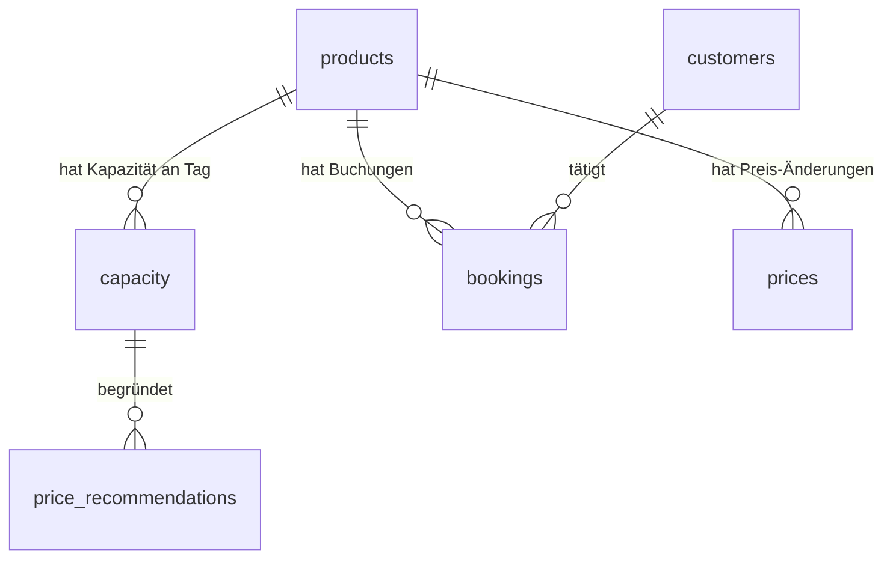

Datenmodell für die Datenbank-Erweiterung der Pricing-Anwendung (Aufgabe siehe [[1.2 Relationale Datenbanken & ORM - Leitfaden#Übungsaufgabe|1.2 Leitfaden – Übungsaufgabe]]). Baut auf dem bestehenden OOP-Stand auf: [[Umsetzungsstand (OOP-Lösung)|Umsetzungsstand (OOP-Lösung)]]. Theorie-Rückbezüge in die [[1.2 Relationale Datenbanken & ORM - Vertiefung|Vertiefung]] (Datenbankdesign, Normalisierung, Foreign Keys, Constraints, Indexes, Beziehungstypen).

*Stand: 2026-07-20 · nur Modell, noch kein Code. Entscheidungen mit Nick abgestimmt (siehe „Verworfene Alternativen").*

## Ziel & Randbedingungen

- Die bisher rein **datei-gestützte** Datenhaltung (CSV) bleibt voll funktionsfähig — die Datenbank kommt **daneben**, nicht als Ersatz. Der Code bekommt später eine `PostgresqlDataSource` **neben** der bestehenden `CsvDataSource` (gleiches `DataSource`-`Protocol`).
- Tabellen entsprechend ihrer **Beziehungen** verknüpft (Foreign Keys), **sinnvolle Constraints und Indizes**, **3. Normalform (NF3)** eingehalten.
- Das Schema ist so entworfen, dass die bestehenden Objekte (`CapacityRow`, `Booking`, `Price`, `PriceRecommendation`) genauso sauber aus DB-Zeilen entstehen wie aus CSV.

## Erkenntnisse aus den echten Daten (Basis der Entscheidungen)

Kurze EDA über einen Tages-Drop (`daily_data/2026-01-08…`), weil die Datenrealität das Modell bestimmt:

| Befund | Konsequenz |
|---|---|
| `capacity(product_id, calendar_date)` **exakt eindeutig** (0 Dubletten / 1,33 Mio. Zeilen) | Natürlicher Schlüssel eindeutig → als `UNIQUE` gesetzt (PK ist Surrogat, s. u.) |
| `capacity.is_bookable` reicht **−16 … 242** | **Kein** `CHECK >= 0` auf Kapazität (reale Überbuchung, bewusst toleriert) |
| `bookings`: 939.559 Zeilen, aber nur **857.719 distinct `id`/`bkg_id`** | Quell-`id` **nicht eindeutig** → **Surrogat-PK**; ~82k Zeilen-Dubletten (Daten-Qualitätspunkt, s. u.) |
| `bookings.feature_1`: **max. 1 Wert pro Produkt** | Hängt funktional vom Produkt ab → gehört wegen **NF3** in `products` (`bedroom_type`) |
| `bookings.feature_2`: **bis 4 Werte pro Produkt** | Bleibt in `bookings` (echtes Buchungs-Attribut) |
| `net_revenue = gross_revenue − discount_amount` (bestätigt) | `net_revenue` als **`GENERATED`-Spalte** |
| `prices.length_of_stay` enthält **„XN"** | `length_of_stay` als **`TEXT`**, nicht `INTEGER` |
| `prices(product_id, date, length_of_stay)`: **2 Dubletten** / 124.528 | Surrogat-PK; strenges `UNIQUE` erst nach Dedup |
| `status`: 4 Werte, **92,6 % „Firm"** | `CHECK`-Vokabel; **kein Index auf `status`** (Selektivität zu gering) |

## Entwurfsentscheidungen (abgestimmt)

1. **`products` & `customers` mit natürlichem Schlüssel**: `product_id` bzw. `cust_id` (die fachliche ID aus den CSV) direkt als `TEXT PRIMARY KEY`. Kein Surrogat, weil diese Entitäten opake IDs mit wenig/keinen eigenen Attributen sind — ein künstlicher Schlüssel wäre reiner Overhead. Angenehmer Nebeneffekt: die Kind-FKs heißen wieder `product_id`/`cust_id` (TEXT) und matchen die CSV 1:1 → **kein `code → id`-Lookup beim Import**.
2. **`capacity` mit Surrogat-Schlüssel**: `id BIGINT GENERATED ALWAYS AS IDENTITY` (moderner Nachfolger von `BIGSERIAL`) als PK; der natürliche `(product_id, calendar_date)` wird als `UNIQUE`-Constraint erzwungen. Bewusst gewählt, um sich nicht auf den zusammengesetzten Schlüssel verlassen zu müssen — dadurch referenziert `price_recommendations` eine **einzelne** `capacity_id`-Spalte statt eines zusammengesetzten FK.
3. **Scope**: Kern (`products`, `capacity`, `bookings`, `prices`) + `customers` + `price_recommendations` (Output).
4. **`status`** über `CHECK (status IN (...))`.
5. **`net_revenue`** als `GENERATED ALWAYS AS (gross_revenue - discount_amount) STORED`.
6. **Ingestion-Philosophie: system of record** — es wird **alles** geladen, was plausiblen analytischen Wert hat (Revenues, Kunde, Status, Daten), nicht nur, was die aktuelle Business-Logik braucht. Begründung: Der Sinn einer DB (statt nur durchrechnen) ist die durable, abfragbare Historie; die täglichen CSV-Drops **rotieren**, an der Grenze Weggeworfenes ist unwiederbringlich. Reine Quell-Artefakte ohne denkbaren Nutzen werden trotzdem nicht aufgehoben (z. B. die nicht-eindeutige Quell-`id` nur als `source_id`).

## ER-Überblick

Alle Beziehungen sind **1:n**, ausgehend vom Produkt (bzw. Kunde). Umsetzung über Fremdschlüssel (vgl. [[1.2 Relationale Datenbanken & ORM - Vertiefung#Beziehungstypen — One-to-One, One-to-Many, Many-to-Many|Beziehungstypen]]).



| Beziehung | Typ | FK-Spalte |
|---|---|---|
| products → capacity | 1:n | `capacity.product_id → products.product_id` |
| products → bookings | 1:n | `bookings.product_id → products.product_id` |
| products → prices | 1:n | `prices.product_id → products.product_id` |
| customers → bookings | 1:n | `bookings.cust_id → customers.cust_id` |
| capacity → price_recommendations | 1:n | `price_recommendations.capacity_id → capacity.id` |

## Tabellen im Detail

### `products` — Produkt-Stammdaten (Hub)

Wird beim Import aus der **Vereinigung** aller `product_id` der drei Quelldateien befüllt (es gibt keine eigene Produkt-Quelldatei). `bedroom_type` stammt aus `feature_1` und liegt hier, weil es funktional vom Produkt abhängt (NF3).

| Spalte | Typ | Constraints | Begründung |
|---|---|---|---|
| `product_id` | `TEXT` | `PRIMARY KEY` | Natürlicher Schlüssel (CSV `product_id`), z. B. `XRKO4` |
| `bedroom_type` | `TEXT` | — (nullable) | Aus `feature_1`; nur für Produkte bekannt, die in Buchungen vorkommen |

**Indizes:** PK-Index auf `product_id` (automatisch).

### `customers` — Kunden

Wie `products` aus den distinct `cust_id` der Buchungen befüllt (keine eigene Quelldatei). ⚠️ Aktuell **attributlos** — die Tabelle ist bewusst eine **Wachstums-Wette** (explizite 1:n-Beziehung Kunde→Buchungen + Platz für künftige Kundenattribute), kein heutiger Nutzen außer referenzieller Integrität. Deshalb konsequent **natürlicher** Schlüssel.

| Spalte | Typ | Constraints | Begründung |
|---|---|---|---|
| `cust_id` | `TEXT` | `PRIMARY KEY` | Natürlicher Schlüssel (CSV `cust_id`), opaker String |

**Indizes:** PK-Index auf `cust_id` (automatisch).

### `capacity` — Kapazitäts-Snapshot je Produkt & Tag

Entspricht `CapacityRow` und wird zur `PriceableUnit`. Surrogat-PK; die fachliche Eindeutigkeit `(product_id, calendar_date)` wird als `UNIQUE` durchgesetzt.

| Spalte | Typ | Constraints | Begründung |
|---|---|---|---|
| `id` | `BIGINT` | `PRIMARY KEY` (IDENTITY) | Surrogatschlüssel (einfacher FK-Ziel-Punkt für `price_recommendations`) |
| `product_id` | `TEXT` | `NOT NULL`, `REFERENCES products(product_id)` | FK zum Produkt |
| `calendar_date` | `DATE` | `NOT NULL` | Tag der Kapazität |
| `bookable_units` | `INTEGER` | `NOT NULL` | CSV `is_bookable`; **kein** `CHECK >= 0` (Werte real negativ) |
| `optional_units` | `INTEGER` | `NOT NULL` | CSV `is_option` |
| — | — | `UNIQUE (product_id, calendar_date)` | Fachliche Eindeutigkeit: je Produkt & Tag nur eine Zeile |

**Indizes:**
- PK `id` (automatisch).
- `UNIQUE(product_id, calendar_date)` erzeugt einen Unique-Index (automatisch) — deckt via [[1.2 Relationale Datenbanken & ORM - Vertiefung#Zusammengesetzte Indizes und die „Leftmost-Prefix"-Regel|Leftmost-Prefix]] auch den FK `product_id` ab → **kein** separater FK-Index nötig.
- `idx_capacity_calendar_date` auf `(calendar_date)` — für den Zukunfts-Filter der Engine (`calendar_date > reference_date`).

### `bookings` — Buchungen

Surrogat-PK, weil die Quell-`id` **nicht eindeutig** ist. `feature_1` wurde nach `products` ausgelagert (NF3); `feature_2` bleibt hier.

| Spalte | Typ | Constraints | Begründung |
|---|---|---|---|
| `id` | `BIGINT` | `PRIMARY KEY` (IDENTITY) | Surrogat (Quell-`id` nicht eindeutig) |
| `source_id` | `BIGINT` | — | Quell-`id`, nur zur Nachvollziehbarkeit (nicht eindeutig) |
| `bkg_id` | `BIGINT` | `NOT NULL` | Fachliche Buchungs-ID |
| `product_id` | `TEXT` | `NOT NULL`, `REFERENCES products(product_id)` | FK zum Produkt |
| `cust_id` | `TEXT` | `NOT NULL`, `REFERENCES customers(cust_id)` | FK zum Kunden |
| `start_date` | `DATE` | `NOT NULL` | CSV `date` (Anreise) |
| `booking_creation_date` | `DATE` | — | Buchungszeitpunkt |
| `status` | `TEXT` | `NOT NULL`, `CHECK (status IN ('Firm','Cancelled','Expired','Pending'))` | Kontrollierte Vokabel |
| `cancellation_date` | `DATE` | — (nullable) | Nur bei `Cancelled` gesetzt |
| `gross_revenue` | `NUMERIC(12,2)` | — | Bruttoumsatz (exakter Geldtyp) |
| `discount_amount` | `NUMERIC(12,2)` | — | Rabattbetrag |
| `net_revenue` | `NUMERIC(12,2)` | `GENERATED ALWAYS AS (gross_revenue - discount_amount) STORED` | Abgeleitet → nie inkonsistent |
| `base_currency` | `TEXT` | `NOT NULL DEFAULT 'STG'` | Währung |
| `nights` | `INTEGER` | `NOT NULL`, `CHECK (nights >= 1)` | CSV `bkg_nights`; Domain-Invariante aus `Booking.__post_init__` |
| `feature_2` | `TEXT` | — | Buchungs-Attribut (nicht produktabhängig) |

**Indizes:**
- PK `id` (automatisch).
- `idx_bookings_product_id` auf `(product_id)` — FK (kein Auto-Index in PG!).
- `idx_bookings_cust_id` auf `(cust_id)` — dito.
- **Kein** Index auf `status`: 92,6 % `Firm` → zu geringe Selektivität (vgl. [[1.2 Relationale Datenbanken & ORM - Vertiefung#Wann bringt ein Index (fast) nichts? — Selektivität|Selektivität]]).

### `prices` — Preis-/Referenzdaten

| Spalte | Typ | Constraints | Begründung |
|---|---|---|---|
| `id` | `BIGINT` | `PRIMARY KEY` (IDENTITY) | Surrogat (Natur-Key nicht 100 % eindeutig) |
| `source_id` | `TEXT` | — | Quell-`id` (Hex-String) |
| `product_id` | `TEXT` | `NOT NULL`, `REFERENCES products(product_id)` | FK zum Produkt |
| `change_date` | `DATE` | `NOT NULL` | CSV `date` |
| `current_price` | `NUMERIC(12,2)` | `NOT NULL`, `CHECK (current_price >= 0)` | Preis (exakter Geldtyp, nie negativ) |
| `length_of_stay` | `TEXT` | `NOT NULL` | Enthält auch `"XN"` → **kein** Integer |

**Indizes:** PK `id` (automatisch); `idx_prices_product_id` auf `(product_id)` (FK).

### `price_recommendations` — App-Output (Persistenz)

Gegenstück zum `CsvRecommendationWriter`. Eine Empfehlung gehört zu **genau einer** Kapazitäts-Zeile → **einspaltiger** FK auf `capacity.id` (Vorteil des capacity-Surrogats). `product_id`/`calendar_date` werden **nicht** dupliziert, sondern per Join über `capacity_id` geholt (siehe offene Punkte für die Denormalisierungs-Option).

> [!note] Nachträglich entfernt: `reference_date`
> Ursprünglich als eigene `NOT NULL DATE`-Spalte geplant. Beim Implementieren des `PostgresqlRecommendationWriter` wieder rausgenommen (Nick, 2026-07-22), damit CSV- und Postgres-Ausgabe **strukturell identisch** bleiben — `CsvRecommendationWriter` schreibt ohnehin nur die Felder von `PriceRecommendation` (die kein `reference_date` kennt). Eine Rückrechnung aus `calendar_date - days_until_travel` wäre möglich gewesen, hätte aber nur zusätzliche, aus anderen Spalten ableitbare Redundanz erzeugt.

| Spalte | Typ | Constraints | Begründung |
|---|---|---|---|
| `id` | `BIGINT` | `PRIMARY KEY` (IDENTITY) | Surrogat |
| `capacity_id` | `BIGINT` | `NOT NULL`, `REFERENCES capacity(id)` | Die zugehörige Kapazitäts-/Priceable-Unit-Zeile |
| `computed_at` | `TIMESTAMPTZ` | `NOT NULL DEFAULT now()` | Zeitpunkt des Laufs |
| `days_until_travel` | `INTEGER` | `NOT NULL` | Aus `PriceRecommendation` |
| `recommended_adjustment_pct` | `NUMERIC(10,6)` | `NOT NULL` | %-Anpassung (6 Nachkommastellen wie in der Domain) |
| `occupancy` | `DOUBLE PRECISION` | `NOT NULL` | Auslastung (Domain-`float`), Snapshot des Laufs |
| `total_capacity` | `INTEGER` | `NOT NULL` | Snapshot des Laufs |
| `booked_units` | `INTEGER` | `NOT NULL` | Snapshot des Laufs |

**Indizes:** PK `id` (automatisch); `idx_recommendations_capacity_id` auf `(capacity_id)` (FK).

## NF3-Nachweis (kurz)

- **1NF:** Alle Spalten atomar (keine Listen/Mehrfachwerte). ✔
- **2NF:** Kein Nicht-Schlüssel-Attribut hängt nur von einem *Teil* eines Schlüssels ab. `capacity` nutzt zwar einen zusammengesetzten `UNIQUE`, aber `bookable_units`/`optional_units` hängen vom **ganzen** `(product_id, calendar_date)` ab. ✔
- **3NF:** Keine transitiven Abhängigkeiten — die kritische war `booking → product → feature_1`; durch Auslagern von `bedroom_type` nach `products` behoben. `net_revenue` ist **abgeleitet** (`GENERATED`), kein gespeicherter transitiver Wert. ✔

Vgl. [[1.2 Relationale Datenbanken & ORM - Vertiefung#3. Normalform (3NF): keine transitiven Abhängigkeiten|3NF in der Vertiefung]].

## Index-Strategie gesamt

| Tabelle | Index | Art | Zweck |
|---|---|---|---|
| products | `product_id` | PK (auto) | Identität / FK-Ziel |
| customers | `cust_id` | PK (auto) | Identität / FK-Ziel |
| capacity | `id` | PK (auto) | Identität / FK-Ziel (recommendations) |
| capacity | `(product_id, calendar_date)` | UNIQUE (auto) | Eindeutigkeit + deckt FK `product_id` |
| capacity | `(calendar_date)` | manuell | Zukunfts-/Datumsfilter |
| bookings | `id` | PK (auto) | Identität |
| bookings | `(product_id)` | manuell | FK-Join/Löschprüfung |
| bookings | `(cust_id)` | manuell | FK-Join/Löschprüfung |
| prices | `id` | PK (auto) | Identität |
| prices | `(product_id)` | manuell | FK-Join/Löschprüfung |
| price_recommendations | `id` | PK (auto) | Identität |
| price_recommendations | `(capacity_id)` | manuell | FK-Join/Löschprüfung |

Leitprinzip: FK-Spalten indizieren (PG legt dort **keinen** Auto-Index an), außer sie sind bereits von einem PK-/UNIQUE-Prefix abgedeckt (wie `capacity.product_id`). Low-Selectivity-Spalten (`status`) **nicht** indizieren. Vgl. [[1.2 Relationale Datenbanken & ORM - Vertiefung#Indexes|Indexes]].

## DDL-Entwurf (komplett)

```sql
CREATE TABLE products (
    product_id   TEXT PRIMARY KEY,             -- natürlicher Schlüssel (CSV "product_id")
    bedroom_type TEXT                          -- aus feature_1 (produktabhängig, NF3)
);

CREATE TABLE customers (
    cust_id TEXT PRIMARY KEY                   -- natürlicher Schlüssel (CSV "cust_id")
);

CREATE TABLE capacity (
    id             BIGINT GENERATED ALWAYS AS IDENTITY PRIMARY KEY,
    product_id     TEXT    NOT NULL REFERENCES products(product_id),
    calendar_date  DATE    NOT NULL,
    bookable_units INTEGER NOT NULL,           -- kann negativ sein: KEIN CHECK
    optional_units INTEGER NOT NULL,
    UNIQUE (product_id, calendar_date)         -- fachliche Eindeutigkeit
);
CREATE INDEX idx_capacity_calendar_date ON capacity (calendar_date);

CREATE TABLE bookings (
    id                    BIGINT GENERATED ALWAYS AS IDENTITY PRIMARY KEY,
    source_id             BIGINT,              -- Quell-"id" (nicht eindeutig)
    bkg_id                BIGINT  NOT NULL,
    product_id            TEXT    NOT NULL REFERENCES products(product_id),
    cust_id               TEXT    NOT NULL REFERENCES customers(cust_id),
    start_date            DATE    NOT NULL,    -- CSV "date"
    booking_creation_date DATE,
    status                TEXT    NOT NULL
                          CHECK (status IN ('Firm','Cancelled','Expired','Pending')),
    cancellation_date     DATE,
    gross_revenue         NUMERIC(12,2),
    discount_amount       NUMERIC(12,2),
    net_revenue           NUMERIC(12,2)
                          GENERATED ALWAYS AS (gross_revenue - discount_amount) STORED,
    base_currency         TEXT    NOT NULL DEFAULT 'STG',
    nights                INTEGER NOT NULL CHECK (nights >= 1),   -- CSV "bkg_nights"
    feature_2             TEXT
);
CREATE INDEX idx_bookings_product_id ON bookings (product_id);
CREATE INDEX idx_bookings_cust_id    ON bookings (cust_id);

CREATE TABLE prices (
    id             BIGINT GENERATED ALWAYS AS IDENTITY PRIMARY KEY,
    source_id      TEXT,                       -- Quell-"id" (Hex)
    product_id     TEXT    NOT NULL REFERENCES products(product_id),
    change_date    DATE    NOT NULL,           -- CSV "date"
    current_price  NUMERIC(12,2) NOT NULL CHECK (current_price >= 0),
    length_of_stay TEXT    NOT NULL            -- enthält "XN" -> TEXT
);
CREATE INDEX idx_prices_product_id ON prices (product_id);

CREATE TABLE price_recommendations (
    id                         BIGINT GENERATED ALWAYS AS IDENTITY PRIMARY KEY,
    capacity_id                BIGINT  NOT NULL REFERENCES capacity(id),
    computed_at                TIMESTAMPTZ NOT NULL DEFAULT now(),
    days_until_travel          INTEGER NOT NULL,
    recommended_adjustment_pct NUMERIC(10,6) NOT NULL,
    occupancy                  DOUBLE PRECISION NOT NULL,
    total_capacity             INTEGER NOT NULL,
    booked_units               INTEGER NOT NULL
);
CREATE INDEX idx_recommendations_capacity_id ON price_recommendations (capacity_id);
```

## Domain-Mapping (DB ↔ Code)

| Tabelle | Domänen-/Transport-Objekt |
|---|---|
| `capacity` | `CapacityRow` → `PriceableUnit` |
| `bookings` | `Booking` (nutzt Teilmenge: `product_id`, `start_date`, `nights`, `status`) |
| `prices` | `Price` |
| `price_recommendations` | `PriceRecommendation` (Output) |
| `products`, `customers` | Neu (Normalisierungs-Hubs, kein bestehendes Domänenobjekt) |

## Verworfene Alternativen & Begründung

| Entscheidung | Gewählt | Verworfene Alternative | Warum |
|---|---|---|---|
| `products`/`customers`-Schlüssel | **Natürlich** (`product_id`/`cust_id` PK) | Surrogat `id` + Code `UNIQUE` | Opake IDs mit wenig/keinen Attributen → Surrogat wäre Overhead + ETL-Lookup. (Bei `products` trägt zwar `bedroom_type`, aber der Nutzen reicht nicht für den Surrogat-Aufwand.) |
| `products`/`customers`-Tabelle überhaupt | **Ja, behalten** | Keine Tabelle, Strings direkt in Kind-Tabellen | Referenzielle Integrität (keine verwaisten `product_id`) + Wachstums-Anker; Aufgabe kündigt Erweiterung an |
| `customers` | **Behalten (natürl. Schlüssel)** | Weglassen, `cust_id` als Attribut auf `bookings` | Bewusste Wachstums-Wette (künftige Kundenattribute + explizite 1:n-Beziehung); heute nur ref. Integrität |
| `capacity`-Schlüssel | **Surrogat `id`** + `UNIQUE(product_id, calendar_date)` | Natürlicher zusammengesetzter PK | Nicht auf zusammengesetzten Schlüssel verlassen; ermöglicht einspaltigen FK aus `price_recommendations` |
| `status` | **`CHECK`** | Lookup-Tabelle / ENUM | 4 Werte, Einfachheit, selbstdokumentierend; kein Join |
| `net_revenue` | **`GENERATED`** | Nicht speichern (nur berechnen) / roh speichern | Als Spalte verfügbar, aber garantiert konsistent, keine Redundanz-Pflege |
| Ingestion | **Alles laden (system of record)** | Lean (nur was Business-Logik braucht) | DB = durable, abfragbare Historie; CSV-Drops rotieren → Drop-at-ingestion ist verlustbehaftet/irreversibel |

## Bewusst offen gelassene Modellierungsfragen

*Beim Kapitelabschluss (19.08.2026) entschieden: Das Modell bleibt so. Die folgenden Punkte sind dokumentierte Abwägungen, keine offenen Aufgaben.*

- **Booking-Dubletten:** ~82k Zeilen tragen eine doppelte `bkg_id`. Es wurde **1:1 übernommen** statt dedupliziert — deshalb ist `bkg_id` kein Schlüssel und die Tabelle hat eine Surrogat-`id`. Für die `booked_units`-Zählung im Builder ist das unkritisch, weil dort über `(product_id, calendar_date)` aggregiert wird, nicht über `bkg_id`.
- **Prices-Dubletten:** 2 doppelte `(product_id, change_date, length_of_stay)`. Zu wenige, um dafür einen Dedup-Schritt und ein `UNIQUE` zu rechtfertigen.
- **`price_recommendations` Selbstbeschreibung:** `product_id`/`calendar_date` wurden **nicht** denormalisiert mitgespeichert. Der CSV-Export joint stattdessen auf `capacity` — Konsistenz vor Bequemlichkeit.
- **`ON DELETE`-Verhalten:** beim Default `NO ACTION` belassen. Kein Kind ist existenzabhängig genug für `CASCADE`, und der Ingest räumt ohnehin per `TRUNCATE … CASCADE` auf.
- **`base_currency`/`length_of_stay`:** bleiben `TEXT` statt Lookup-Tabellen. Bei zwei bzw. wenigen Ausprägungen wäre der Join teurer als der gesparte Platz.

## Umsetzung (Stand 2026-07-22 — erledigt, s. [[Umsetzungsstand (DB-Erweiterung)|Umsetzungsstand]] für Details)

1. ✅ Schema angelegt (obiges DDL, per init-dir).
2. ✅ `PostgresqlDataSource` implementiert (erfüllt dasselbe `DataSource`-`Protocol` wie `CsvDataSource`), ohne ORM, roh mit `psycopg`.
3. ✅ `ingest.py`: erst `products`/`customers` (distinct Codes), dann `capacity`/`bookings`/`prices` — dank natürlicher Schlüssel ohne ID-Auflösung.
   Für `price_recommendations` löst `PostgresqlRecommendationWriter` die `capacity_id` **nicht** über die Domain-Objekte auf (die bleiben bewusst DB-agnostisch, s. `domain.py`-Kopfkommentar), sondern per einmaligem Bulk-Lookup: `SELECT id, product_id, calendar_date FROM capacity` → Dict `{(product_id, calendar_date): id}`, dann pro Recommendation nachgeschlagen. Vermeidet N Einzel-Queries; fehlende Keys werden übersprungen + gezählt geloggt (Datenqualitäts-Signal statt Hard-Crash, analog zum `orphan_nights`-Pattern in `builder.py`).
4. **Nächster Schritt:** dieselbe `DataSource`/denselben `Writer` mit **SQLAlchemy** nachbauen — Vergleich der Ansätze (Teil 2 der Aufgabe).
