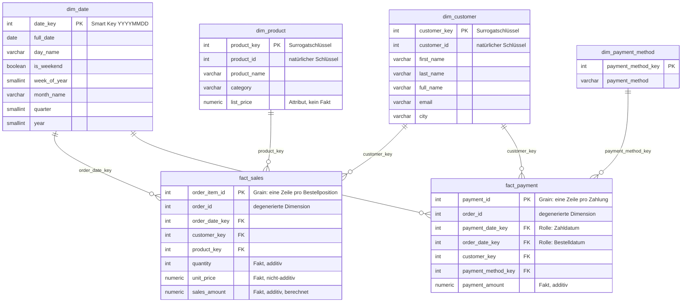
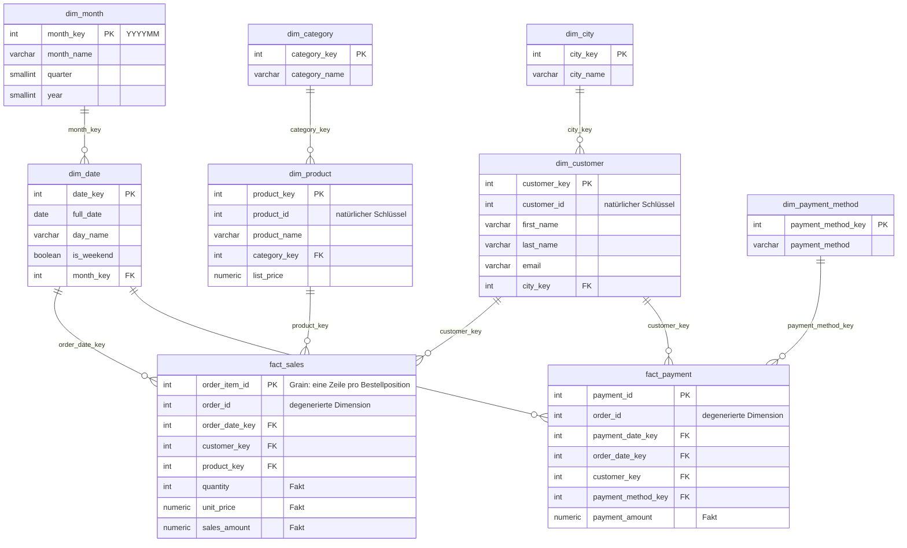

---
tags:
  - documentation
---

# Musterlösung — Dimensionale Modellierung (Übungsaufgabe 2.2)

Musterlösung zur Übungsaufgabe aus [[2.2 OLAP Datenmodellierung & Datawarehousing - Leitfaden#Aufgaben|dem Leitfaden]]. Theorie dazu in [[2.2 OLAP Datenmodellierung & Datawarehousing - Vertiefung|der Vertiefung]], Abschnitte 2 bis 6.

> [!info] Wozu dieses Dokument da ist
> Auf ausdrücklichen Wunsch **nach** Abgabe der eigenen Lösung erstellt — sie wurde gemeinsam mit einem Kollegen erarbeitet und mit der Teamleitung besprochen. Dieses Dokument dient dem **Abgleich**, nicht als Vorlage.
> Es gibt bei dieser Aufgabe mehrere vertretbare Modelle. Wo die eigene Lösung abweicht, ist das nicht automatisch ein Fehler — die [[#11. Prüfliste zum Abgleich|Prüfliste am Ende]] trennt legitime Varianten von echten Fehlern.

> [!success] Alles hier ist getestet
> Jeder SQL-Block in diesem Dokument wurde gegen **PostgreSQL 17.11** ausgeführt — mit dem Generator aus dem Leitfaden (1.200 Positionen, 500 Bestellungen) **und** mit den drei Beispielkunden. Die Beispieltabellen in den Diagrammen sind **echtes Pipeline-Ergebnis**, nicht von Hand ausgedacht. Testprotokoll in [[#10. Testprotokoll|Abschnitt 10]].
> Anforderungen: **Teil 1** läuft ab PostgreSQL 12, **Teil 2** braucht **PostgreSQL 17** (`MERGE … WHEN NOT MATCHED BY SOURCE`); ein Fallback für ältere Versionen steht in [[#12. Grenzen und Erweiterungen|Abschnitt 12]].

## Inhaltsverzeichnis

- [[#1. Analyse der Quelle]]
- [[#2. Die Modellierungsentscheidungen]]
- [[#3. Star Schema]]
- [[#4. Snowflake Schema]]
- [[#5. Skript 1 — DDL Star Schema]]
- [[#6. Skript 2 — Pipeline Teil 1]]
- [[#7. Teil 2 — SCD Typ 2 und Deletes: die Entscheidungen]]
- [[#8. Skript 3 und 4 — DDL und Pipeline mit SCD Typ 2]]
- [[#9. Auswertungen]]
- [[#10. Testprotokoll]]
- [[#11. Prüfliste zum Abgleich]]
- [[#12. Grenzen und Erweiterungen]]

---

## 1. Analyse der Quelle

### Die Geschäftsprozesse

Das OLTP-Modell enthält **zwei** Geschäftsprozesse, nicht einen — und das ist die wichtigste Erkenntnis vor jedem Diagramm:

| Prozess | Ereignis | Natürlicher Grain | Kennzahlen |
|---|---|---|---|
| **Verkauf** | ein Produkt wird in einer bestimmten Menge bestellt | **eine Bestellposition** (`OrderItem`) | Menge, Umsatz |
| **Zahlung** | eine Bestellung wird bezahlt | **eine Zahlung** (`Payment`, 1:1 zur Bestellung) | Zahlbetrag |

`Order` selbst ist **kein** eigener Prozess mit eigenen Kennzahlen. Die Tabelle trägt nur den Kunden und das Datum — beides wird zu Dimensionen — und die Bestellnummer, die als **degenerierte Dimension** in beiden Faktentabellen landet ([[2.2 OLAP Datenmodellierung & Datawarehousing - Vertiefung#2.11 Sonderfälle im Dimensionsdesign|Vertiefung 2.11]]).

### Befunde in den Daten

Vier Dinge, die beim Modellieren auffallen sollten und die Entscheidungen begründen:

**1. Positionssumme und Zahlbetrag stimmen nicht überein.** Schon in den Beispieldaten des Leitfadens: Bestellung 1001 hat Positionen über **2 × 25 € + 1 × 150 € = 200 €**, die Zahlung beträgt aber **100 €**. Das ist kein Fehler im Modell, sondern eine Eigenschaft der Welt — Teilzahlungen, Rabatte, Gutschriften. **Zahlbetrag und Umsatz sind zwei verschiedene Kennzahlen zweier verschiedener Prozesse** und lassen sich nicht auseinander ableiten.

**2. Der Generator erzeugt Bestellungen ohne Positionen.** `OrderItem.order_id` wird zufällig gezogen, also bekommt nicht jede Bestellung Positionen. Für diese berechnet der Generator den Zahlbetrag als `SUM` über eine leere Menge — **49 von 500 Zahlungen haben einen `NULL`-Betrag**. Fakten dürfen `NULL`-Kennzahlen haben; Fremdschlüssel nicht ([[2.2 OLAP Datenmodellierung & Datawarehousing - Vertiefung#2.6 Die Dimensionstabelle: flach, breit, denormalisiert|Vertiefung 2.6]]).

**3. Die Quelle speichert keinen Preis pro Position.** `OrderItem` hat nur eine Menge; der Preis steht im Produkt und wird dort **überschrieben**. Wer den Umsatz zur Abfragezeit aus dem aktuellen Produktpreis berechnet, bewertet alte Bestellungen mit heutigen Preisen. Der Preis muss deshalb **beim Laden** in den Fakt — in Teil 1 eingefroren, in Teil 2 aus der historisch gültigen Produktversion.

**4. Dieselbe Bestellung kann dasselbe Produkt mehrfach enthalten.** Der Generator zieht Produkte zufällig. Deshalb lautet der Grain **„eine Zeile pro Bestellposition"**, nicht „eine Zeile pro Produkt pro Bestellung" — Letzteres würde zwei Positionen zu einer verschmelzen.

---

## 2. Die Modellierungsentscheidungen

| Entscheidung | Gewählt | Begründung | Vertretbare Alternative |
|---|---|---|---|
| Anzahl Faktentabellen | **zwei**: `fact_sales`, `fact_payment` | zwei Prozesse, zwei Grains — Zusammenlegen erzeugt einen **Fan-Trap** ([[#C. Der Fan-Trap|Nachweis in 9C]]) | ein **Accumulating Snapshot** auf Bestellebene mit Bestell- und Zahldatum |
| Grain `fact_sales` | eine Zeile pro **Bestellposition** | atomar, alle Dimensionen eindeutig ([[2.2 OLAP Datenmodellierung & Datawarehousing - Vertiefung#2.9 Der Grain — der wichtigste Schritt|Vertiefung 2.9]]) | — |
| Grain `fact_payment` | eine Zeile pro **Zahlung** | Zahlung ist 1:1 zur Bestellung | — |
| Bestellnummer | **degenerierte Dimension** in beiden Fakten | keine eigenen Attribute; dient als Brücke für Drill-Across | eine `dim_order` — unnötig, aber nicht falsch |
| Primärschlüssel der Fakten | die degenerierten Schlüssel `order_item_id` bzw. `payment_id` | definieren den Grain; ein zusätzlicher Surrogatschlüssel brächte nichts | eigener Surrogatschlüssel |
| Zahlart | eigene kleine Dimension | Referenzdaten, filterbar, erweiterbar | als Attribut direkt im Fakt |
| Datum | `dim_date` mit Smart Key `YYYYMMDD`, **zwei Rollen** in `fact_payment` | Kalenderlogik gehört in eine Tabelle ([[2.2 OLAP Datenmodellierung & Datawarehousing - Vertiefung#2.7 Die Date Dimension|Vertiefung 2.7]]) | reines `DATE` im Fakt — schwächer |
| Surrogatschlüssel | `GENERATED ALWAYS AS IDENTITY` | Pflicht für SCD Typ 2 ([[2.2 OLAP Datenmodellierung & Datawarehousing - Vertiefung#2.10 Surrogate Keys|Vertiefung 2.10]]) | `SERIAL` — gleichwertig |
| Unbekannte Bezüge | „Unbekannt"-Zeile mit Schlüssel **-1** in jeder Dimension | Fremdschlüssel sind nie `NULL` | — |
| Preis | `unit_price` **im Fakt** | Quelle speichert keinen historischen Preis (Befund 3) | — |

Die erste Zeile ist die folgenreichste. Eine Lösung mit `payment_amount` in `fact_sales` zählt jede Zahlung so oft, wie die Bestellung Positionen hat — auf den Generatordaten das **3,4-Fache** des tatsächlichen Zahlvolumens.

---

## 3. Star Schema



> [!note] Legende
> **`fact_`** = Faktentabelle · **`dim_`** = Dimensionstabelle · **PK** = Primärschlüssel · **FK** = Fremdschlüssel · *degenerierte Dimension* = Dimensionsschlüssel ohne eigene Tabelle

### Beispieleinträge

Ergebnis der Pipeline aus [[#6. Skript 2 — Pipeline Teil 1|Abschnitt 6]] auf den Beispieldaten des Leitfadens. Die Zeile mit Schlüssel **-1** ist die „Unbekannt"-Zeile.

**`fact_sales`** — Faktentabelle

| order_item_id<br>PK, degen. | order_id<br>degen. | order_date_key<br>FK | customer_key<br>FK | product_key<br>FK | quantity<br>Fakt | unit_price<br>Fakt | sales_amount<br>Fakt |
|---|---|---|---|---|---|---|---|
| 1 | 1001 | 20250401 | 1 | 1 | 2 | 25.00 | 50.00 |
| 2 | 1001 | 20250401 | 1 | 2 | 1 | 150.00 | 150.00 |
| 3 | 1002 | 20250401 | 2 | 3 | 1 | 300.00 | 300.00 |
| 4 | 1003 | 20250402 | 1 | 1 | 1 | 25.00 | 25.00 |

**`fact_payment`** — Faktentabelle

| payment_id<br>PK, degen. | order_id<br>degen. | payment_date_key<br>FK | order_date_key<br>FK | customer_key<br>FK | payment_method_key<br>FK | payment_amount<br>Fakt |
|---|---|---|---|---|---|---|
| 501 | 1001 | 20250401 | 20250401 | 1 | 2 | 100.00 |
| 502 | 1002 | 20250401 | 20250401 | 2 | 1 | 300.00 |
| 503 | 1003 | 20250402 | 20250402 | 1 | 2 | 25.00 |

**`dim_customer`** — Dimension

| customer_key<br>PK, Surrogat | customer_id<br>natürl. Schlüssel | first_name | last_name | full_name | email | city |
|---|---|---|---|---|---|---|
| -1 | -1 | | | Unbekannt | | |
| 1 | 1 | Alice | Smith | Alice Smith | alice@example.com | Berlin |
| 2 | 2 | Bob | Johnson | Bob Johnson | bob@example.com | Munich |
| 3 | 3 | Clara | Lee | Clara Lee | clara@example.com | Hamburg |

**`dim_product`** — Dimension

| product_key<br>PK, Surrogat | product_id<br>natürl. Schlüssel | product_name | category | list_price |
|---|---|---|---|---|
| -1 | -1 | Unbekannt | Unbekannt | |
| 1 | 101 | Wireless Mouse | Electronics | 25.00 |
| 2 | 102 | Office Chair | Furniture | 150.00 |
| 3 | 103 | Standing Desk | Furniture | 300.00 |

**`dim_date`** — Dimension (Auszug)

| date_key<br>PK, Smart Key | full_date | day_name | is_weekend | week_of_year | month_name | quarter | year |
|---|---|---|---|---|---|---|---|
| -1 | | Unbekannt | | | Unbekannt | | |
| 20250401 | 2025-04-01 | Dienstag | false | 14 | April | 2 | 2025 |
| 20250402 | 2025-04-02 | Mittwoch | false | 14 | April | 2 | 2025 |

**`dim_payment_method`** — Dimension

| payment_method_key<br>PK | payment_method |
|---|---|
| -1 | Unbekannt |
| 1 | PayPal |
| 2 | Credit Card |

Zwei Dinge, die man an den Beispielen sieht:

- **Surrogat- und natürlicher Schlüssel sind verschiedene Spalten** — bei den Produkten deutlich (1 ↔ 101), bei den Kunden zufällig gleich nummeriert. Die Gleichheit ist Zufall der Ladereihenfolge, kein Konzept.
- **`fact_payment` verwendet `dim_date` zweimal** — als Zahldatum und als Bestelldatum. Das ist eine *role-playing dimension* ([[2.2 OLAP Datenmodellierung & Datawarehousing - Vertiefung#2.11 Sonderfälle im Dimensionsdesign|Vertiefung 2.11]]); daraus lässt sich die Zahlungsdauer ohne weitere Tabelle berechnen.

---

## 4. Snowflake Schema

Dieselben Fakten, aber mit **normalisierten** Dimensionen: Die Hierarchien werden in eigene Tabellen ausgelagert und über Fremdschlüssel verkettet.



### Beispieleinträge der ausgelagerten Tabellen

Die Faktentabellen und `dim_payment_method` sind identisch zum Star Schema. Neu bzw. verändert:

**`dim_customer`** — Stadt als Fremdschlüssel

| customer_key<br>PK | customer_id | first_name | last_name | email | city_key<br>FK |
|---|---|---|---|---|---|
| 1 | 1 | Alice | Smith | alice@example.com | 1 |
| 2 | 2 | Bob | Johnson | bob@example.com | 2 |
| 3 | 3 | Clara | Lee | clara@example.com | 3 |

**`dim_city`**

| city_key<br>PK | city_name |
|---|---|
| 1 | Berlin |
| 2 | Munich |
| 3 | Hamburg |

**`dim_product`** — Kategorie als Fremdschlüssel

| product_key<br>PK | product_id | product_name | category_key<br>FK | list_price |
|---|---|---|---|---|
| 1 | 101 | Wireless Mouse | 1 | 25.00 |
| 2 | 102 | Office Chair | 2 | 150.00 |
| 3 | 103 | Standing Desk | 2 | 300.00 |

**`dim_category`**

| category_key<br>PK | category_name |
|---|---|
| 1 | Electronics |
| 2 | Furniture |

**`dim_date`** und **`dim_month`**

| date_key<br>PK | full_date | day_name | is_weekend | month_key<br>FK |
|---|---|---|---|---|
| 20250401 | 2025-04-01 | Dienstag | false | 202504 |
| 20250402 | 2025-04-02 | Mittwoch | false | 202504 |

| month_key<br>PK | month_name | quarter | year |
|---|---|---|---|
| 202504 | April | 2 | 2025 |

### Star vs. Snowflake an diesem Modell

| | Star | Snowflake |
|---|---|---|
| Tabellen | 6 | 9 |
| Joins für „Umsatz nach Kategorie" | 1 | 2 (verkettet) |
| Joins für „Umsatz nach Stadt und Monat" | 2 | 4 |
| Redundanz | `Furniture` steht bei 2 Produkten, `April` bei 30 Tagen | jeder Wert genau einmal |
| Gesparter Platz | — | vernachlässigbar: die Dimensionen sind winzig gegen die Faktentabelle |

Beide Varianten liefern dasselbe Ergebnis — getestet mit „Umsatz nach Kategorie", Electronics 75 €, Furniture 450 € in beiden Schemata. Der Unterschied ist die **Join-Tiefe**, nicht die Antwort ([[2.2 OLAP Datenmodellierung & Datawarehousing - Vertiefung#2.15 Star vs. Snowflake|Vertiefung 2.15]], [[2.2 OLAP Datenmodellierung & Datawarehousing - Vertiefung#2.21 Joins und der Query-Planer|2.21]]). Für die weiteren Teile wird deshalb das **Star Schema** umgesetzt, wie es die Aufgabe verlangt.

---

## 5. Skript 1 — DDL Star Schema

Hinweise zum Lesen:

- `sales_amount` ist eine **generierte Spalte** (`quantity × unit_price`). Sie kann nie von der Rechnung abweichen und muss in der Pipeline nicht gepflegt werden.
- Die „Unbekannt"-Zeilen werden mit `OVERRIDING SYSTEM VALUE` eingefügt, weil `GENERATED ALWAYS` sonst keinen expliziten Schlüssel zulässt. Achtung, die Klausel steht **hinter** der Spaltenliste.
- Postgres legt für Fremdschlüssel **keine** Indizes an — die Indizes auf den Fakten sind deshalb explizit.
- Die `DROP`-Anweisung verwirft das gesamte Schema. Das ist für die wiederholbare Übungsumgebung gedacht, nicht für ein produktives Warehouse.

```sql
-- =====================================================================
-- Teil 1 · DDL Star Schema
-- Grain fact_sales:   eine Zeile pro Bestellposition (order_item)
-- Grain fact_payment: eine Zeile pro Zahlung (= pro Bestellung, 1:1)
-- =====================================================================
DROP SCHEMA IF EXISTS dwh CASCADE;   -- nur Übungsumgebung: verwirft das komplette Warehouse
CREATE SCHEMA dwh;

-- ---------- Dimensionen ----------------------------------------------

CREATE TABLE dwh.dim_date (
    date_key      INTEGER PRIMARY KEY,          -- Smart Key YYYYMMDD, -1 = unbekannt
    full_date     DATE UNIQUE,
    day_of_month  SMALLINT,
    day_of_week   SMALLINT,                     -- ISO: 1 = Montag
    day_name      VARCHAR(10),
    is_weekend    BOOLEAN,
    week_of_year  SMALLINT,
    month_number  SMALLINT,
    month_name    VARCHAR(10),
    quarter       SMALLINT,
    year          SMALLINT
);

CREATE TABLE dwh.dim_customer (
    customer_key  INTEGER GENERATED ALWAYS AS IDENTITY PRIMARY KEY,   -- Surrogatschlüssel
    customer_id   INTEGER NOT NULL UNIQUE,                           -- natürlicher Schlüssel
    first_name    VARCHAR(50),
    last_name     VARCHAR(50),
    full_name     VARCHAR(101),
    email         VARCHAR(100),
    city          VARCHAR(50)
);

CREATE TABLE dwh.dim_product (
    product_key   INTEGER GENERATED ALWAYS AS IDENTITY PRIMARY KEY,
    product_id    INTEGER NOT NULL UNIQUE,
    product_name  VARCHAR(100),
    category      VARCHAR(50),
    list_price    NUMERIC(10,2)                 -- aktueller Listenpreis (Attribut, kein Fakt)
);

CREATE TABLE dwh.dim_payment_method (
    payment_method_key  INTEGER GENERATED ALWAYS AS IDENTITY PRIMARY KEY,
    payment_method      VARCHAR(50) NOT NULL UNIQUE
);

-- ---------- Fakten ---------------------------------------------------

CREATE TABLE dwh.fact_sales (
    order_item_id   INTEGER PRIMARY KEY,                                   -- degenerierte Dimension, definiert den Grain
    order_id        INTEGER NOT NULL,                                      -- degenerierte Dimension
    order_date_key  INTEGER NOT NULL REFERENCES dwh.dim_date (date_key),
    customer_key    INTEGER NOT NULL REFERENCES dwh.dim_customer (customer_key),
    product_key     INTEGER NOT NULL REFERENCES dwh.dim_product (product_key),
    quantity        INTEGER,                                               -- additiv
    unit_price      NUMERIC(10,2),                                         -- Preis zum Ladezeitpunkt, eingefroren
    sales_amount    NUMERIC(12,2) GENERATED ALWAYS AS (quantity * unit_price) STORED   -- additiv
);

CREATE TABLE dwh.fact_payment (
    payment_id          INTEGER PRIMARY KEY,                               -- degenerierte Dimension
    order_id            INTEGER NOT NULL,                                  -- degenerierte Dimension, Brücke zu fact_sales
    payment_date_key    INTEGER NOT NULL REFERENCES dwh.dim_date (date_key),
    order_date_key      INTEGER NOT NULL REFERENCES dwh.dim_date (date_key),       -- zweite Rolle der Datumsdimension
    customer_key        INTEGER NOT NULL REFERENCES dwh.dim_customer (customer_key),
    payment_method_key  INTEGER NOT NULL REFERENCES dwh.dim_payment_method (payment_method_key),
    payment_amount      NUMERIC(12,2)                                      -- additiv
);

-- Postgres legt für Fremdschlüssel keine Indizes an
CREATE INDEX ON dwh.fact_sales   (order_date_key);
CREATE INDEX ON dwh.fact_sales   (customer_key);
CREATE INDEX ON dwh.fact_sales   (product_key);
CREATE INDEX ON dwh.fact_sales   (order_id);
CREATE INDEX ON dwh.fact_payment (payment_date_key);
CREATE INDEX ON dwh.fact_payment (customer_key);
CREATE INDEX ON dwh.fact_payment (order_id);

-- ---------- „Unbekannt"-Zeilen: Fremdschlüssel sind nie NULL ---------

INSERT INTO dwh.dim_date (date_key, day_name, month_name) VALUES (-1, 'Unbekannt', 'Unbekannt');
INSERT INTO dwh.dim_customer (customer_key, customer_id, full_name)
       OVERRIDING SYSTEM VALUE VALUES (-1, -1, 'Unbekannt');
INSERT INTO dwh.dim_product (product_key, product_id, product_name, category)
       OVERRIDING SYSTEM VALUE VALUES (-1, -1, 'Unbekannt', 'Unbekannt');
INSERT INTO dwh.dim_payment_method (payment_method_key, payment_method)
       OVERRIDING SYSTEM VALUE VALUES (-1, 'Unbekannt');
```

---

## 6. Skript 2 — Pipeline Teil 1

Liest direkt aus den Quelltabellen (hier im Schema `oltp`) und schreibt ins Star Schema. **Nur Upserts**, wie die Aufgabe für Teil 1 vorgibt; alle Dimensionen verhalten sich als **SCD Typ 1** (überschreiben).

**Die tragenden Entscheidungen:**

**Idempotenz durch `ON CONFLICT … DO UPDATE … WHERE … IS DISTINCT FROM`.** Aktualisiert wird nur, wenn sich wirklich etwas geändert hat. Ein zweiter Lauf auf unveränderter Quelle ändert **keine einzige Zeile** — das ist getestet ([[#10. Testprotokoll|Abschnitt 10]]). Ohne die `WHERE`-Klausel würde jeder Lauf alle Zeilen neu schreiben: fachlich gleich, aber teuer und für jede Änderungsverfolgung unbrauchbar.

**`ON CONFLICT` statt `MERGE`.** Für reine Upserts ist `ON CONFLICT` die bessere Wahl: Es garantiert ein atomares Einfügen-oder-Aktualisieren auch unter Nebenläufigkeit, was `MERGE` nicht tut. `MERGE` kommt in Teil 2 zum Einsatz, wo zusätzlich gelöscht werden muss.

**Surrogate Key Pipeline mit `LEFT JOIN` und `COALESCE(…, -1)`.** Jeder natürliche Schlüssel wird gegen die Dimension aufgelöst; findet sich keiner, landet die Zeile auf „Unbekannt" statt zu verschwinden ([[2.2 OLAP Datenmodellierung & Datawarehousing - Vertiefung#3.14 Die Surrogate Key Pipeline|Vertiefung 3.14]]).

**Der eingefrorene Preis.** Beim **ersten** Laden einer Position wird der aktuelle Listenpreis in `unit_price` geschrieben. Bei späteren Läufen bleibt er stehen — eine Preisänderung im Produkt verändert vergangene Umsätze nicht. Neu bewertet wird nur, wenn sich das **Produkt** der Position ändert. Ohne diesen Mechanismus wäre Teil 1 fachlich falsch, denn die Quelle kennt keinen historischen Preis (Befund 3).

**Alles in einer Transaktion.** Bricht ein Schritt ab, bleibt der Stand des vorigen Laufs vollständig erhalten.

```sql
-- =====================================================================
-- Teil 1 · Pipeline OLTP → Star Schema
-- Nur Upserts (Inserts + Updates), keine Deletes. Alle Dimensionen Typ 1.
-- Idempotent: ein zweiter Lauf auf unveränderter Quelle ändert keine Zeile.
-- =====================================================================
BEGIN;

-- 1. Datumsdimension: alle Tage der betroffenen Jahre (Bestell- und Zahldaten)
INSERT INTO dwh.dim_date (date_key, full_date, day_of_month, day_of_week, day_name, is_weekend,
                          week_of_year, month_number, month_name, quarter, year)
SELECT to_char(d, 'YYYYMMDD')::INTEGER,
       d,
       EXTRACT(DAY FROM d),
       EXTRACT(ISODOW FROM d),
       (ARRAY['Montag','Dienstag','Mittwoch','Donnerstag','Freitag','Samstag','Sonntag'])[EXTRACT(ISODOW FROM d)::INT],
       EXTRACT(ISODOW FROM d) IN (6, 7),
       EXTRACT(WEEK FROM d),
       EXTRACT(MONTH FROM d),
       (ARRAY['Januar','Februar','März','April','Mai','Juni','Juli','August',
              'September','Oktober','November','Dezember'])[EXTRACT(MONTH FROM d)::INT],
       EXTRACT(QUARTER FROM d),
       EXTRACT(YEAR FROM d)
FROM (SELECT MIN(dt) AS von, MAX(dt) AS bis
      FROM (SELECT order_date AS dt FROM oltp."Order"
            UNION ALL
            SELECT payment_date FROM oltp.payment) alle_daten) grenzen
CROSS JOIN LATERAL generate_series(date_trunc('year', grenzen.von),
                                   date_trunc('year', grenzen.bis) + INTERVAL '1 year - 1 day',
                                   INTERVAL '1 day') AS g(ts)
CROSS JOIN LATERAL (SELECT g.ts::DATE AS d) AS tag
ON CONFLICT (date_key) DO NOTHING;

-- 2. Kunden (Typ 1: überschreiben, nur wenn sich etwas geändert hat)
INSERT INTO dwh.dim_customer AS t (customer_id, first_name, last_name, full_name, email, city)
SELECT customer_id, first_name, last_name, concat_ws(' ', first_name, last_name), email, city
FROM oltp.customer
ON CONFLICT (customer_id) DO UPDATE
SET first_name = EXCLUDED.first_name,
    last_name  = EXCLUDED.last_name,
    full_name  = EXCLUDED.full_name,
    email      = EXCLUDED.email,
    city       = EXCLUDED.city
WHERE (t.first_name, t.last_name, t.email, t.city)
      IS DISTINCT FROM (EXCLUDED.first_name, EXCLUDED.last_name, EXCLUDED.email, EXCLUDED.city);

-- 3. Produkte (Typ 1)
INSERT INTO dwh.dim_product AS t (product_id, product_name, category, list_price)
SELECT product_id, product_name, category, price
FROM oltp.product
ON CONFLICT (product_id) DO UPDATE
SET product_name = EXCLUDED.product_name,
    category     = EXCLUDED.category,
    list_price   = EXCLUDED.list_price
WHERE (t.product_name, t.category, t.list_price)
      IS DISTINCT FROM (EXCLUDED.product_name, EXCLUDED.category, EXCLUDED.list_price);

-- 4. Zahlarten (Referenzdaten: nur neue Werte ergänzen)
INSERT INTO dwh.dim_payment_method (payment_method)
SELECT DISTINCT payment_method FROM oltp.payment WHERE payment_method IS NOT NULL
ON CONFLICT (payment_method) DO NOTHING;

-- 5. Fakt Verkauf: Surrogate Key Pipeline, nie NULL im Fremdschlüssel
INSERT INTO dwh.fact_sales AS f
       (order_item_id, order_id, order_date_key, customer_key, product_key, quantity, unit_price)
SELECT oi.order_item_id,
       oi.order_id,
       COALESCE(dd.date_key,     -1),
       COALESCE(dc.customer_key, -1),
       COALESCE(dp.product_key,  -1),
       oi.quantity,
       dp.list_price                        -- aktueller Preis; wird unten beim Update eingefroren
FROM oltp.orderitem oi
LEFT JOIN oltp."Order"       o  ON o.order_id     = oi.order_id
LEFT JOIN dwh.dim_date       dd ON dd.full_date   = o.order_date
LEFT JOIN dwh.dim_customer   dc ON dc.customer_id = o.customer_id
LEFT JOIN dwh.dim_product    dp ON dp.product_id  = oi.product_id
ON CONFLICT (order_item_id) DO UPDATE
SET order_id       = EXCLUDED.order_id,
    order_date_key = EXCLUDED.order_date_key,
    customer_key   = EXCLUDED.customer_key,
    product_key    = EXCLUDED.product_key,
    quantity       = EXCLUDED.quantity,
    -- Preis eingefroren: nur neu bewerten, wenn sich das Produkt der Position geändert hat
    unit_price     = CASE WHEN f.product_key IS DISTINCT FROM EXCLUDED.product_key
                          THEN EXCLUDED.unit_price ELSE f.unit_price END
WHERE (f.order_id, f.order_date_key, f.customer_key, f.product_key, f.quantity)
      IS DISTINCT FROM
      (EXCLUDED.order_id, EXCLUDED.order_date_key, EXCLUDED.customer_key, EXCLUDED.product_key, EXCLUDED.quantity);

-- 6. Fakt Zahlung
INSERT INTO dwh.fact_payment AS f
       (payment_id, order_id, payment_date_key, order_date_key, customer_key, payment_method_key, payment_amount)
SELECT p.payment_id,
       p.order_id,
       COALESCE(dpd.date_key,           -1),
       COALESCE(dod.date_key,           -1),
       COALESCE(dc.customer_key,        -1),
       COALESCE(dm.payment_method_key,  -1),
       p.amount
FROM oltp.payment p
LEFT JOIN oltp."Order"           o   ON o.order_id         = p.order_id
LEFT JOIN dwh.dim_date           dpd ON dpd.full_date      = p.payment_date
LEFT JOIN dwh.dim_date           dod ON dod.full_date      = o.order_date
LEFT JOIN dwh.dim_customer       dc  ON dc.customer_id     = o.customer_id
LEFT JOIN dwh.dim_payment_method dm  ON dm.payment_method  = p.payment_method
ON CONFLICT (payment_id) DO UPDATE
SET order_id           = EXCLUDED.order_id,
    payment_date_key   = EXCLUDED.payment_date_key,
    order_date_key     = EXCLUDED.order_date_key,
    customer_key       = EXCLUDED.customer_key,
    payment_method_key = EXCLUDED.payment_method_key,
    payment_amount     = EXCLUDED.payment_amount
WHERE (f.order_id, f.payment_date_key, f.order_date_key, f.customer_key, f.payment_method_key, f.payment_amount)
      IS DISTINCT FROM
      (EXCLUDED.order_id, EXCLUDED.payment_date_key, EXCLUDED.order_date_key,
       EXCLUDED.customer_key, EXCLUDED.payment_method_key, EXCLUDED.payment_amount);

COMMIT;
```

> [!warning] Die Schwäche von Teil 1 — und der Grund für Teil 2
> Zieht Alice von Berlin nach Hamburg, überschreibt Teil 1 ihre Stadt. **Alle** ihre bisherigen Umsätze werden ab dann Hamburg zugerechnet, auch die aus der Zeit in Berlin. Die Auswertung „Umsatz nach Stadt" ändert sich rückwirkend, ohne dass sich ein einziger Fakt geändert hat. Genau das zeigt Spalte „as is" in [[#A. Umsatz nach Stadt — damals und heute|Auswertung A]].

---

## 7. Teil 2 — SCD Typ 2 und Deletes: die Entscheidungen

### Welche Attribute werden historisiert?

| Dimension | Attribut | Typ | Begründung |
|---|---|---|---|
| `dim_customer` | `city` | **2** | Regionale Auswertungen müssen den Wohnort **zum Kaufzeitpunkt** kennen |
| `dim_customer` | `first_name`, `last_name`, `email` | **2** *(vereinfacht)* | fachlich gemischt — Namensänderung nach Heirat ist Typ 2, ein Tippfehler Typ 1 |
| `dim_product` | `list_price` | **2** | historisch korrekter Preis für die Bewertung jeder Position |
| `dim_product` | `category` | **2** | Kategorieauswertungen nach damaliger Einordnung |
| `dim_product` | `product_name` | **2** *(vereinfacht)* | Umbenennungen sind fachlich meist Typ 1 |
| `dim_payment_method` | — | **1** | Referenzdaten, keine Historie nötig |
| `dim_date` | — | — | statisch |

Die Aufgabe verlangt „alle relevanten SCDs nach Typ 2". Umgesetzt ist deshalb **Typ 2 für alle Attribute** von Kunde und Produkt, mit **einem** Hash je Dimension. Die fachlich genauere Variante — Typ-1- und Typ-2-Attribute getrennt mit zwei Hashes ([[2.2 OLAP Datenmodellierung & Datawarehousing - Vertiefung#3.12 Warum zwei Hashes?|Vertiefung 3.12]]) — steht als Erweiterung in [[#12. Grenzen und Erweiterungen|Abschnitt 12]].

### Wie das Snapshot-Datum in die Pipeline kommt

Umgesetzt nach dem Vorschlag aus dem Leitfaden: Jede Staging-Tabelle trägt eine Spalte **`todays_date`**, die für alle Zeilen eines Snapshots denselben Wert hat. Die Pipeline liest sie zu Beginn in eine temporäre Tabelle `run_ctx` und prüft, dass es **genau einen** Wert gibt. Alle folgenden Schritte beziehen sich auf dieses Datum statt auf `CURRENT_DATE`.

Damit ist der Lauf **reproduzierbar**: Derselbe Snapshot ergibt dasselbe Ergebnis, egal an welchem Tag er verarbeitet wird.

### Die Entscheidungen im Einzelnen

**Erstversion gilt „seit jeher".** Die allererste Version jeder Entität bekommt `valid_from = 1900-01-01`, spätere Versionen das Snapshot-Datum. Der Grund: Die Quelle sagt nicht, seit wann ein Kunde in Berlin wohnt. Läge der Beginn beim ersten Ladedatum, fänden Bestellungen von **vor** dem ersten Snapshot keine Kundenversion und landeten auf „Unbekannt". Die Annahme „der erste bekannte Zustand galt schon immer" ist die übliche und ehrlichste Lösung.

**Geschlossene Intervalle, lückenlos.** Die alte Version endet am **Vortag** (`valid_to = snapshot_date − 1`), die neue beginnt am Snapshot-Tag. So findet ein `BETWEEN` an jedem Tag **genau eine** Version — sonst würden Fakten dupliziert ([[2.2 OLAP Datenmodellierung & Datawarehousing - Vertiefung#3.6 Die Konventionen für „aktuell"|Vertiefung 3.6]]).

**Constraints als Sicherheitsnetz.** Drei Regeln, die die Datenbank erzwingt, statt dass man auf die Ladelogik vertrauen muss:
- `CHECK (valid_to >= valid_from)` — kein negatives Intervall
- `EXCLUDE USING gist (… WITH =, daterange(…) WITH &&)` — **Zeiträume einer Entität überlappen nie**
- ein partieller Unique-Index auf `(customer_id) WHERE is_current` — **höchstens eine aktuelle Version**

Der `EXCLUDE`-Constraint braucht die Erweiterung `btree_gist`, die zum Standardumfang von Postgres gehört.

**Deletes als Tombstone.** Fehlt eine Entität im Snapshot, wird ihre aktuelle Version geschlossen und eine neue Version mit `is_deleted = true` angelegt ([[2.2 OLAP Datenmodellierung & Datawarehousing - Vertiefung#3.15 Deletes|Vertiefung 3.15]]). Gegenüber bloßem Schließen hat das zwei Vorteile: Der Zustand „gelöscht" ist **abfragbar** („wie viele Kunden wurden im Quartal deaktiviert?"), und eine **Reaktivierung** fügt sich nahtlos ein — die Historie zeigt dann aktiv → gelöscht → wieder aktiv.

**Vollständigkeitsprüfung vor jeder Delete-Erkennung.** Eine fehlende Zeile wird als Löschung gewertet. Ein halb übertragener Snapshot würde also **leise die halbe Dimension löschen**. Die Pipeline bricht deshalb ab, wenn Kunden, Produkte oder Positionen um mehr als 10 % gegenüber dem Bestand schrumpfen.

**Laufprotokoll.** `etl_run_log` hält fest, welche Snapshots verarbeitet wurden. Ein **älterer** Snapshot als der zuletzt verarbeitete wird abgewiesen — sonst würden Versionen rückwärts geschlossen. Derselbe Snapshot darf dagegen **wiederholt** werden; das ist idempotent und ändert nichts.

**Fakten über das Zeitfenster, nicht über `is_current`.** Jede Position wird an die Kunden- und Produktversion gehängt, die **am Bestelltag** galt. Würde man über `is_current` joinen, hinge jede Bestellung an der heutigen Version — und die ganze Historisierung wäre umsonst. Eine erwünschte Nebenwirkung: Weil der Schlüssel bei jedem Lauf neu aufgelöst wird, hängen Fakten bei verspätet eintreffenden Dimensionsänderungen **automatisch** an die richtige Version um ([[2.2 OLAP Datenmodellierung & Datawarehousing - Vertiefung#3.16 Late-arriving Facts und late-arriving Dimensions|Vertiefung 3.16]]).

**Der Preis kommt jetzt aus der Produktversion.** Der Einfrier-Trick aus Teil 1 entfällt: `unit_price` ist der Listenpreis der Produktversion, die am Bestelltag galt. Weil diese Version sich nie ändert, ist der Preis stabil — SCD Typ 2 löst das Problem aus Befund 3 strukturell.

**Fakten mit `MERGE` und Soft Delete.** `MERGE … WHEN NOT MATCHED BY SOURCE` erkennt Positionen, die im Snapshot fehlen, und markiert sie mit `is_deleted = true`. Taucht eine Position wieder auf, wird die Markierung zurückgenommen. Physisch gelöscht wird nichts — das Warehouse ist *nonvolatile*, und die Löschung ist selbst eine Information.

**`MERGE` als zweites Sicherheitsnetz.** Würden sich zwei Dimensionsversionen doch überlappen, liefert der Zeitfenster-Join für eine Position **zwei** Treffer. `MERGE` bricht dann mit „cannot affect row a second time" ab, statt still doppelt zu zählen.

**Warum die Dimensionen nicht mit einem einzigen `MERGE` geladen werden.** Eine Typ-2-Änderung braucht für **eine** Quellzeile **zwei** Aktionen — alte Version schließen *und* neue einfügen. `MERGE` erlaubt pro Quellzeile nur eine. Deshalb bestehen die Dimensionsschritte aus `UPDATE` plus `INSERT`, zusammengehalten durch die Transaktion.

### Der Ablauf eines Laufs

```
0   Laufkontext: genau ein todays_date?  ─┐
0a  Schutzprüfungen: Reihenfolge, Vollständigkeit ─┴─ sonst ABBRUCH, nichts geschrieben
1   dim_date ergänzen
2a  dim_customer: geänderte und reaktivierte Versionen schließen
2b  dim_customer: neue Versionen einfügen (neu · geändert · reaktiviert)
2c  dim_customer: Gelöschte schließen und Tombstone anlegen
3   dim_product: dieselben drei Schritte
4   dim_payment_method: neue Werte ergänzen
5   fact_sales:   MERGE — einfügen · aktualisieren · als gelöscht markieren
6   fact_payment: MERGE — dasselbe
7   Lauf protokollieren
    COMMIT
```

Die Reihenfolge ist zwingend: **Dimensionen vor Fakten**, weil die Fakten die Surrogatschlüssel der gerade angelegten Versionen brauchen. Und innerhalb einer Dimension **schließen vor einfügen**, weil der Unique-Index nur eine aktuelle Version zulässt.

---

## 8. Skript 3 und 4 — DDL und Pipeline mit SCD Typ 2

### Skript 3 — DDL

Gegenüber Teil 1 neu: das Schema `stg` für die Snapshots, die Versionierungsspalten in Kunde und Produkt, die Soft-Delete-Spalten in den Fakten, das Laufprotokoll und vier Views für die Auswertung, die nur aktive Zeilen zeigen.

```sql
-- =====================================================================
-- Teil 2 · DDL Star Schema mit SCD Typ 2 und Delete-Behandlung
-- Änderungen gegenüber Teil 1:
--   · dim_customer, dim_product: Versionierung (valid_from/valid_to/is_current),
--     Löschmarkierung (is_deleted), Änderungs-Hash; natürlicher Schlüssel nicht mehr eindeutig
--   · Faktentabellen: Soft Delete (is_deleted, deleted_date)
--   · neu: Staging-Schema für Tages-Snapshots (mit todays_date) und Lauf-Protokoll
-- =====================================================================
DROP SCHEMA IF EXISTS dwh CASCADE;   -- nur Übungsumgebung
DROP SCHEMA IF EXISTS stg CASCADE;
CREATE SCHEMA dwh;
CREATE SCHEMA stg;
CREATE EXTENSION IF NOT EXISTS btree_gist;   -- für den Überlappungsschutz (EXCLUDE) unten

-- ---------- Staging: ein Tages-Snapshot je Lauf ---------------------

CREATE TABLE stg.customer (
    customer_id  INTEGER PRIMARY KEY,
    first_name   VARCHAR(50),
    last_name    VARCHAR(50),
    email        VARCHAR(100),
    city         VARCHAR(50),
    todays_date  DATE NOT NULL
);
CREATE TABLE stg.product (
    product_id    INTEGER PRIMARY KEY,
    product_name  VARCHAR(100),
    category      VARCHAR(50),
    price         NUMERIC(10,2),
    todays_date   DATE NOT NULL
);
CREATE TABLE stg.orders (
    order_id     INTEGER PRIMARY KEY,
    customer_id  INTEGER,
    order_date   DATE,
    todays_date  DATE NOT NULL
);
CREATE TABLE stg.order_item (
    order_item_id  INTEGER PRIMARY KEY,
    order_id       INTEGER,
    product_id     INTEGER,
    quantity       INTEGER,
    todays_date    DATE NOT NULL
);
CREATE TABLE stg.payment (
    payment_id      INTEGER PRIMARY KEY,
    order_id        INTEGER,
    payment_date    DATE,
    amount          NUMERIC(10,2),
    payment_method  VARCHAR(50),
    todays_date     DATE NOT NULL
);

-- ---------- Dimensionen ----------------------------------------------

CREATE TABLE dwh.dim_date (
    date_key      INTEGER PRIMARY KEY,
    full_date     DATE UNIQUE,
    day_of_month  SMALLINT,
    day_of_week   SMALLINT,
    day_name      VARCHAR(10),
    is_weekend    BOOLEAN,
    week_of_year  SMALLINT,
    month_number  SMALLINT,
    month_name    VARCHAR(10),
    quarter       SMALLINT,
    year          SMALLINT
);

CREATE TABLE dwh.dim_customer (
    customer_key  INTEGER GENERATED ALWAYS AS IDENTITY PRIMARY KEY,  -- Surrogatschlüssel pro VERSION
    customer_id   INTEGER NOT NULL,                                 -- natürlicher Schlüssel pro ENTITÄT
    first_name    VARCHAR(50),
    last_name     VARCHAR(50),
    full_name     VARCHAR(101),
    email         VARCHAR(100),
    city          VARCHAR(50),
    -- SCD-Typ-2-Verwaltung
    valid_from    DATE    NOT NULL,
    valid_to      DATE    NOT NULL DEFAULT DATE '9999-12-31',
    is_current    BOOLEAN NOT NULL DEFAULT true,
    is_deleted    BOOLEAN NOT NULL DEFAULT false,
    row_hash      CHAR(32),                                         -- Hash über die Typ-2-Attribute
    CHECK (valid_to >= valid_from),
    -- höchstens eine Version pro Kunde und Tag, und Zeiträume einer Entität überlappen nie
    UNIQUE (customer_id, valid_from),
    EXCLUDE USING gist (customer_id WITH =, daterange(valid_from, valid_to, '[]') WITH &&)
);
-- höchstens eine aktuelle Version pro Kunde
CREATE UNIQUE INDEX ON dwh.dim_customer (customer_id) WHERE is_current;

CREATE TABLE dwh.dim_product (
    product_key   INTEGER GENERATED ALWAYS AS IDENTITY PRIMARY KEY,
    product_id    INTEGER NOT NULL,
    product_name  VARCHAR(100),
    category      VARCHAR(50),
    list_price    NUMERIC(10,2),                                    -- Typ 2: historischer Preis bleibt erhalten
    valid_from    DATE    NOT NULL,
    valid_to      DATE    NOT NULL DEFAULT DATE '9999-12-31',
    is_current    BOOLEAN NOT NULL DEFAULT true,
    is_deleted    BOOLEAN NOT NULL DEFAULT false,
    row_hash      CHAR(32),
    CHECK (valid_to >= valid_from),
    UNIQUE (product_id, valid_from),
    EXCLUDE USING gist (product_id WITH =, daterange(valid_from, valid_to, '[]') WITH &&)
);
CREATE UNIQUE INDEX ON dwh.dim_product (product_id) WHERE is_current;

CREATE TABLE dwh.dim_payment_method (                                -- Referenzdaten: keine Historie (Typ 1)
    payment_method_key  INTEGER GENERATED ALWAYS AS IDENTITY PRIMARY KEY,
    payment_method      VARCHAR(50) NOT NULL UNIQUE
);

-- ---------- Fakten ---------------------------------------------------

CREATE TABLE dwh.fact_sales (
    order_item_id   INTEGER PRIMARY KEY,
    order_id        INTEGER NOT NULL,
    order_date_key  INTEGER NOT NULL REFERENCES dwh.dim_date (date_key),
    customer_key    INTEGER NOT NULL REFERENCES dwh.dim_customer (customer_key),   -- Version zum Bestelldatum
    product_key     INTEGER NOT NULL REFERENCES dwh.dim_product (product_key),     -- Version zum Bestelldatum
    quantity        INTEGER,
    unit_price      NUMERIC(10,2),                                                 -- Listenpreis der Produktversion
    sales_amount    NUMERIC(12,2) GENERATED ALWAYS AS (quantity * unit_price) STORED,
    is_deleted      BOOLEAN NOT NULL DEFAULT false,                                -- Soft Delete
    deleted_date    DATE
);

CREATE TABLE dwh.fact_payment (
    payment_id          INTEGER PRIMARY KEY,
    order_id            INTEGER NOT NULL,
    payment_date_key    INTEGER NOT NULL REFERENCES dwh.dim_date (date_key),
    order_date_key      INTEGER NOT NULL REFERENCES dwh.dim_date (date_key),
    customer_key        INTEGER NOT NULL REFERENCES dwh.dim_customer (customer_key),
    payment_method_key  INTEGER NOT NULL REFERENCES dwh.dim_payment_method (payment_method_key),
    payment_amount      NUMERIC(12,2),
    is_deleted          BOOLEAN NOT NULL DEFAULT false,
    deleted_date        DATE
);

CREATE INDEX ON dwh.fact_sales   (order_date_key);
CREATE INDEX ON dwh.fact_sales   (customer_key);
CREATE INDEX ON dwh.fact_sales   (product_key);
CREATE INDEX ON dwh.fact_sales   (order_id);
CREATE INDEX ON dwh.fact_payment (payment_date_key);
CREATE INDEX ON dwh.fact_payment (customer_key);
CREATE INDEX ON dwh.fact_payment (order_id);

-- ---------- Lauf-Protokoll: Reihenfolge und Wiederholbarkeit ---------

CREATE TABLE dwh.etl_run_log (
    snapshot_date  DATE PRIMARY KEY,
    first_run_at   TIMESTAMPTZ NOT NULL DEFAULT now(),
    last_run_at    TIMESTAMPTZ NOT NULL DEFAULT now(),
    run_count      INTEGER NOT NULL DEFAULT 1
);

-- ---------- „Unbekannt"-Zeilen ---------------------------------------

INSERT INTO dwh.dim_date (date_key, day_name, month_name) VALUES (-1, 'Unbekannt', 'Unbekannt');
INSERT INTO dwh.dim_customer (customer_key, customer_id, full_name, valid_from)
       OVERRIDING SYSTEM VALUE VALUES (-1, -1, 'Unbekannt', DATE '1900-01-01');
INSERT INTO dwh.dim_product (product_key, product_id, product_name, category, valid_from)
       OVERRIDING SYSTEM VALUE VALUES (-1, -1, 'Unbekannt', 'Unbekannt', DATE '1900-01-01');
INSERT INTO dwh.dim_payment_method (payment_method_key, payment_method)
       OVERRIDING SYSTEM VALUE VALUES (-1, 'Unbekannt');

-- ---------- Komfort-Views für Auswertungen --------------------------

CREATE VIEW dwh.v_dim_customer_current AS
    SELECT * FROM dwh.dim_customer WHERE is_current AND NOT is_deleted;
CREATE VIEW dwh.v_dim_product_current AS
    SELECT * FROM dwh.dim_product WHERE is_current AND NOT is_deleted;
CREATE VIEW dwh.v_fact_sales AS
    SELECT * FROM dwh.fact_sales WHERE NOT is_deleted;
CREATE VIEW dwh.v_fact_payment AS
    SELECT * FROM dwh.fact_payment WHERE NOT is_deleted;
```

### Skript 4 — Pipeline

```sql
-- =====================================================================
-- Teil 2 · Pipeline Tages-Snapshot → Star Schema mit SCD Typ 2
-- Voraussetzung: stg.* enthält GENAU EINEN Snapshot (alle Zeilen mit demselben todays_date).
-- Behandelt: neue Entitäten · Änderungen (neue Version) · Deletes (Tombstone) · Reaktivierung.
-- Idempotent: derselbe Snapshot zweimal verarbeitet ändert beim zweiten Mal nichts.
-- Benötigt PostgreSQL ≥ 17 (MERGE … WHEN NOT MATCHED BY SOURCE).
-- =====================================================================
BEGIN;

-- 0. Laufkontext: das Datum dieses Snapshots
CREATE TEMP TABLE run_ctx ON COMMIT DROP AS
SELECT MIN(todays_date) AS snapshot_date,
       COUNT(DISTINCT todays_date) AS anzahl_daten
FROM (SELECT todays_date FROM stg.customer
      UNION ALL SELECT todays_date FROM stg.product
      UNION ALL SELECT todays_date FROM stg.orders
      UNION ALL SELECT todays_date FROM stg.order_item
      UNION ALL SELECT todays_date FROM stg.payment) alle;

-- 0a. Schutzprüfungen: lieber abbrechen als still falsch laden
DO $$
DECLARE
    v_datum     DATE;
    v_anzahl    BIGINT;
    v_letzter   DATE;
    v_neu       BIGINT;
    v_alt       BIGINT;
    c_schwelle  CONSTANT NUMERIC := 0.9;   -- mehr als 10 % Rückgang gilt als verdächtig
BEGIN
    SELECT snapshot_date, anzahl_daten INTO v_datum, v_anzahl FROM run_ctx;
    IF v_anzahl <> 1 THEN
        RAISE EXCEPTION 'Staging enthält % verschiedene todays_date-Werte, erwartet genau einen', v_anzahl;
    END IF;

    SELECT MAX(snapshot_date) INTO v_letzter FROM dwh.etl_run_log;
    IF v_datum < v_letzter THEN
        RAISE EXCEPTION 'Snapshot % ist älter als der zuletzt verarbeitete (%) — Reihenfolge verletzt', v_datum, v_letzter;
    END IF;

    -- Vollständigkeit: eine fehlende Zeile wird gleich als Delete gewertet.
    -- Ein halb übertragener Snapshot darf deshalb nicht verarbeitet werden.
    SELECT COUNT(*) INTO v_neu FROM stg.customer;
    SELECT COUNT(*) INTO v_alt FROM dwh.dim_customer WHERE is_current AND NOT is_deleted AND customer_key <> -1;
    IF v_alt > 0 AND v_neu < v_alt * c_schwelle THEN
        RAISE EXCEPTION 'Kunden-Snapshot verdächtig klein: % statt bisher % aktiver Kunden', v_neu, v_alt;
    END IF;

    SELECT COUNT(*) INTO v_neu FROM stg.product;
    SELECT COUNT(*) INTO v_alt FROM dwh.dim_product WHERE is_current AND NOT is_deleted AND product_key <> -1;
    IF v_alt > 0 AND v_neu < v_alt * c_schwelle THEN
        RAISE EXCEPTION 'Produkt-Snapshot verdächtig klein: % statt bisher % aktiver Produkte', v_neu, v_alt;
    END IF;

    SELECT COUNT(*) INTO v_neu FROM stg.order_item;
    SELECT COUNT(*) INTO v_alt FROM dwh.fact_sales WHERE NOT is_deleted;
    IF v_alt > 0 AND v_neu < v_alt * c_schwelle THEN
        RAISE EXCEPTION 'Positions-Snapshot verdächtig klein: % statt bisher % aktiver Positionen', v_neu, v_alt;
    END IF;
END $$;

-- 1. Datumsdimension ergänzen
INSERT INTO dwh.dim_date (date_key, full_date, day_of_month, day_of_week, day_name, is_weekend,
                          week_of_year, month_number, month_name, quarter, year)
SELECT to_char(d, 'YYYYMMDD')::INTEGER,
       d,
       EXTRACT(DAY FROM d),
       EXTRACT(ISODOW FROM d),
       (ARRAY['Montag','Dienstag','Mittwoch','Donnerstag','Freitag','Samstag','Sonntag'])[EXTRACT(ISODOW FROM d)::INT],
       EXTRACT(ISODOW FROM d) IN (6, 7),
       EXTRACT(WEEK FROM d),
       EXTRACT(MONTH FROM d),
       (ARRAY['Januar','Februar','März','April','Mai','Juni','Juli','August',
              'September','Oktober','November','Dezember'])[EXTRACT(MONTH FROM d)::INT],
       EXTRACT(QUARTER FROM d),
       EXTRACT(YEAR FROM d)
FROM (SELECT MIN(dt) AS von, MAX(dt) AS bis
      FROM (SELECT order_date AS dt FROM stg.orders
            UNION ALL
            SELECT payment_date FROM stg.payment) alle_daten) grenzen
CROSS JOIN LATERAL generate_series(date_trunc('year', grenzen.von),
                                   date_trunc('year', grenzen.bis) + INTERVAL '1 year - 1 day',
                                   INTERVAL '1 day') AS g(ts)
CROSS JOIN LATERAL (SELECT g.ts::DATE AS d) AS tag
ON CONFLICT (date_key) DO NOTHING;

-- ---------------------------------------------------------------------
-- 2. dim_customer · SCD Typ 2
-- ---------------------------------------------------------------------

-- 2a. Geänderte und wieder aufgetauchte Kunden: aktuelle Version schließen
UPDATE dwh.dim_customer d
SET    valid_to   = r.snapshot_date - 1,
       is_current = false
FROM   stg.customer s, run_ctx r
WHERE  d.customer_id = s.customer_id
  AND  d.is_current
  AND  (d.is_deleted
        OR d.row_hash <> md5(ROW(s.first_name, s.last_name, s.email, s.city)::TEXT));

-- 2b. Neue Version für alle Kunden im Snapshot ohne aktuelle Version
--     (neue Kunden, gerade geschlossene geänderte, reaktivierte)
INSERT INTO dwh.dim_customer
       (customer_id, first_name, last_name, full_name, email, city,
        valid_from, valid_to, is_current, is_deleted, row_hash)
SELECT s.customer_id, s.first_name, s.last_name, concat_ws(' ', s.first_name, s.last_name), s.email, s.city,
       -- Erstversion gilt „seit jeher": wir kennen den echten Beginn nicht
       CASE WHEN EXISTS (SELECT 1 FROM dwh.dim_customer x WHERE x.customer_id = s.customer_id)
            THEN r.snapshot_date ELSE DATE '1900-01-01' END,
       DATE '9999-12-31', true, false,
       md5(ROW(s.first_name, s.last_name, s.email, s.city)::TEXT)
FROM   stg.customer s CROSS JOIN run_ctx r
WHERE  NOT EXISTS (SELECT 1 FROM dwh.dim_customer d
                   WHERE d.customer_id = s.customer_id AND d.is_current);

-- 2c. Gelöschte Kunden: aktuelle Version schließen und Tombstone-Version anlegen
WITH geloescht AS (
    UPDATE dwh.dim_customer d
    SET    valid_to   = r.snapshot_date - 1,
           is_current = false
    FROM   run_ctx r
    WHERE  d.is_current
      AND  NOT d.is_deleted
      AND  d.customer_key <> -1
      AND  NOT EXISTS (SELECT 1 FROM stg.customer s WHERE s.customer_id = d.customer_id)
    RETURNING d.*
)
INSERT INTO dwh.dim_customer
       (customer_id, first_name, last_name, full_name, email, city,
        valid_from, valid_to, is_current, is_deleted, row_hash)
SELECT g.customer_id, g.first_name, g.last_name, g.full_name, g.email, g.city,
       r.snapshot_date, DATE '9999-12-31', true, true, g.row_hash
FROM   geloescht g CROSS JOIN run_ctx r;

-- ---------------------------------------------------------------------
-- 3. dim_product · SCD Typ 2 (identisches Muster)
-- ---------------------------------------------------------------------

UPDATE dwh.dim_product d
SET    valid_to   = r.snapshot_date - 1,
       is_current = false
FROM   stg.product s, run_ctx r
WHERE  d.product_id = s.product_id
  AND  d.is_current
  AND  (d.is_deleted
        OR d.row_hash <> md5(ROW(s.product_name, s.category, s.price)::TEXT));

INSERT INTO dwh.dim_product
       (product_id, product_name, category, list_price,
        valid_from, valid_to, is_current, is_deleted, row_hash)
SELECT s.product_id, s.product_name, s.category, s.price,
       CASE WHEN EXISTS (SELECT 1 FROM dwh.dim_product x WHERE x.product_id = s.product_id)
            THEN r.snapshot_date ELSE DATE '1900-01-01' END,
       DATE '9999-12-31', true, false,
       md5(ROW(s.product_name, s.category, s.price)::TEXT)
FROM   stg.product s CROSS JOIN run_ctx r
WHERE  NOT EXISTS (SELECT 1 FROM dwh.dim_product d
                   WHERE d.product_id = s.product_id AND d.is_current);

WITH geloescht AS (
    UPDATE dwh.dim_product d
    SET    valid_to   = r.snapshot_date - 1,
           is_current = false
    FROM   run_ctx r
    WHERE  d.is_current
      AND  NOT d.is_deleted
      AND  d.product_key <> -1
      AND  NOT EXISTS (SELECT 1 FROM stg.product s WHERE s.product_id = d.product_id)
    RETURNING d.*
)
INSERT INTO dwh.dim_product
       (product_id, product_name, category, list_price,
        valid_from, valid_to, is_current, is_deleted, row_hash)
SELECT g.product_id, g.product_name, g.category, g.list_price,
       r.snapshot_date, DATE '9999-12-31', true, true, g.row_hash
FROM   geloescht g CROSS JOIN run_ctx r;

-- 4. Zahlarten (Referenzdaten, Typ 1, nie gelöscht)
INSERT INTO dwh.dim_payment_method (payment_method)
SELECT DISTINCT payment_method FROM stg.payment WHERE payment_method IS NOT NULL
ON CONFLICT (payment_method) DO NOTHING;

-- ---------------------------------------------------------------------
-- 5. fact_sales · MERGE mit Soft Delete
--    Schlüsselauflösung über das ZEITFENSTER der Dimension, nicht über is_current:
--    jede Position hängt an der Kunden- und Produktversion, die am Bestelltag galt.
-- ---------------------------------------------------------------------
MERGE INTO dwh.fact_sales AS f
USING (
    SELECT oi.order_item_id,
           oi.order_id,
           COALESCE(dd.date_key,     -1) AS order_date_key,
           COALESCE(dc.customer_key, -1) AS customer_key,
           COALESCE(dp.product_key,  -1) AS product_key,
           oi.quantity,
           dp.list_price                 AS unit_price
    FROM   stg.order_item oi
    LEFT JOIN stg.orders       o  ON o.order_id     = oi.order_id
    LEFT JOIN dwh.dim_date     dd ON dd.full_date   = o.order_date
    LEFT JOIN dwh.dim_customer dc ON dc.customer_id = o.customer_id
                                 AND o.order_date BETWEEN dc.valid_from AND dc.valid_to
    LEFT JOIN dwh.dim_product  dp ON dp.product_id  = oi.product_id
                                 AND o.order_date BETWEEN dp.valid_from AND dp.valid_to
) AS s
ON f.order_item_id = s.order_item_id
WHEN MATCHED AND (f.is_deleted
                  OR (f.order_id, f.order_date_key, f.customer_key, f.product_key, f.quantity, f.unit_price)
                     IS DISTINCT FROM
                     (s.order_id, s.order_date_key, s.customer_key, s.product_key, s.quantity, s.unit_price)) THEN
    UPDATE SET order_id       = s.order_id,
               order_date_key = s.order_date_key,
               customer_key   = s.customer_key,
               product_key    = s.product_key,
               quantity       = s.quantity,
               unit_price     = s.unit_price,
               is_deleted     = false,
               deleted_date   = NULL
WHEN NOT MATCHED BY TARGET THEN
    INSERT (order_item_id, order_id, order_date_key, customer_key, product_key, quantity, unit_price)
    VALUES (s.order_item_id, s.order_id, s.order_date_key, s.customer_key, s.product_key, s.quantity, s.unit_price)
WHEN NOT MATCHED BY SOURCE AND NOT f.is_deleted THEN
    UPDATE SET is_deleted   = true,
               deleted_date = (SELECT snapshot_date FROM run_ctx);

-- 6. fact_payment · MERGE mit Soft Delete
MERGE INTO dwh.fact_payment AS f
USING (
    SELECT p.payment_id,
           p.order_id,
           COALESCE(dpd.date_key,          -1) AS payment_date_key,
           COALESCE(dod.date_key,          -1) AS order_date_key,
           COALESCE(dc.customer_key,       -1) AS customer_key,
           COALESCE(dm.payment_method_key, -1) AS payment_method_key,
           p.amount                            AS payment_amount
    FROM   stg.payment p
    LEFT JOIN stg.orders               o   ON o.order_id        = p.order_id
    LEFT JOIN dwh.dim_date             dpd ON dpd.full_date     = p.payment_date
    LEFT JOIN dwh.dim_date             dod ON dod.full_date     = o.order_date
    LEFT JOIN dwh.dim_customer         dc  ON dc.customer_id    = o.customer_id
                                          AND o.order_date BETWEEN dc.valid_from AND dc.valid_to
    LEFT JOIN dwh.dim_payment_method   dm  ON dm.payment_method = p.payment_method
) AS s
ON f.payment_id = s.payment_id
WHEN MATCHED AND (f.is_deleted
                  OR (f.order_id, f.payment_date_key, f.order_date_key, f.customer_key, f.payment_method_key, f.payment_amount)
                     IS DISTINCT FROM
                     (s.order_id, s.payment_date_key, s.order_date_key, s.customer_key, s.payment_method_key, s.payment_amount)) THEN
    UPDATE SET order_id           = s.order_id,
               payment_date_key   = s.payment_date_key,
               order_date_key     = s.order_date_key,
               customer_key       = s.customer_key,
               payment_method_key = s.payment_method_key,
               payment_amount     = s.payment_amount,
               is_deleted         = false,
               deleted_date       = NULL
WHEN NOT MATCHED BY TARGET THEN
    INSERT (payment_id, order_id, payment_date_key, order_date_key, customer_key, payment_method_key, payment_amount)
    VALUES (s.payment_id, s.order_id, s.payment_date_key, s.order_date_key, s.customer_key, s.payment_method_key, s.payment_amount)
WHEN NOT MATCHED BY SOURCE AND NOT f.is_deleted THEN
    UPDATE SET is_deleted   = true,
               deleted_date = (SELECT snapshot_date FROM run_ctx);

-- 7. Lauf protokollieren
INSERT INTO dwh.etl_run_log (snapshot_date)
SELECT snapshot_date FROM run_ctx
ON CONFLICT (snapshot_date) DO UPDATE
SET last_run_at = now(),
    run_count   = dwh.etl_run_log.run_count + 1;

COMMIT;
```

### Der Verlauf an den Beispieldaten

Zwei Snapshots auf den Kunden aus dem Leitfaden:

- **1. April** — Bestellungen 1001 und 1002 liegen vor, Bestellung 1003 noch nicht.
- **2. April** — Alice zieht von Berlin nach **Hamburg** · der Standing Desk kostet jetzt **320 €** statt 300 € · Clara wird **gelöscht** · Bestellung 1003 kommt hinzu.

**`dim_customer`** nach dem zweiten Lauf

| customer_key | customer_id | full_name | city | valid_from | valid_to | is_current | is_deleted |
|---|---|---|---|---|---|---|---|
| -1 | -1 | Unbekannt | | 1900-01-01 | 9999-12-31 | true | false |
| 1 | 1 | Alice Smith | Berlin | 1900-01-01 | **2025-04-01** | false | false |
| **4** | 1 | Alice Smith | **Hamburg** | **2025-04-02** | 9999-12-31 | true | false |
| 2 | 2 | Bob Johnson | Munich | 1900-01-01 | 9999-12-31 | true | false |
| 3 | 3 | Clara Lee | Hamburg | 1900-01-01 | **2025-04-01** | false | false |
| **5** | 3 | Clara Lee | Hamburg | **2025-04-02** | 9999-12-31 | true | **true** |

Alice hat jetzt zwei Versionen mit lückenlosem Übergang. Clara hat eine geschlossene Version und einen **Tombstone** — ihre Daten sind nicht verloren, aber als gelöscht markiert.

**`dim_product`** nach dem zweiten Lauf

| product_key | product_id | product_name | category | list_price | valid_from | valid_to | is_current |
|---|---|---|---|---|---|---|---|
| 1 | 101 | Wireless Mouse | Electronics | 25.00 | 1900-01-01 | 9999-12-31 | true |
| 2 | 102 | Office Chair | Furniture | 150.00 | 1900-01-01 | 9999-12-31 | true |
| 3 | 103 | Standing Desk | Furniture | **300.00** | 1900-01-01 | **2025-04-01** | false |
| **4** | 103 | Standing Desk | Furniture | **320.00** | **2025-04-02** | 9999-12-31 | true |

**`fact_sales`** nach dem zweiten Lauf

| order_item_id | order_id | order_date_key | customer_key | product_key | quantity | unit_price | sales_amount | is_deleted |
|---|---|---|---|---|---|---|---|---|
| 1 | 1001 | 20250401 | **1** *(Alice, Berlin)* | 1 | 2 | 25.00 | 50.00 | false |
| 2 | 1001 | 20250401 | **1** *(Alice, Berlin)* | 2 | 1 | 150.00 | 150.00 | false |
| 3 | 1002 | 20250401 | 2 | **3** *(Desk zu 300 €)* | 1 | **300.00** | 300.00 | false |
| 4 | 1003 | 20250402 | **4** *(Alice, Hamburg)* | 1 | 1 | 25.00 | 25.00 | false |

Hier sieht man den ganzen Zweck der Übung in einer Tabelle:

- **Bestellung 1001** vom 1. April hängt an **Alice in Berlin**, **Bestellung 1003** vom 2. April an **Alice in Hamburg** — dieselbe Kundin, zwei Versionen, jeweils die zum Bestelltag gültige.
- **Bestellung 1002** behält den damaligen Preis von **300 €**, obwohl der Schreibtisch inzwischen 320 € kostet.
- Keine einzige Faktenzeile wurde dafür nachträglich bearbeitet.

---

## 9. Auswertungen

Drei Abfragen, die zeigen, was das Modell leistet — und was passiert, wenn man es falsch benutzt.

```sql
-- =====================================================================
-- Auswertungen gegen das Star Schema (Teil 2)
-- =====================================================================

-- A. Umsatz nach Stadt — „as was" (Stadt zum Bestellzeitpunkt) vs. „as is" (heutige Stadt)
WITH damals AS (
    SELECT c.city, SUM(f.sales_amount) AS umsatz
    FROM   dwh.v_fact_sales f
    JOIN   dwh.dim_customer c ON c.customer_key = f.customer_key        -- Version zum Bestelltag
    GROUP  BY c.city
), heute AS (
    SELECT c_heute.city, SUM(f.sales_amount) AS umsatz
    FROM   dwh.v_fact_sales f
    JOIN   dwh.dim_customer c       ON c.customer_key     = f.customer_key
    JOIN   dwh.dim_customer c_heute ON c_heute.customer_id = c.customer_id  -- über den natürlichen Schlüssel
                                   AND c_heute.is_current                   -- zur aktuellen Version
    GROUP  BY c_heute.city
)
SELECT COALESCE(d.city, h.city) AS stadt,
       d.umsatz                 AS umsatz_wie_damals,
       h.umsatz                 AS umsatz_nach_heutiger_stadt
FROM   damals d FULL JOIN heute h ON h.city = d.city
ORDER  BY stadt;

-- B. Drill-Across über die degenerierte Dimension order_id:
--    Positionssumme (fact_sales) gegen Zahlbetrag (fact_payment) — getrennt aggregiert, DANN verbunden
WITH positionen AS (
    SELECT order_id, SUM(sales_amount) AS positionssumme
    FROM   dwh.v_fact_sales GROUP BY order_id
), zahlungen AS (
    SELECT order_id, SUM(payment_amount) AS zahlbetrag
    FROM   dwh.v_fact_payment GROUP BY order_id
)
SELECT order_id, positionssumme, zahlbetrag,
       CASE WHEN positionssumme IS DISTINCT FROM zahlbetrag THEN 'Abweichung' ELSE 'ok' END AS abgleich
FROM   positionen FULL JOIN zahlungen USING (order_id)
ORDER  BY order_id;

-- C. Der Fan-Trap: FALSCH — Zahlungen an die Positionen gejoint, dann summiert
SELECT 'falsch: Join, dann SUM'   AS variante, SUM(p.payment_amount) AS zahlungen_gesamt
FROM   dwh.v_fact_payment p
JOIN   dwh.v_fact_sales   s ON s.order_id = p.order_id
UNION ALL
SELECT 'richtig: SUM je Faktentabelle', SUM(payment_amount)
FROM   dwh.v_fact_payment;
```

### A. Umsatz nach Stadt — damals und heute

| stadt | umsatz_wie_damals | umsatz_nach_heutiger_stadt |
|---|---|---|
| Berlin | 200.00 | |
| Hamburg | 25.00 | 225.00 |
| Munich | 300.00 | 300.00 |

**„Wie damals"** rechnet jede Bestellung der Stadt zu, in der Alice zum Bestellzeitpunkt wohnte. **„Nach heutiger Stadt"** springt über den natürlichen Schlüssel zur aktuellen Version und rechnet alles Hamburg zu — das ist exakt das, was Teil 1 als einzige Möglichkeit geliefert hätte. Mit SCD Typ 2 sind **beide** Sichten verfügbar; die Join-Technik der zweiten Spalte entspricht SCD Typ 7 ([[2.2 OLAP Datenmodellierung & Datawarehousing - Vertiefung#3.9 Die Hybriden: Typ 5, 6 und 7|Vertiefung 3.9]]).

### B. Abgleich Positionen gegen Zahlungen (Drill-Across)

| order_id | positionssumme | zahlbetrag | abgleich |
|---|---|---|---|
| 1001 | 200.00 | 100.00 | **Abweichung** |
| 1002 | 300.00 | 300.00 | ok |
| 1003 | 25.00 | 25.00 | ok |

Jede Faktentabelle wird **zuerst für sich aggregiert** und erst danach über die degenerierte Dimension `order_id` verbunden. Das ist das Drill-Across-Muster aus [[2.2 OLAP Datenmodellierung & Datawarehousing - Vertiefung#2.19 Conformed Dimensions und die Bus Matrix|Vertiefung 2.19]]. Es macht die Inkonsistenz aus Befund 1 sichtbar, statt sie zu verstecken.

### C. Der Fan-Trap

| variante | zahlungen_gesamt (Beispieldaten) | zahlungen_gesamt (Generator) |
|---|---|---|
| falsch: Join, dann SUM | **525.00** | **1.813.648,51** |
| richtig: SUM je Faktentabelle | 425.00 | 537.455,02 |

Wird die Zahlung an die Positionen gejoint und danach summiert, erscheint jede Zahlung so oft, wie die Bestellung Positionen hat. Bestellung 1001 hat zwei Positionen, also werden ihre 100 € zweimal gezählt. Auf den Generatordaten wird das tatsächliche Zahlvolumen **um das 3,4-Fache** überschätzt — und die Abfrage läuft ohne jede Warnung ([[2.2 OLAP Datenmodellierung & Datawarehousing - Vertiefung#4.21 Fan-Trap und Chasm-Trap|Vertiefung 4.21]]).

Das ist auch der Grund für die Entscheidung in [[#2. Die Modellierungsentscheidungen|Abschnitt 2]], Zahlungen nicht in `fact_sales` aufzunehmen: Das Modell selbst würde den Fehler dann bei **jeder** Abfrage machen, nicht nur bei einer falsch geschriebenen.

---

## 10. Testprotokoll

Ausgeführt gegen **PostgreSQL 17.11** mit dem Generator aus dem Leitfaden (Zufallszahlen fest gesetzt) sowie mit den Beispieldaten.

**Teil 1**

| Test | Erwartung | Ergebnis |
|---|---|---|
| Erstlauf | 100 Kunden, 50 Produkte, 3 Zahlarten, 1.200 Positionen, 500 Zahlungen | ✅ exakt |
| Zweiter Lauf, Quelle unverändert | **keine** geänderte Zeile | ✅ alle Schritte `INSERT 0 0` |
| Stadtänderung eines Kunden | 1 Zeile überschrieben | ✅ |
| Preisänderung eines Produkts | bestehende Positionen behalten den alten Preis | ✅ 225,45 € bleibt, Listenpreis jetzt 235,45 € |
| Mengenänderung einer Position | neue Menge × **eingefrorener** Preis | ✅ 3 × 225,45 = 676,35 € |
| Neue Position für das teurer gewordene Produkt | neuer Preis | ✅ 235,45 € |
| Position wechselt das Produkt | wird mit dem Preis des neuen Produkts bewertet | ✅ 0 Abweichungen |
| Unbekannte Schlüssel in `fact_sales` | 0 | ✅ |

**Teil 2** — fünf Tage mit Störfällen

| Tag | Szenario | Erwartung | Ergebnis |
|---|---|---|---|
| 10.04. | Erstbefüllung | alle Erstversionen ab 1900-01-01 | ✅ |
| 11.04. | Stadtänderung, Preis- und Kategorieänderung, neuer Kunde, ein Kunde und zwei Positionen fehlen | je 1 neue Version, 1 Tombstone, 2 Soft Deletes, Fakten mit Bestelldatum ab 11.04. umgehängt | ✅ — `MERGE 30` = 28 umgehängte + 2 gelöschte Positionen, nachgezählt |
| 11.04. | **derselbe Snapshot nochmal** | keine Änderung | ✅ alle Dimensions- und Faktenschritte 0 |
| 12.04. | Kunde und eine Position tauchen wieder auf | Tombstone geschlossen, Reaktivierung, Soft Delete zurückgenommen | ✅ |
| 09.04. | **veralteter** Snapshot | Abbruch | ✅ „Reihenfolge verletzt" |
| 13.04. | 40 % der Kunden fehlen | Abbruch | ✅ „verdächtig klein: 61 statt bisher 101" |
| 13.04. | zwei verschiedene `todays_date` im Staging | Abbruch | ✅ |

**Invarianten nach allen Läufen** — jeweils **0 Verstöße**: Lücken oder Überlappungen in den Versionen · Entitäten ohne genau eine aktuelle Version · Fakten an einer Kunden- oder Produktversion, die am Bestelltag nicht galt · Fakten mit einem anderen Preis als dem ihrer Produktversion · Abweichung der aktiven Kunden und Positionen von der Quelle.

> [!note] Ein Befund aus dem Test
> Bei den Beispieldaten mit nur drei Kunden ist das Löschen von Clara bereits ein Rückgang von 33 % — die 10-%-Schwelle schlägt an. Für das Beispiel wurde sie gesenkt. **Relative Schwellen müssen zur Datenmenge passen**; bei kleinen Tabellen ist eine absolute Untergrenze sinnvoller.

---

## 11. Prüfliste zum Abgleich

Zum Durchgehen mit der eigenen Lösung. Die erste Tabelle sind Abweichungen, die **in Ordnung** sind — die zweite sind **Fehler**, die man in jedem Fall korrigieren sollte.

### Vertretbare Varianten

| Abweichung | Bewertung |
|---|---|
| Eine `dim_order` statt degenerierter Bestellnummer | unnötig, aber nicht falsch — sie hätte keine eigenen Attribute |
| Zahlart als Spalte direkt in `fact_payment` | vertretbar; man verliert nur die Erweiterbarkeit um Attribute |
| Zahlung als **Accumulating Snapshot** auf Bestellebene (Bestell-, Zahldatum als Meilensteine) | gute Alternative, wenn Durchlaufzeiten interessieren ([[2.2 OLAP Datenmodellierung & Datawarehousing - Vertiefung#2.5 Die drei Faktentabellen-Typen|Vertiefung 2.5]]) |
| Surrogatschlüssel für die Faktentabelle zusätzlich | harmlos |
| `SERIAL` statt `IDENTITY` | gleichwertig |
| Deletes durch bloßes Schließen statt Tombstone | vertretbar — man verliert die Abfragbarkeit des Zustands „gelöscht" |
| Fakten bei Deletes physisch gelöscht | vertretbar **nur** mit dauerhaft aufbewahrten Snapshots; sonst ist die Information weg |
| Dimensionen per `MERGE` + separatem `INSERT` statt `UPDATE` + `INSERT` | gleichwertig |
| `valid_to IS NULL` statt `9999-12-31` für die aktuelle Version | vertretbar; erfordert Sonderbehandlung in jedem `BETWEEN` |
| Erstversion ab Ladedatum statt ab 1900 | vertretbar, wenn ältere Bestellungen bewusst als „unbekannt" gelten sollen |
| Datum als Smart Key oder als bedeutungsloser Schlüssel | beides üblich |

### Fehler

| Fehler | Folge | Steht in |
|---|---|---|
| **`payment_amount` in `fact_sales`** | Fan-Trap: Zahlungen werden je Position mehrfach gezählt — 525 statt 425 € | [[#C. Der Fan-Trap|9C]] |
| **Gemischter Grain** in einer Faktentabelle (Positionen und Bestellungen zusammen) | jede Aggregation stillschweigend falsch | Vertiefung 2.9 |
| **`NULL` im Fremdschlüssel** statt „Unbekannt"-Zeile | Zeilen verschwinden beim Inner Join | Vertiefung 2.6 |
| **Natürlicher Schlüssel als Primärschlüssel** der Dimension in Teil 2 | SCD Typ 2 unmöglich — der Schlüssel kommt mehrfach vor | Vertiefung 2.10 |
| **Fakten über `is_current` gejoint** statt über das Zeitfenster | jede Bestellung hängt an der heutigen Version — Historisierung wirkungslos | [[#7. Teil 2 — SCD Typ 2 und Deletes: die Entscheidungen|Abschnitt 7]] |
| **`valid_to` der alten = `valid_from` der neuen Version** | am Wechseltag zwei gültige Versionen, Fakten werden verdoppelt | Vertiefung 3.6 |
| **Preis zur Abfragezeit aus dem aktuellen Produkt** | alte Bestellungen mit heutigem Preis bewertet | Befund 3 |
| **Keine Vollständigkeitsprüfung** vor der Delete-Erkennung | ein unvollständiger Snapshot löscht still große Teile der Dimension | Vertiefung 3.15 |
| **Keine Transaktion** um den Lauf | ein Abbruch hinterlässt Entitäten mit zwei oder keiner aktuellen Version | Vertiefung 3.13 |
| **Physisches Löschen von Dimensionszeilen** | Fakten zeigen ins Leere; in Warehouses ohne erzwungene Fremdschlüssel unbemerkt | Vertiefung 3.15 |
| **Reines `INSERT INTO`** ohne Konfliktbehandlung | zweiter Lauf erzeugt Duplikate oder bricht ab — nicht idempotent | Vertiefung Block 6 |
| **Hash ohne `NULL`-Behandlung** | `'Berlin' \|\| NULL` ergibt `NULL`, jede `NULL`-Spalte macht den Vergleich blind | Vertiefung 3.12 |

Zum letzten Punkt: Diese Lösung verwendet `md5(ROW(…)::TEXT)`. Die Zeilendarstellung unterscheidet `NULL` (leer) von einem leeren String (`""`), ist also `NULL`-sicher, ohne jede Spalte einzeln mit `COALESCE` zu behandeln.

---

## 12. Grenzen und Erweiterungen

**Die SCD2-Tabellen sind System of Record.** Ohne dauerhaft aufbewahrte Snapshots lässt sich die Kundenhistorie nicht neu berechnen — die Quelle hat die alten Werte überschrieben. Mit einer **Persistent Staging Area**, die jeden Tages-Snapshot unverändert behält, würden die Dimensionen wieder zu Derived Data, und ein kompletter Neuaufbau wäre jederzeit möglich ([[2.2 OLAP Datenmodellierung & Datawarehousing - Vertiefung#3.21 Ist eine SCD2-Tabelle System of Record oder Derived Data?|Vertiefung 3.21]], [[2.2 OLAP Datenmodellierung & Datawarehousing - Vertiefung#5.3 Staging: transient oder persistent|5.3]]). Bis dahin gilt: Backup wie ein Quellsystem, kein Drop-and-Reload.

**Typ-1- und Typ-2-Attribute trennen.** Fachlich genauer wäre es, Tippfehlerkorrekturen in Namen und E-Mail **nicht** als neue Version zu führen. Umsetzung: je Dimension zwei Hashes (`hash_type1` über Name und E-Mail, `hash_type2` über Stadt), Schritt 2a schließt nur bei abweichendem `hash_type2`, und ein zusätzliches `UPDATE` überschreibt bei abweichendem `hash_type1` die Typ-1-Spalten der aktuellen Version ([[2.2 OLAP Datenmodellierung & Datawarehousing - Vertiefung#3.12 Warum zwei Hashes?|Vertiefung 3.12]]).

**`valid_from` ist der Beobachtungstag, nicht der echte Änderungstag.** Zieht Alice am 20. März um und taucht das erst im Snapshot vom 2. April auf, werden ihre Bestellungen zwischen dem 20. März und dem 1. April noch Berlin zugerechnet. Das ist die Vermischung von *valid time* und *transaction time* — der `todays_date`-Mechanismus bildet die Erfassungszeit ab ([[2.2 OLAP Datenmodellierung & Datawarehousing - Vertiefung#3.17 Bitemporalität: valid time und transaction time|Vertiefung 3.17]]). Eine bitemporale Lösung bräuchte ein echtes Änderungsdatum aus der Quelle.

**Fakten können ihren Surrogatschlüssel wechseln.** Weil die Schlüssel bei jedem Lauf neu aufgelöst werden, hängt eine Position um, wenn sich die gültige Version zu ihrem Bestelldatum ändert. Das ist gewollt (late-arriving dimensions werden automatisch korrekt), bedeutet aber: Wer Faktenschlüssel extern speichert, muss damit rechnen.

**Schwellwerte kalibrieren.** Die 10-%-Schwelle der Vollständigkeitsprüfung ist ein Startwert. Bei kleinen Tabellen passt eine absolute Untergrenze besser, bei Tabellen mit legitimen Massenlöschungen braucht es eine bewusste Freigabe statt eines Schwellwerts.

**Partitionierung.** Bei wachsenden Daten ist `fact_sales` nach `order_date_key` zu partitionieren, die SCD2-Dimensionen — wenn überhaupt — nach `valid_from`, **nie** nach `is_current` ([[2.2 OLAP Datenmodellierung & Datawarehousing - Vertiefung#3.19 SCD2 und Partitionierung|Vertiefung 3.19]]).

**PostgreSQL vor Version 17.** Dort fehlt `WHEN NOT MATCHED BY SOURCE`. Ersatz: den `MERGE` ohne diese Klausel ausführen (oder durch `INSERT … ON CONFLICT` ersetzen) und die Deletes in einem eigenen Schritt markieren — ebenfalls getestet:

```sql
UPDATE dwh.fact_sales f
SET    is_deleted = true, deleted_date = r.snapshot_date
FROM   run_ctx r
WHERE  NOT f.is_deleted
  AND  NOT EXISTS (SELECT 1 FROM stg.order_item s WHERE s.order_item_id = f.order_item_id);
```

Analog für `fact_payment`. Das Zurücknehmen eines Soft Deletes bei Wiederauftauchen übernimmt der Upsert, wenn er `is_deleted = false` setzt.
