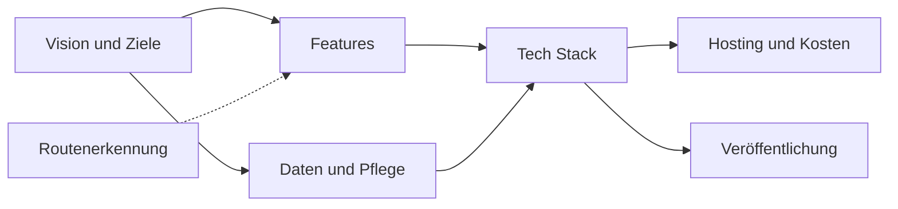

---
tags:
  - project
erstellt: 2026-11-05
status: active
client:
start: 2026-11-05
deadline:
team: []
---
# Boulder App

Persönliches Coding-Projekt, Arbeitstitel „Boulder App“. Eine Web- bzw. Android-App zeigt die eigene Boulderhalle als Grundriss von oben. Ein Klick auf eine Wand öffnet ein aktuelles Frontalfoto, auf dem alle Routen als anklickbare Punkte markiert sind. Zu jeder Route kann man eine eigene Bewertung abgeben und eventuell ein Video vom eigenen Send hochladen. Als Zusatzidee sollen Routen auf einem hochgeladenen Wandfoto automatisch per Vision-Modell erkannt werden.

> [!note]+ Status
> Discovery-Phase. Noch ist nichts entschieden. Zuerst werden die Fragen in den Teilnotizen beantwortet, danach fallen die Entscheidungen in der Reihenfolge unten.

## Große Fragen nach Priorität

Die Reihenfolge folgt den Abhängigkeiten: Spätere Fragen lassen sich erst sinnvoll beantworten, wenn die früheren geklärt sind. Wer die App nutzt und wie viele, bestimmt den Feature-Umfang. Der Umfang und die Plattform bestimmen den Tech Stack. Erst mit Stack und Nutzerzahl lassen sich Hosting-Kosten abschätzen, und ob man überhaupt in einen App Store muss, hängt von der Plattform-Entscheidung ab.

1. [[Boulder App - Vision und Ziele|Vision und Ziele]]: Wofür ist das Projekt, für wen, und wann ist es „fertig“?
2. [[Boulder App - Features|Features]]: Was gehört ins MVP, was kommt später?
3. [[Boulder App - Daten und Pflege der Routen|Daten und Pflege der Routen]]: Woher kommen Grundriss, Fotos und Routen, und wer hält sie aktuell, wenn umgeschraubt wird?
4. [[Boulder App - Tech Stack|Tech Stack]]: Python-Backend ist gesetzt. Offen sind Frontend, Plattform (Web, PWA, nativ), Datenbank und Speicher für Medien.
5. [[Boulder App - Routenerkennung|Routenerkennung]]: Wie gut erkennt ein Vision-Modell Routen auf einem Wandfoto? Läuft als unabhängiges Experiment, weil es das größte technische Risiko ist.
6. [[Boulder App - Hosting und Kosten|Hosting und Kosten]]: Wo läuft das Ganze günstig, und was kostet Speicher für Fotos und Videos?
7. [[Boulder App - Veröffentlichung|Veröffentlichung]]: Braucht es einen App Store, und wenn ja, wie kommt die App in den Google Play Store?

Die Routenerkennung hängt nur lose am Rest: Das Experiment liefert die Antwort, ob das Feature ins MVP kann oder später kommt.

## Entscheidungen

Jede Entscheidung bekommt hier einen Eintrag mit Datum, Entscheidung und kurzer Begründung, damit man später nachvollziehen kann, warum etwas so gebaut ist.

| Datum | Thema | Entscheidung | Begründung |
| --- | --- | --- | --- |
| 2026-11-05 | Backend-Sprache | Python | Sprache, in der Nick am sichersten ist |

## Tasks

- [[Discovery Boulder App abschließen]]
